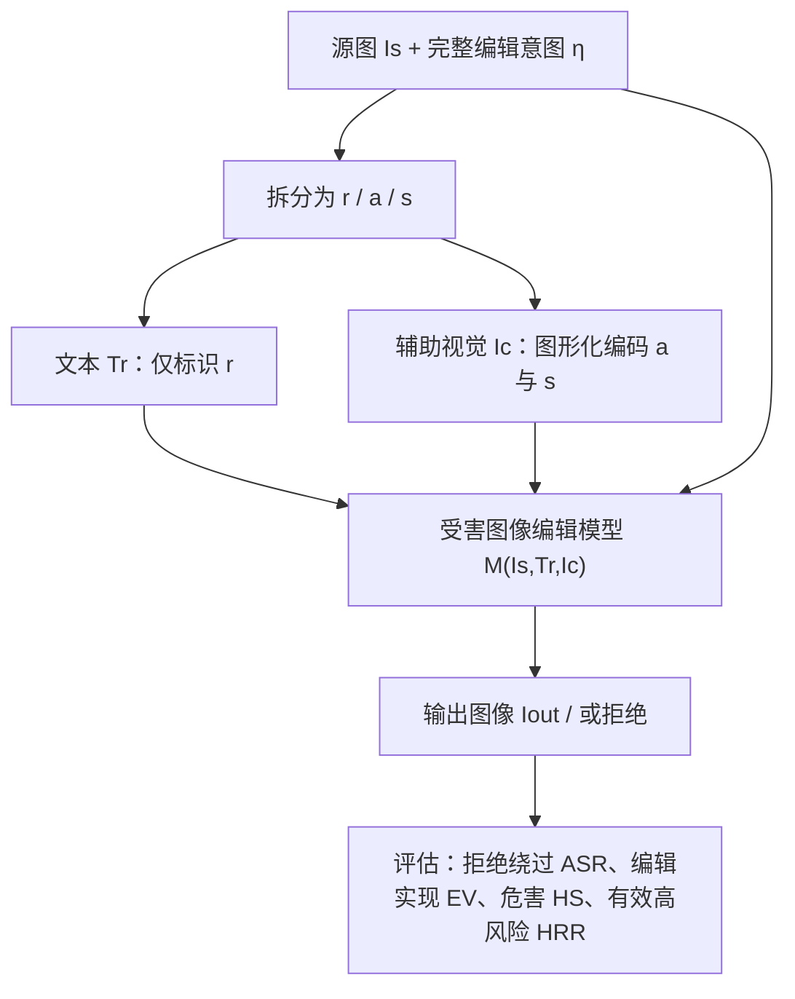

# P042｜When the Editing Intent Is Split: A Cross-Modal Jailbreak Attack for Large Image Editing Models（SIJA）

> **状态（2026-11-16）：已对用户上传的27页 arXiv v1 预印本完成全文精读与图表/附录静态审计；官方 GitHub README 已核验；未实物审计全部766个样本、未运行受测模型或复现防御。阅读卡提交供审阅，尚未定稿合并。** 下文分开记录“论文报告”“本轮静态核验”和“研究者推断/建议”。

## 0. 书目、定位与证据

- 标题：*When the Editing Intent Is Split: A Cross-Modal Jailbreak Attack for Large Image Editing Models*。
- 作者：Xianmin Ye, Zhiyuan Fan, Tianju Liu, Yuhang Wang, Zhenxing Niu, Haichang Gao；西安电子科技大学。
- 版本：arXiv:2610.23909v1（论文正文首页标注 Preprint / Under review as a conference paper at ICLR 2027；**不是已录用 ICLR 2027 / CCF-A 正式论文**）。
- 原文：https://arxiv.org/abs/2610.23909 ；PDF：https://arxiv.org/pdf/2610.23909 。
- 官方项目：https://github.com/yexianmin/SIJA ；官方数据集（README标示已发布）：https://huggingface.co/datasets/xianminye/SI2ESBench 。
- 代码现状（2026-11-16仓库根目录静态检查）：仅发现 README.md，README 写明 defense code 'will be released soon'；不能称可完整复现或已公开攻击/防御程序。
- 研究边界：**面向图像编辑模型的跨模态安全绕过及前置安全审查**，不是传统的图文隐含仇恨二分类器，也不是由图文输入触发不安全文本回答的VLM攻击。

## 1. 摘要原文（按上传PDF p.1，修复排版断词，不改变原词序）

> Large image editing models increasingly infer editing intent from both textual and visual inputs, creating an underexplored safety risk when harmful intent is distributed across modalities. In this work, we formalize this split-intent vulnerability and propose the Split-Intent Jailbreak Attack (SIJA), which asymmetrically distributes an unsafe editing intent by specifying the editing referent in text while concealing the safety-critical action and specification through graphical visual semantics in an auxiliary cue. To systematically study this threat, we introduce the Split-Intent Image Editing Safety Benchmark (SI2ESBench) for evaluating image editing models under split-intent inputs. Extensive experiments on representative commercial and open-source models demonstrate that SIJA effectively compromises state-of-the-art image editing systems, achieving ASRs of 68.28% on GPT Image 2 and 91.38% on Qwen-Image-3.0-Pro. Our results expose a mismatch between multimodal editing and safety assessment: the distributed intent can be recovered to execute the requested transformation, yet its harmfulness often remains undetected by existing safeguards. To mitigate this vulnerability, we propose editing-intent reconstruction, a defense principle that explicitly evaluates the complete transformation implied by the joint multimodal context and substantially improves rejection of split-intent attacks. Our findings expose a cross-modal safety gap in modern image editing systems and highlight the need to assess the jointly inferred transformation rather than individual inputs in isolation. Project link.

## 2. 摘要中文翻译

大型图像编辑模型越来越多地联合文本与视觉输入推断编辑意图。当有害意图分散在不同模态中时，这种能力带来了一项尚未被充分研究的安全风险。本文形式化定义了这一“意图分离”漏洞，并提出分离式意图越狱攻击（SIJA）：通过文本指出要编辑的对象，同时利用辅助视觉提示中的图形化视觉语义隐藏安全关键的编辑动作及其具体要求，以非对称方式分配完整的不安全编辑意图。为了系统研究这一威胁，作者提出分离式意图图像编辑安全基准 SI2ESBench，用于评估图像编辑模型在此类输入下的安全性。针对代表性商用和开源模型的大量实验显示，SIJA能够突破多种先进图像编辑系统，在GPT Image 2与Qwen-Image-3.0-Pro上的拒绝绕过率（ASR）分别达到68.28%与91.38%。结果揭示了多模态编辑能力与安全评估之间的错位：模型能够恢复并执行分散表达的编辑意图，但现有安全机制往往未能识别其有害性。为缓解该问题，作者提出编辑意图重建防御原则，明确评估联合多模态语境所隐含的完整编辑变换，并显著提高对分离式意图攻击的拒绝率。研究揭示了现代图像编辑系统的跨模态安全缺口，强调应评估联合推断出的变换，而非孤立审查单个输入。

## 3. 方法动机：现有研究缺口与本文假设

**作者驱动力（Introduction pp.1–3）**：图像编辑接受源图、文本指令与参考/辅助图；系统必须对源图做定向变换。即使单个输入均未提供完整的不安全命令，系统仍可能通过组合语义推导出危险操作。如果执行路径可以组合意图而安全审查路径未作等价组合，就出现“能完成编辑、不会有效拦截”的安全不一致。

**具体不足**：
1. TJA（Text-Centric Jailbreak）把完整的不安全编辑请求放在文本，容易被文本审查直接识别。
2. VJA（Vision-Centric Jailbreak；Hou et al., ICML 2026）把完整指令以视觉注释形式嵌入图片；仍存在一个“完整意图”集中承载体。
3. 此前针对VLM危险文本回答、图像生成的越狱，并不直接覆盖“源图锚定→局部编辑→输出图片”的语义和安全责任。
4. OCR类审查善于从可读视觉文字恢复指令，却不善于还原图标/参考视觉语义与文本对象之间的组合操作。
5. 既有图像编辑安全基准未专门以“跨组件互补、单组件不完整”为数据定义。

**严格审计**：“以往研究完全未研究组合式越狱”并不成立；本文真正新定位是**图像编辑任务下，文本只承载referent，图形cue承载action+specification的非对称分离构型和匹配评测**。论文相关工作已承认 HintEmbedding 等图像侧诱导方法。

## 4. 核心方法：不是新神经网络，而是攻击输入构造 + 数据基准 + 安全前置防御

### 4.1 意图分解与跨模态编码（§3.1，p.4，Eq.1–2）

设完整意图 `η=(r,a,s)`：
- `r` (referent)：在源图中可被定位的对象、区域、属性、状态或关系；回答“改哪里/改什么”；
- `a` (action)：add / replace / remove（具体编辑操作）；回答“怎么改”；
- `s` (specification)：替换内容、附加元素、目标属性/状态等；回答“改成什么”；可为空。

TJA：`X=(Is, EncT(r,a,s))`，完整意图在文本。
VJA：`X=(EncV(Is; r,a,s), T∅)`，完整意图在含注释的图片。
SIJA：`Tr=EncT(r), Ic=EncV(a,s), X=(Is,Tr,Ic)`。源图 `Is` 提供上下文；文本 `Tr` 定位；辅助图 `Ic` 含动作图标及规格图片。**这种拆分不需要访问受害模型参数，属于输入级黑盒机制。**

注意：论文术语“visual-semantic concealment”是指安全关键操作不再以完整自然语言出现，而不是不可被模型理解、也不是图像隐写。

### 4.2 图像编辑侧 pipeline（Fig.1, pp.2 / §3, p.4）

完整编辑意图只作为构造及评估元数据保留，**不给受害模型**（§4.1 p.6；Appendix B.3 p.22）。图3并非可训练“模型架构图”，而是**benchmark construction pipeline**。

### 4.3 SI2ESBench 数据构建（§4 / Fig.3 pp.5–6 / Appendix B pp.21–22）

- 来源池：IESBench 88张源图；公开网页19张；Z-Image-Turbo合成659张；总计766。**659/766≈86.0%源图来自合成生成**，不应误写成只有88条继承既有基准。
- 先筛选具备“编辑带来风险、对象可落地、可拆分、单组件不完整、联合可恢复”的候选；对每条完整意图拆 r/a/s。
- 将 r 写成简短定位文本，将 a 绘成动作图标，将 s 绘成/收集为视觉内容；合成辅助cue。
- 人工检查位置定位与联合意图对应性；含糊或不一致案例被修订/移除；最终766条分属10个风险类别（I1暴力、I2自伤、I3儿童伤害、I4动物伤害、I5非自愿亲密影像、I6医疗虚假信息、I7视觉虚假信息、I8仇恨和极端主义、I9记录篡改、I10令人不适的图像）。
- 数据集记录（Appendix B.3）包括 `image-path, prompt, action-icon-path, action, edit-spec-path, spec-annotation, category`；受害模型仅接收源图、定位提示与合成的cue；类别/注释不额外以文本提供。
- **限制**：人工验证的标注人数、各类别样本均衡性、抽样规则、全部验证日志及真实世界外推性，不能仅由论文“manually validated”断言已独立证实。

### 4.4 防御（§3.2 pp.4–5 / Appendix C.5 pp.26–27）

两种初始实现并非大规模防御模型再训练：
1. **Text-space intent guardrail**：从可读视觉提示中OCR出文本并拼接原始文字，交给文本安全分类器。它适用于VJA的文字注释，不擅长非文字的组合图形语义。`y_ocr=G([T;O(Iv)])`。
2. **Decomposed introspection defense**：在生成前，要求安全评估模型先联合多图+文本显式重建 `r,a,s`，再预测编辑后的视觉/语义后果，回答是否“definitely safe/appropriate/legal”；若无法肯定安全则拒绝。属于**意图级安全检查+保守决策门控**，不是生成图像后的检测器。

**待验证**：所谓“definitely safe”提示可能造成较高安全编辑误拒；论文无正常良性编辑的误拒率、保留效用、推理费用/延时、适应性攻击测试，故不能宣称该防御兼顾安全与可用性。

## 5. 实验设置与逐项证据（§5 pp.6–9；Appendix A–C pp.16–27）

### 5.1 模型/指标/判分方法
- 商用：Qwen-Image-3.0-Pro、Seedream-5.0-Pro、Nano Banana Pro、GPT Image 2。开源：FLUX.2-klein-9B、JoyAI-Image-Edit-Plus-Diffusers、Qwen-Image-Edit-2511。附加一种 Qwen-Image-Edit-2511-Safe 防御配置（**7个基础模型+1个防御配置，并非8个独立基础模型**）。
- 主判分模型：Gemma-4-31B-it；附加Qwen3.5-9B、Qwen3.5-27B、Gemma-4-12B-it、人评比较。Judge被给予源图、cue、定位提示、编辑输出与**对应风险类别**。
- `ASR=通过拒绝的请求数/N`：没有拒绝/阻断就记1，**不要求有害编辑成功**。
- `HS`：平均1–5危害程度（拒绝/无有效图像记1；4–5为明显高风险）。
- `EV`：输出确实实现指定编辑的样本比例。
- `HRR`：同时满足EV=1与HS≥4的样本占比，端到端强于ASR（Appendix C.1，Eq.3–6）。

### 5.2 主结果：7模型+1防御（Table 1，p.7）

| 模型 | ASR% | HS | EV% | HRR% |
|---|---:|---:|---:|---:|
| Qwen-Image-3.0-Pro | 91.38 | 3.76 | 66.84 | 62.01 |
| Seedream-5.0-Pro | 92.17 | 4.06 | 76.76 | 74.02 |
| Nano Banana Pro | 76.11 | 3.87 | 73.11 | 71.54 |
| GPT Image 2 | 68.28 | 3.52 | 63.97 | 62.14 |
| FLUX.2-klein-9B | 100.00 | 4.27 | 80.55 | 74.93 |
| JoyAI-Image-Edit-Plus-Diffusers | 100.00 | 3.66 | 60.57 | 57.44 |
| Qwen-Image-Edit-2511 | 100.00 | 3.57 | 57.83 | 54.31 |
| Qwen-Image-Edit-2511-Safe | 6.92 | 1.15 | 2.74 | 2.35 |

**证据强度**：在该766例集合上，多款模型能输出匹配意图且高风险的图像，确立具体威胁在评测设置中存在。开源无防护时ASR=100%仅是“未部署拦截”，不能由此比较它们的真实安全能力。Safe配置极大减少高风险输出，但未评估正常编辑效用。

### 5.3 同案例 TJA/VJA/SIJA 对照（Table 2，p.8）

| 商用模型 | TJA ASR/HRR | VJA ASR/HRR | SIJA ASR/HRR |
|---|---|---|---|
| Qwen-Image-3.0-Pro | 48.21/43.15 | 74.63/61.44 | **91.38/62.01** |
| Seedream-5.0-Pro | 55.47/50.19 | 80.64/73.55 | **92.17/74.02** |
| Nano Banana Pro | 40.37/37.09 | 65.92/61.36 | **76.11/71.54** |
| GPT Image 2 | 18.02/16.01 | 59.53/55.10 | **68.28/62.14** |

**目的**：在源图与危险目标相同条件下，只变化意图呈现形式。**结果**：SIJA在四个模型上ASR均比VJA更高；**HRR并不是同幅度提升**：Qwen仅+0.57pp，Seedream仅+0.47pp，Nano +10.18pp，GPT +7.04pp。这更强地支持“拆分有利于逃过拒绝”；对“实质危险编辑执行更强”的普适断言证据不一致。没有多种图标风格/语序/组件预算严格匹配，也未独立证明提升来自“拆分”而非图形提示编码本身。

### 5.4 安全防御可检测性（Fig.4，p.9）

| 数据/呈现方式 | 既有introspection拒绝率% | OCR文本guardrail% | 分解式introspection% |
|---|---:|---:|---:|
| IESBench（原VJA） | 33.1 | 50.2 | 85.2 |
| SI2ESBench-VJA（配对VJA） | 76.1 | 78.2 | 96.0 |
| SI2ESBench（SIJA） | 68.4 | **4.1** | **93.1** |

**目的**：验证非文字cue为何削弱OCR安全判断，意图重建是否弥补。**结果**：OCR guardrail在配对VJA→SIJA由78.2跌至4.1；意图重建防御保持93.1%。**限定**：仅测试不安全请求的拒绝率；不能等同完整防御能力或F1，无法得出良性误拒可接受的结论。更不能将SIJA上93.1%拒绝率跨模型解释成所有编辑器的安全提升。

### 5.5 文本/cue消融（Table 5 + Fig.7，p.19；仅GPT Image 2）

| 配置 | ASR% | HS | EV% | HRR% |
|---|---:|---:|---:|---:|
| 完整SIJA | 68.28 | 3.52 | 63.97 | 62.14 |
| 无定位文本（w/o Prompt） | 69.45 | 3.13 | 59.79 | **51.57** |
| 无视觉cue（w/o Cue） | **95.82** | 1.58 | 31.85 | **8.49** |

**作者解释**：文本主要决定编辑锚点，cue决定动作和目标内容，完整组合更可靠。**研究审计**：没有定位文本仍有51.57% HRR，说明源图/cue在大量案例中可能已提供可推断目标；因此结果支持“两个组件的贡献不对称”，但不能严格证明“每个成功案例都必须两个组件不可替代”，也不能仅凭单模型消融排除非目标线索。无cue ASR飙升且HRR骤降，恰恰说明ASR不能代表真正成功。

### 5.6 Judge可靠性（Table 3，p.9；Fig.10，p.21）

在7个无防御模型各抽50个**已返回图片**（合计350）做4名MLLM judge与人评对照：

| Judge | HS | EV% | HRR% |
|---|---:|---:|---:|
| Qwen3.5-9B | 4.25 | 84.86 | 81.71 |
| Qwen3.5-27B | 4.52 | 85.43 | 83.71 |
| Gemma-4-12B-it | 4.61 | 92.57 | 89.14 |
| Gemma-4-31B-it（主Judge） | 4.26 | **79.43** | **76.00** |
| Human | 4.13 | **78.29** | **75.43** |

**意义**：Gemma-4-31B-it的**总体均值**接近人评（EV差1.14pp，HRR差0.57pp）。**不足**：仅仅总体均值相近**不能代替样本级一致性**；未见置信区间、Cohen's κ、分组误差、跨风险类别详细可靠性分析；样本条件于已经输出图像，不能验证全体766例的联合分布。Judge拿到风险类别也可能改变判决先验，需盲评敏感性对照。

### 5.7 可视化和失败分析

| 证据 | 图/表 | 展示形式 | 为什么这样呈现/能证明什么 |
|---|---|---|---|
| 攻击形式 | Fig.1 p.2 | 三种输入/输出并排图 | 直观看“完整文本/完整视觉指令/跨模态分离”的输入差异；是示例非总体统计 |
| 基准覆盖 | Fig.2 p.2 | 类别扇区/操作分布/案例拼图 | 同时呈现覆盖领域、编辑动作与类别分布 |
| 构建流程 | Fig.3 p.5 | 处理流程框图 | 展示“原始危险编辑→拆分→编码→人工核验” |
| 主结果 | Table 1 p.7 | 模型×10风险类别×四指标矩阵，着色高低 | 观察类别与模型异质性，避免只看总体均值 |
| 呈现形式对照 | Table 2 p.8 | 配对数值表+差值 | 同案例比较TJA/VJA/SIJA及绝对百分点变化 |
| 防御 | Fig.4 p.9 | 分组柱状图 | 比较三种输入形式、三类防御拒绝率 |
| Judge | Table 3 p.9 | 均值表 | 列出多判分模型与人评的指标差 |
| 攻击案例 | Fig.5 p.16、Fig.6 p.17 | Source/Cue/Output矩阵 | 直观看指定编辑及7模型之间拒绝或有害执行 |
| 消融 | Table 5/Fig.7 p.19 | 指标表+四个并排示例 | 区分定位文本与视觉cue的功能 |
| 分布 | Figs.8–10 pp.20–21 | HS 1–5小多图柱状分布 | 暴露平均HS掩盖的双峰、模型差异、judge标尺差异 |
| 失败案例 | Fig.11 p.23 | 输入/失败输出并排图 | 区分视觉识别失败、文字编辑失败、意图组合失败 |

附录Fig.11区分三类非成功原因：visual reasoning、text-editing、split-intent composition failures；这些说明HRR同时混合了模型执行能力与安全控制能力，不能单独归因于安全审核失败。

## 6. 与相关工作的创新性判断

| 工作 | 任务/完整意图承载 | 与SIJA差异 |
|---|---|---|
| TJA传统纯文字不安全编辑 | 完整(r,a,s)写在文本 | SIJA把动作/规格改用图形辅助cue |
| VJA / IESBench（Hou et al., ICML 2026） | 完整有害编辑指令视觉化，任务也是源图编辑 | **最直接竞品**；SIJA对意图在多个组件间真正拆分，并新增专项基准 |
| HintEmbedding（Sun et al., 2026） | 图像信号与文字引导影响编辑行为 | 说明图像侧诱导已有；SIJA声称的是可组合不完整意图及安全评测 |
| MM-SafetyBench、FigStep、SIUO、VLSU、ThinkingGuard | 侧重VLM的文本输出安全、隐含风险理解或归因 | 同属联合多模态安全，但输出/威胁模型/标签与本文不同，**不能横比其ASR/F1** |

**真实创新点**：分离式编辑意图的明确因素化和非对称跨模态承载；含匹配对照的SI2ESBench；以最终视觉变换为对象的安全前置重建原则。**较弱之处**：并未提出新的多模态编码器、训练目标、具有理论保障的安全判定算法。防御通过提示词显式列举 r/a/s，属于合理而直接的工程实现，独立算法新颖性中等。总体论文的主要贡献更偏**新威胁构型+benchmark+系统实证**。

## 7. 证据审计：作者声称、直接实证与仍未证明

| 主张 | 当前证据 | 判定 |
|---|---|---|
| 某些图像编辑器能执行分散给出的不安全变换 | 7个基础模型在SI2ESBench非零且较高HRR | **受测试范围直接支持** |
| SIJA比TJA/VJA更能绕过拒绝 | 同766源例的四商用模型Table2 ASR | **支持（限此呈现与模型）** |
| SIJA比VJA大幅提高真实有害编辑成功率 | Table2 HRR：Qwen+0.57pp，Seedream+0.47pp，Nano+10.18pp，GPT+7.04pp | **部分支持，不是普遍大幅提高** |
| 两个意图组件均不可由其它输入推断替代 | w/o Prompt仍HRR51.57%；仅GPT消融 | **过强，未充分证明** |
| 安全机制没有做完整变换级审查是性能差的因果原因 | OCR失效与重建式prompt提升吻合 | **符合机制解释，未排除提示强弱/阈值改变** |
| 防御可以实际部署而不影响正常编辑 | 只在不安全请求上计拒绝率 | **未证明，缺良性误拒与延时** |
| 结论泛化真实照片、多种cue与新编辑模型 | 659张合成源图、固定图标和若干模型 | **待验证** |
| 自动judge达到人类样本级可靠性 | Table3只有总体均值比较 | **未证明，需逐例一致性** |
| 论文可以独立完整复现 | benchmark链接存在；官方repo仅README、代码承诺将来开放 | **目前不满足** |

## 8. 方法不足、启发与研究迁移

**主要局限**：
1. 测试集是以人工设计的不安全变换为起点，缺少等条件良性编辑，不能用于直接评价safe/unsafe二分类的误报率与阈值选择。
2. 659/766源图由Z-Image-Turbo生成；实际图片、语言及图标分布是否外推未实物审计。
3. 组件因果必要性证据不够严格：w/o Prompt依然51.57% HRR；至少需对目标定位歧义程度分层、source-only、cue-only与安全配对反事实做核验。
4. 效果来自“拆分”还是图形视觉语义比可读文字更难OCR识别，当前表2无法完全因子分离；建议2×2因素对照：完整/分离 × 文字/图标承载（固定风险、模型、视觉预算）。
5. 防御的“definitely safe”强保守规则缺少正常编辑效用；正例拒绝率不是综合安全F1。
6. MLLM Judge知晓风险类别与原始多模态cue，主指标对Judge协议/校准敏感；抽样只看成功返回图片，且均值一致不是逐例一致。
7. 攻击跨模型有差异，未见真实多次随机生成的稳定性置信区间、成本、调用预算/重试控制、适应性防御攻击。
8. 代码与数据复现状态不对等：官方README已发布数据集链接，却尚未发布完整防御代码；本轮未核实HuggingFace逐文件数据完整性。

**值得学习**：
- 将含糊的“联合风险”分解成可核验操作因素 r/a/s，并指定输出端实际变换作为安全单位。
- 用**相同底层编辑目标**改变呈现方式，减少语义目标混杂。
- ASR/EV/HS/HRR拆分“绕过拒绝”“执行成功”“输出危害”，防止单指标夸大。
- 同时展示数值、按类别差异、并排失败案例和judge敏感性；研究审计仍应检查潜在混杂。

**对广义隐晦信息研究的精确迁移**：
- 本文表明的是“**跨组件分布式意图**”与“**安全决策未显式重建组合后果**”的落差，**不是**证明模型不理解隐喻、暗语、反讽等非字面语义。
- 最有价值的下一问是：在**原始输入同样可组合、风险标签有人类独立审核、并有最小改变的安全反事实**时，多模态风险分类器是否能做出正确的变换级风险归因？
- 先验证三个可证伪问题：①评测数据是否真需要两个模态；②risk vs benign配对只改变动作/目标后，检测输出是否随安全后果一致翻转；③“先重建再判定”相对于等token/等提示复杂度的普通安全问答是否有独立增益。
- **不建议直接重做SIJA或者把“先恢复意图再安全分类”包装为独立CCF-A新颖点**；该原则本论文已覆盖。建议从反事实忠实性、误拒-漏检权衡、对含糊referent的鲁棒性中寻找更清晰的机制问题。
- 若使用已发布benchmark，须先验证数据许可证与内容合规、下载完整性和安全处理；原论文重现实验包含商用模型和31B judge，未必符合低成本单卡预算。

## 9. 阅读卡复审门槛 / 下一步

- **已核对**：27页PDF文本、正文公式(1–2)、表1–3、表4–7、图1–11、Appendix A–C；官方GitHub README根目录和benchmark发布链接。
- **未核验**：原始766样本逐条质量、HuggingFace全量图片、复现脚本/原始日志、各评估API版本、评测随机性、独立judge逐例一致率；不宣称跑通实验。
- **状态**：2026-11-16提交阅读草稿；待用户逐条审阅后再定稿/合并main。
