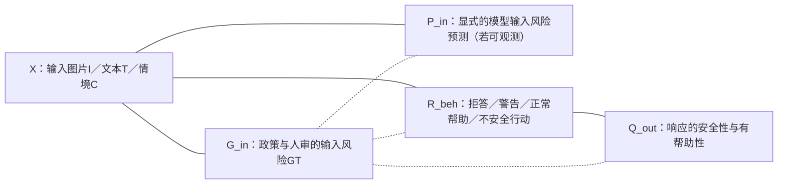

# R4-03｜正式综述图表的优先级、论证目标与制作规范（R4-4审阅稿）

> 2026-11-09｜状态：**R4-4 REVISED FOR REVIEW，待用户审核，未合并main**。**这里只规划图表/给出可执行结构草图，不制作或声称已完成最终图片**。所有图应自行绘制，避免直接复制原论文图和版权问题；正式写作前需补版权、引用和出版核验。
>
> 来源：R1 T1–T6、R2-C、R3-A1/A2/A3/A4、R3-B AUTALIC FINAL与MCIB FINAL（未解决的代码与实验归因风险保留）。图表不用于证明尚无数据支持的心理机制或严格因果关系；“概念关系”只表示综述组织框架。

## 0. 整体建议

**候选库：6张原创概念图 + 8张对比表**（不是硬性投稿配额）。优先**F1/F2/F3/F5**四张主图，Ch6若图片条件允许则F4优先补入或替换F3；F6与重复解释图可入附录。主表优先**T1/T2/T3/T5/T6**；T4为Ch5必要时精简入正文，T7横向方法可压缩到Ch8正文，T8证据透明宜放补充资料。优先提供SVG/PDF矢量原图（矢量文件需自行生成）；最终稿中的引用按论文/数据来源列于图注。

**图形规范**：
- 术语中英首次并列；颜色仅作任务层或研究家族编码，**不能**以颜色表示作者论文优劣；
- **无箭头实线**表示本综述的分类/审计维度关系；**无箭头虚线**表示跨机制/任务的例证性对应，并**不表示因果效应、模型流水线或时间次序**；
- 图中的“安全/有害”必须相对明确的GT、风险策略与语境，不应用模糊“普遍正确”语气；
- 模型或数据实验主表数值按原论文任务协议/作者报告分别标明，不跨研究拿F1/Accuracy/安全响应率画统一排行榜；
- 如果图中需要例句，建议用作者许可可再述的**自构造无害例子**，标注“作者示意，非真实标注数据”，不要直接复制受限样本。

## 1. 六张图的正式制作清单

| 图号/位置 | 拟定标题 | 应在图中展示的实体和关系 | 支撑来源与直接主张 | 必须避免的错误 |
|---|---|---|---|---|
| **F1 / Ch1** | **表达与意义机制 × 规范/行为研究 × T1–T6研究地图** | 六条并行研究线**分两组**：K1–K4语用、修辞、社群编码、跨模态意义为表达/意义机制；R1–R2语境危害、联合输入风险与回应为规范/行为研究。外接任务T1–T6及X/G/E证据条件 | R3-A1/A3（main FINAL）；R4-07 §§1–2/5–7；P020（ACL2025 Main，CCF-A）、P023（ACL2026 Main，CCF-A）、P038（ICLR2026 Main，CCF-A） | 不叫“六个意义机制”；T5不等于全部Hateful Memes或严格S-S-U，T6不等于T4；图不表示时间/因果链 |
| **F2 / Ch2** | **五轴实验协议审计：机制／任务／模态依赖／可用信息／GT与评价** | 审计单位是**一个具体实验协议**；A机制；B预测Y与T1–T6；C模态/语境与联合依赖；D训练/测试输入预算及Oracle/检索；E标注单位、GT、正负两侧与judge；以Task=(X,Y,G,E)统一记录 | R1五轴、R4-07 §§2.2–2.4/8.2–8.5；DRInQ（ACL2026 Main，CCF-A）、VAGUE（ICCV2025 Main，CCF-A）、AUTALIC（ACL2025 Main，CCF-A） | 把论文名当作唯一评测协议、混淆gold情绪与模型预测、把拒答Judge当输入风险GT、把融合增益当必要性 |
| **F3 / Ch4** | **社群编码：词项发现、语境消歧、含义解码与危害判定** | 四个并列模块，共享文本/社群/时间上下文：type发现；给定D和定义的instance disambiguation；候选意义mapping；语境化T4判定；每模块下注明GT | Silent Signals ACL2024 A；FETCH! ACL2025 A；FA-Net AAAI2024 A；CodedLang ACL2026 A；SeTox ACL2026 A | 不能把FETCH!已有词典留出写成真实时间OOV；不给四模块画“全部完成后才可做T4”的必经箭头 |
| **F4 / Ch6（有条件主文）** | **跨模态非冗余信息与捷径诊断** | 原始模态与OCR/gold辅助信息显式分栏；图文的text-only/image-only/joint与音视频的text/audio/video单模态对照**不能合并同一测试**；说明受控配对及分布变化 | MultiMM（ACL2025 Main，CCF-A）；V-FLUTE（NAACL2025 Main，CCF-B）；VLSBench（ACL2025 Main，CCF-A）；MCIB（AAAI2026 Technical，CCF-A） | ‘加图涨分=因果理解’不成立；MCIB三模态反讽不可画成静态图文Meme消融 |
| **F5 / Ch7** | **输入风险GT、显式预测、响应行为与输出质量四层测量对象** | G_in=人/政策输入风险GT；P_in=显式输入分类（**仅在可观测时**）；R_beh=拒绝/警告/执行等回应；Q_out=输出安全与帮助性；安全误拒与危险漏判必须双侧呈现 | VLSU（ICLR2026 Main，CCF-A）；MMSafeAware（ACL2025 Main，CCF-A）；MOSSBench/MSSBench（ICLR2025 Main，CCF-A）；CrossGuard（ACL2026 Main，CCF-A）；Meerkat-VL（ICML2026 Main，CCF-A） | 不能凭最终输出倒推出模型真实内部风险预测；各层GT/Judge/指标不同不可合并 |
| **F6 / Ch8** | **技术路线 × 研究瓶颈的机制对照图** | 6×5定性矩阵：词典/RSA、PLM对比域适应、LLM检索工具、多任务融合/LoRA、解释/偏好、Guard/RL；对应语境歧义、时间/OOD、细粒度意义、跨模态捷径、安全/有用性 | R3-A2；FA-Net AAAI2024 A、SeTox ACL2026 A、DOSE ACL2026 A、ExPO-HM ICLR2026 A、MCIB AAAI2026 A | 不用大小/深浅冒充实测性能，也不按年份把旧方法全部划掉 |

### F1 / F2 可编辑源图的唯一正式编辑入口（R4-4修订）

**[R4-04_F1_F2_Figure_Specs.md](R4_04_F1_F2_Figure_Specs.md)** 包含修订后的两幅Mermaid原图、完整中英术语口径、原创中文图注和直接证据。为避免本文件与R4-04出现两个不同版本的图1，**本工作单不再复制旧F1混层Mermaid**。两图均为可编辑结构草案，**未导出最终矢量图**。

F1的内容检查：K1–K4意义机制／R1–R2规范及行为研究／T1–T6任务／X/G/E证据条件，四层不得合并；F2的检查：A机制、B任务、C模态和上下文、D训练/测试信息预算、E标注与指标，不把T5缩写成严格S-S-U，也不因图文输入就认定联合依赖。

### F5 草图（变量之间有关联、指标必须独立）

该图是**测量分层**。P_in并非所有研究都显式输出：若仅观察最终回复，内部风险预测可能不可直接观测，所以图中使用无向连线表示联合评价同一输入与行为，不声称P_in是所有模型显式可见的内部中介。

## 2. 八张正式综述核心表

| 表号/位置 | 推荐表名 | 列字段（必须含证据状态） | 优先比较的论文（会场、CCF） |
|---|---|---|---|
| **T1 / Ch2** | **广义隐晦信息六类概念的必要条件与交叉** | 术语；性质；是否必须非字面；是否必须意图隐藏；是否必然有害；任务例；典型反例 | P011 ACL2025 A、P023 ACL2026 A、R1；理论经典不设CCF |
| **T2 / Ch2–3** | **T1–T6任务定义与GT可观测性** | Task；输入X及额外先验；输出Y；GT G及标注主体；评价E；限制；例证 | DRInQ ACL2026 A、VAGUE ICCV2025 A、V-FLUTE NAACL2025 B、VLSU ICLR2026 A |
| **T3 / Ch4** | **编码语言基准与开放词义协议对比** | 论文ID；已知词/未知词；type/instance；可用词典义；真实时间划分否；标签者；指标；许可；全文证据状态 | Silent Signals ACL2024 A、FETCH! ACL2025 A、FA-Net AAAI2024 A、CodedLang/SeTox ACL2026 A |
| **T4 / Ch5** | **隐晦有害数据的标签来源与歧义** | 论文；GT是否含implicit定义；是否有人审隐含解释；样本来源；有无引用/社群语境；标注分歧；安全负例；主要限制 | T017 Latent Hatred EMNLP2021 B、ToxiGen ACL2022 A、When People are Floods ACL2025 A、AUTALIC ACL2025 A |
| **T5 / Ch6** | **多模态修辞理解任务—方法—额外输入** | 论文；模态；目标任务；解释/源目标GT；是否用gold情绪/域；主干与loss；模态消融；训练/测试捷径风险；证据等级 | MultiMM ACL2025 A、V-FLUTE NAACL2025 B、MGMCF AAAI2025 A、M3UCD AAAI2026 A、DOSE ACL2026 A、MCIB AAAI2026 A |
| **T6 / Ch7** | **多模态风险与安全响应：输入/输出标签协议** | 论文；输入是否明确safe/unsafe/borderline；单模态标签；联合风险配对；模型输出分类/回答；Safe及Unsafe两侧指标；Judge；test-only/许可 | Hateful Memes NeurIPS2020 A、VLSBench ACL2025 A、MSSBench/MOSSBench ICLR2025 A、VLSU ICLR2026 A、CrossGuard ACL2026 A、Meerkat-VL ICML2026 A |
| **T7 / Ch8** | **方法族、训练信号与已提出的竞争性机制** | 方法；监督来自何种标签/外部知识；训练or推理；是否需要检索/付费模型；作者指标；关键公平基线；未证；直接竞争 | P020 ACL2025 A、ImpCon COLING2022 B、FA-Net AAAI2024 A、SeTox ACL2026 A、DOSE ACL2026 A、ExPO-HM ICLR2026 A、RV-HATE ACL2026 A |
| **T8 / Ch8或附录** | **证据透明与可复现性风险清单** | 论文ID；问题类别；已证实P/S/T/H/O；具体数值/代码版本；受影响结论；已关闭/未关闭；使用许可 | AUTALIC ACL2025 A、VLSU ICLR2026 A、DRInQ ACL2026 A、MultiMM ACL2025 A、MCIB AAAI2026 A、RV-HATE ACL2026 A |

**主文 vs 附录建议**：T1/T2/T3/T5/T6放正文；T4/T7可根据篇幅正文压缩；T8完整表建议在线附录/补充资料，正文仅展示最有代表性的反例及方法论规则。

## 3. 必须保持严格的数字证据

| 数据/方法 | 可以列的数字性质 | 当前不能画的数字或注记 |
|---|---|---|
| R0/R2：59+32=91 | **本项目文献入账候选数**，不是全球年度发表数 | 禁止用这91条做“全领域近年研究数量增长曲线”或PRISMA流程图（检索召回不存在） |
| AUTALIC（ACL 2025 Main A） | 论文称2,400目标句、3位标注者/句、κ约0.25；需标论文报告[P] | 242正+2160负=2402，**不一致**；未打开真实CSV，禁按二者绘制精确占比柱状图；并遵守限制用途 |
| VLSU（ICLR 2026 Main A） | 论文设计3层风险、17种目标组合；公开CSV含8,159记录和not_sure，由P卡静态审计 | 不把论文8,187与公开8159混为同版本；严格S-S-U的公开35条不能写37且不报区间；官方test-only不可无声明作训练集 |
| MCIB（AAAI 2026 Technical A） | 作者报告R数据weighted F1=75.64、文本/音频/视频三模态；R3-B定稿保留方法/源码差异[S/O] | 不画“无捷径 vs 有捷径”因果前后提升证明图；SpeechPrompt v2表内P/R/F1有数学疑点，未核实前不用该行作精确可视化 |
| MultiMM（ACL 2025 Main A） | 论文报告跨文化/源目标/情绪标签与相应对照 | gold情绪测试输入不是部署预测情绪；不得在图上当同输入预算纯图文baseline |
| MOSSBench（ICLR 2025 Main A） | 安全请求中模型输出是否拒绝/响应等行为指标 | 禁把安全请求误拒率和输入Unsafe二分类混画 |
| ThinkingGuard（ACM MM 2026刊会A） | 方法可按作者录用稿描述；正式元数据待核 | 不能直接列入“经官方验证已正式出版的CCF-A Main论文总数” |

## 4. 图表制作优先级和工单

| 优先级 | 图表 | 可直接使用的资料 | 需要追加的人工/静态核验 | 完成标准 |
|---|---|---|---|---|
| **P0（框架冻结）** | F1、F2、T1、T2 | R1任务框架、R3-A1/A2/A3/A4定稿、R4-07 | 对照完整46小节论断；F1纠正意义/规范混层；F2区分Gold/测试辅助字段 | 每个节点有定义/反例；无未经实证因果箭头；T5广义条件/严格S-S-U/ T6边界同时成立 |
| **P0** | F3、T3 | Silent Signals/FETCH!/FA-Net/CodedLang/SeTox精读 | 核词典留出、是否给定词义与可用许可 | type/instance/meaning/harm四栏可与各篇论文一一匹配 |
| **P1（按篇幅）** | F4、T5 | MultiMM、MGMCF、M3UCD、DOSE、V-FLUTE、MCIB | MCIB定稿仍开放的loss/实现协议；MultiMM和MGMCF额外输入协议；F4不重复F2的五轴原则 | F4若保留应提供具体反事实评测设计/输入字段差异，避免仅画‘融合可能有捷径’空话 |
| **P0** | F5、T6 | VLSU、MSSBench、MOSSBench、CrossGuard、Meerkat-VL | 区分数据标签 vs Judge行为；VLSU版本 | 分开G_in/P_in/R_beh/Q_out；误拒与漏检均在相应协议中可测 |
| **P1** | F6、T7 | R3-A2方法史和竞争矩阵 | 只从已验证训练协议归类 | 无SOTA排行榜/虚假跨任务排名 |
| **P1** | T4、T8 | AUTALIC R3-B、R2-C/P卡静态审计 | AUTALIC许可及类别数，MCIB指标口径，P039出版 | 数值都带证据/数据版本，无歧义指标脚注 |

**时间顺序（不表示异步承诺）**：先确定F1/F2逻辑，冻结T1/T2的GT定义，再画F3/F4/F5；最后通过T7/T8审计前面每张图/表。对尚缺实物的dataset图像和原文不制作任何“真实统计曲线”。

## 5. 参考来源和论文主分配

- [R4正式目录](R4_01_Formal_Outline.md)
- [R4全91篇论文唯一主归属](R4_02_Paper_Allocation.md)
- [R4-07全46小节论断—证据矩阵](R4_07_Section_Claim_Evidence_Matrix.md)
- [R4-04 F1/F2源图与图注](R4_04_F1_F2_Figure_Specs.md)
- [R3-A2六大方法谱系](../R3_evolution/R3A_Method_Evolution.md)
- [R3-A4证据审计定稿（main）](../R3_evolution/R3A_Coverage_and_Evidence_Audit.md)
- [R3-B AUTALIC定稿](../R3_targeted_reading/R3B_01_AUTALIC_FINAL.md)
- [R3-B MCIB定稿](https://github.com/YuSun-WK/implicit-content-research/blob/main/03_survey/R3_targeted_reading/R3B_02_MCIB_FINAL.md)

## 6. R4-4 图表—章节论断矩阵（以R4-07为准）

| 图/表 | 优先级与成品目标 | 应支撑的R4-07小节 | 必须体现的证据类型/限制 |
|---|---|---|---|
| **F1** | 主文P0：研究地图、六脉络分层 | 1.1–1.3、2.1–2.5、6.7、7.1 | 仅H组织框架+P任务存在；不画因果、T5/T6边界清楚 |
| **F2** | 主文P0：五轴协议核查 | 2.2–2.4、4.2–4.6、6.3–6.5、8.2–8.5 | X/Y/G/E与P/S/H/O；尤其信息预算/独立GT |
| **F3** | 主文P0：编码type/instance/meaning/harm四目标 | 4.2–4.6 | Silent Signals/FETCH!/FA-Net/SeTox不同先验；词典留出≠时间外 |
| **F4** | 有篇幅再纳入：非冗余模态/捷径诊断 | 6.3–6.6、8.4 | MultiMM/MGMCF/MCIB静态风险是S/O，不能画已证机制 |
| **F5** | 主文P0：输入风险与安全响应双侧评测 | 7.1–7.5、8.5 | 输入GT、可观察风险预测、行为、质量的四层指标 |
| **F6** | 附录/候选：方法族×瓶颈 | 8.1/8.6 | 定性映射，不等于实验对比或历史单线 |
| **T1/T2** | 主文P0：概念与T1–T6任务定义 | 2.1–2.5 | 操作定义、T5特定情形、T6邻接行为 |
| **T3** | 主文P0：编码数据/词义协议 | 4.2–4.5 | type/instance、来源词典、真实时间划分、GT |
| **T4** | 正文压缩或附录：语境有害标注 | 5.1–5.5 | AUTALIC 2400 vs 2402冲突；Flood非人化GT缺失 |
| **T5** | 主文P0：多模态意义/辅助输入 | 6.2–6.5 | 模态、gold字段、任务目标、复现状态、额外输入 |
| **T6** | 主文P0：多模态安全/响应分层 | 7.1–7.5 | VLSU公开版本、S-S-U特例、误拒/漏判、Judge来源 |
| **T7/T8** | Ch8压缩/附录：横向方法与证据 | 8.1–8.6 | 数值不跨GT排名；未关闭问题明确P/S/H/O |

**图表验收门槛**：

1. F1不把规范/危害或安全回应画为意义机制；不与R3-A2方法M1–M6混名。
2. F2每个案例的原始输入、gold辅助、具体预测目标和GT/Judge可追溯到R4-07。
3. 四张优先主图（F1/F2/F3/F5）不是固定投稿要求；若版面不足，优先保留F1/F2/F5及T2/T6，F3可并入T3。
4. 无任何图表以文献库91项推算全球发文趋势；数据未实物核的子集占比、版权受限样本、未核Track或模型复现均不得强绘。
5. 该文件只规划**可绘制结构及证据入口**；F1/F2 Mermaid在R4-04唯一维护，最终矢量导出与图像审阅留待写作/排版阶段。

> **R4-4工作单裁决：CONDITIONAL PASS，待用户审核。** 本轮不合并main，不覆盖R0–R3定稿。