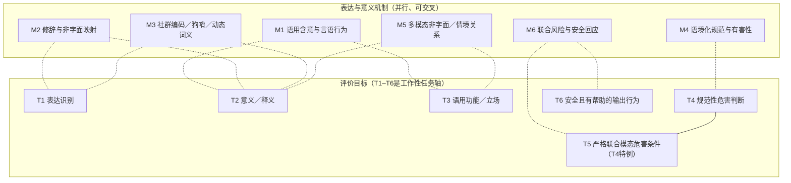
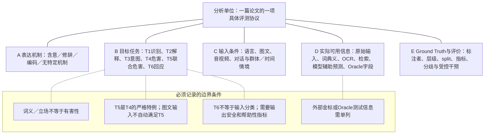

# R4-04｜图1与图2：可复用概念图、图注与证据边界（审阅版）

> 日期：2026-11-09；状态：**R4 REVIEW DRAFT**。本文件提供在GitHub Markdown中可预览、可编辑的Mermaid源图及论文图注文字，**尚未导出符合具体期刊格式的SVG/PDF最终版**。归纳框架为作者的理论组织视角；图中的连线不是跨论文测量得到的因果路径。

## 1. Figure 1｜广义隐晦信息研究的并行机制与交叉任务

**主张**：此领域不是“显式仇恨检测→隐式仇恨→多模态Safety”单一路线。语用、修辞、编码、语境危害、多模态解释和模型响应研究可并行发展；同一篇论文也可能同时触及不同机制和任务。[H：R3-A1/A3]

### 建议正式图注（中文，可用于重绘）

**图1 广义隐晦信息的六条研究机制谱系与任务交叉关系。** 上部为研究所关心的交际与表达机制，下部为本文提出的任务分类T1–T6。点线只表示常见研究关联，不代表机制决定任务、方法必须顺序执行、后续任务先天优于前序任务，或已经存在经验证的认知因果链。T5是在明确联合模态依赖条件下的T4特殊情形；T6讨论模型输出的安全和帮助性行为，并非输入危害类别。该图为本文工作性研究地图，不能用来作历史“首次”或成果数量的统计证据。

### 图1每条谱系的代表性依据（非互斥）

| 机制 | 代表论文（正式会议/CCF等级） | 允许据此说明的任务证据 | 禁止越界 |
|---|---|---|---|
| M1 语用与间接言语行为 | P020 (RSA)²（ACL 2025 Main，A）、R2A-001 DRInQ（ACL 2026 Main，A）、R2A-002 VAGUE（ICCV 2025 Main，A） | 词义/含意多选、语境变换、视觉行动意图候选 | MCQ不是真实意图的直接观测 |
| M2 修辞/非字面 | P035 EmoBi（ACL 2025 Main，A）、R2A-019 DOSE（ACL 2026 Main，A） | 隐喻、夸张、反讽识别与一些目标/解释任务 | 发现修辞≠获得独立风险金标 |
| M3 编码与社会词义 | R2A-006 Silent Signals（ACL 2024 Main，A）、R2A-007 FETCH!（ACL 2025 Main，A）、P023 CodedLang（ACL 2026 Main，A） | 词项/实例/编码策略等不同监督对象 | 已有词典留出不等于时间外新词 |
| M4 语境与规范危害 | P001 ToxiGen（ACL 2022 Main，A）、R2A-013 AUTALIC（ACL 2025 Main，A） | 例句有害性、群体态度、语境案例与多标注分歧 | 社会规范金标≠可观察作者心理意图；AUTALIC未做同模型删语境对照 |
| M5 多模态非字面关系 | P019 V-FLUTE（NAACL 2025 Main，B）、R2A-017 M3UCD（AAAI 2026 Technical，A）、R2A-024 MCIB（AAAI 2026 Technical，A） | 视觉蕴含/多任务隐喻/音视频反讽捷径及融合研究 | 融合分类F1≠忠实跨模态解释；MCIB审计定稿也不等于机制独立验证 |
| M6 联合风险与输出安全 | P038 VLSU（ICLR 2026 Main，A）、P034 CrossGuard（ACL 2026 Main，A）、P040 Meerkat-VL（ICML 2026 Main，A） | 多模态输入风险GT、Guard预测与安全回应优化 | 输入分类F1与输出安全/帮助性不可互换 |

说明：M1–M6是**综述者按研究问题整理的路径**，不是来自一篇单独文献的公认本体；T1–T6具有边界交叉，T5不意味着所有Hateful Memes都含联合危害。[H]

## 2. Figure 2｜用五个正交属性审查一篇论文的任务与证据

**主张**：不能仅凭“用了图和文本”“模型输出Unsafe”“有一段解释”决定研究归属。应同时记录：形式机制A、目标任务B、输入/上下文条件C、测试信息预算D、Ground Truth和评价E。

### 建议正式图注

**图2 统一记录广义隐晦信息计算任务的五轴评估框架。** 每篇论文/基准首先确定其实际操作的输入X、目标输出Y、标注GT与评价E，再标记表达机制、任务、模态/语境条件、实际可用信息和评测限制。线条连接分析对象与各记录维度，仅表示文献整理要素，并非训练Pipeline。额外提供的Gold情绪、源/目标域、Oracle caption等测试时字段必须作为与原始输入不同的信息预算；没有严格标注与受控实验，不应将模态性能敏感性解释成因果语义依赖。

### 图2五个轴及最小记录字段

| 轴 | 记录什么 | 常见错误和防线 |
|---|---|---|
| A 表达机制 | implicature / figurative / coded / obfuscated / social norm / multimodal relational；允许多标签；未涉及特殊机制则记none | 把所有Context-dependent歧义都叫隐晦、把编码天然判有害 |
| B 预测任务 | T1形式、T2释义、T3语用、T4规范性危害、T5需要联合证据的T4子类、T6安全帮助回应 | 把T1/2/3/4/6画成必经pipeline，或把所有图文分类归T5 |
| C 输入情境 | 文本/图文/多图/音视频/对话；语言/社群/时间/同说话者分组；联合依赖是否是样本级GT | 随机样本split后隐含跨图复用、同演员、同来源 |
| D 信息预算 | raw image/text/audio；OCR、gold情绪、gold意图、source/target、提示词典义、检索证据和外部模型输出；训练与测试分开 | 把oracle信息方法与纯原始输入方法直接做同等难度SOTA比较 |
| E GT与评测 | 标注单位（词项、句子、会话、图文对）、标注者数与分歧、难例、指标分母、受控反事实、license | F1算某类/weighted/macro不明；不同Judge、正负例被混同 |

### 三个校验例（概念化而非数据集逐例再标注）

| 假设研究实例 | A表达机制 | B任务 | C/D条件 | E真实需要的GT |
|---|---|---|---|---|
| 某句话是反讽但没有针对受保护群体的攻击 | 反讽、语用评价 | T1或T2/T3 | 对话语境 | 反讽/立场GT；**不应自动赋有害标签** |
| 给定一个Dog Whistle定义判断某句是否使用该义 | 编码、受众共享约定 | T1a instance WSD | 词典定义属于明确辅助信息 | 逐例义GT；不能从已知词义实验推断新词发现能力 |
| 某图文组合改变危害判断 | 跨模态语义＋规范 | T4；只有严格证据满足时标T5 | 同图/同文的单模态控制、图源和时间组 | 单模态与联合风险GT及独立配对；模型行为需另评T6 |

## 3. 放入正式综述之前必须检查

- [ ] 正式论文中的术语定义与R1工作定义一致，第一次出现用中英对照。
- [ ] Figure 1明确注明“多轨并行／解释性的研究组织图，不是时间先后和因果流水线”。
- [ ] Figure 2严格区分目标标签与训练/测试特权字段，不漏标情绪/解释/Oracle等辅助输入。
- [ ] T5只用于明确联合依赖的严格场景，而不是所有视觉安全或Hateful Meme。
- [ ] T6表示响应行为，不能单独由input risk label判定输出质量。
- [ ] 引用源图应为原创；不直接复刻作者原论文受版权约束的figures。
- [ ] 若正式绘制SVG/PDF，需要另行检查中文字体、缩放后文字可读性、黑白印刷区分度、图注及每条引用。

## 4. 后续图表衔接

F3编码任务图使用图2的B/D/E轴定义词典和Gold；F4跨模态依赖图使用C/D/E轴；F5输入风险与安全回应分层使用T4/T5/T6的不同输出定义。没有这两张图的约束，后续图表最容易重复上一阶段暴露的Oracle辅助和标签错配问题。

### 内部及官方来源

- [R1定义与T1–T6](../R1_taxonomy/R1_Working_Framework_DRAFT.md)
- [R3-A1并行谱系（review，未最终批准）](../R3_evolution/R3A_Research_Evolution.md)
- [R3-A2方法史（FINAL）](../R3_evolution/R3A_Method_Evolution.md)
- [R4正式目录](R4_01_Formal_Outline.md)
- [R4全91篇目录归属](R4_02_Paper_Allocation.md)
- [R3-B MCIB定稿](../R3_targeted_reading/R3B_02_MCIB_FINAL.md)
- [MCIB AAAI正式论文](https://ojs.aaai.org/index.php/AAAI/article/view/39874)
- [AUTALIC ACL正式论文](https://aclanthology.org/2025.acl-long.1022/)
- [VLSU ICLR正式论文](https://proceedings.iclr.cc/paper_files/paper/2026/hash/a36e092659c42b2c92b8b0eb2394bf74-Abstract-Conference.html)

> 本文件只给出图源/图注/可检验边界，不包含某张图已经通过正式期刊排版或版权审核的声明。
