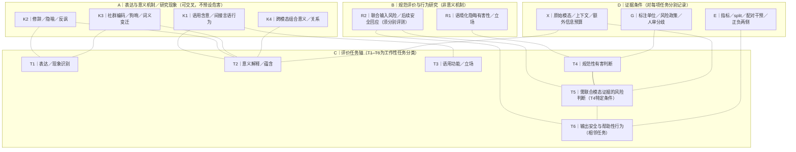
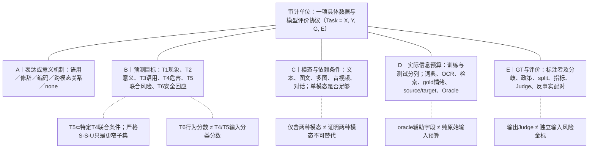

# R4-04｜Figure 1 / Figure 2：概念—任务分轴图与五轴证据审计图（R4-4审阅版）

> 2026-11-09；状态：**R4-4 REVISED FOR REVIEW（等待用户审核，未定稿）**。修订依据为最新main已定稿R3-A1/A2/A3/A4、R3-B AUTALIC/MCIB，及当前[R4-01](R4_01_Formal_Outline.md)、[R4-02](R4_02_Paper_Allocation.md)和[R4-07](R4_07_Section_Claim_Evidence_Matrix.md)。本文件提供**可编辑Mermaid源图与原创图注**，非已经导出的投稿级SVG/PDF，不声称已通过视觉排版或外部论文复现。

## 0. 关键修订裁决与图中符号

| 原R4图的失真风险 | R4-4的定向修复 | 直接依据 |
|---|---|---|
| 把“语境化危害评价”和“联合风险/安全回应”写成与修辞/语用相同性质的**意义机制** | F1分成 **表达与意义机制K1–K4** / **规范评价与行为研究R1–R2**，再单设任务轴与证据条件轴。六条仍可并行研究，但不是六个同构机制 | R1定义；R3-A3 §1 Q3–Q6；R4-07 §1–9 |
| T5旧图标作“严格单模态安全、联合有害” | T5明确为**风险判定需要联合模态证据的特定研究条件**，严格S-S-U只是可测试的更窄子类型，非T5全集 | R4-01 §2.4/7.1；R3-A4 CL01/CL11；VLSU |
| T6与T4/T5风险标签混在一起 | T6单列**输出行为安全与帮助性**，与输入的T4/T5风险预测保留不同标签/指标 | R4-07 §7.4–7.5、8.5；B4a跨论文综合 |
| 用箭头把六机制画成必经处理流水线 | 所有跨维度连线为**无向虚线的例证性对应**，任务类别关系为无向实线；没有时间/因果/认知必经方向 | R3-A3总叙事；R3-A2并行方法 |
| R3-A2的M1–M6指方法族，旧F1的M1–M6又指研究线，易撞名 | F1改用 **K1–K4（意义机制）、R1–R2（风险/行为研究）**，不与R3-A2方法族M1–M6同号 | R3-A2 §0与R4-01 |

**作图语义**：实线无箭头=本文分类/限定关系（不是因果）；虚线无箭头=代表论文中可能跨轴共现的研究关联（不是已验证作用）；不使用箭头暗示认知顺序。图中GT与模型输出必须区分；若正式排版要去掉简图的细节，应删边而不是删任务界线。

## 1. Figure 1｜研究脉络 × 任务对象 × 证据条件：一个非线性研究地图

### 1.1 正式图题

**图1 广义隐晦信息研究的六条并行问题脉络：表达与意义机制、规范/行为任务及证据条件的分层组织**。

**核心信息**：六条并行研究脉络中，前四条主要关注交际含义生成/识别的机制或现象，后两条是**规范性评价与模型行为研究**，不能假装是相同层级的“语言机制”。横向任务T1–T6对这些现象作不同的可检验操作化。具体论文并不必然只属于一个脉络。

### 1.2 Mermaid原创源图（仅概念编辑图，不是正式导出图）

图的四大板块是不同**分析层**，不是从上到下必须执行的模型Pipeline；节点K/R/T/E的编号只在本图内部使用，不替代R1的T1–T6或R3方法族M1–M6。

### 1.3 投稿候选中文图注

**图1｜广义隐晦信息研究的并行研究脉络、评价任务及证据条件。** 语用含意、修辞、社群编码和跨模态组合构成可交叠的表达/意义机制；语境化有害性与多模态风险/安全回应则涉及规范评价或行为结果，属于不同的分析层。六条研究脉络与本文工作性任务T1–T6存在多对多关联（虚线），不表示因果或算法处理顺序。T4为输入危害判断；T5是在明确模态联合证据需求下讨论的特定风险判断，**单模态各安全而组合危险（S-S-U）仅是其中一种更严格配置**；T6评价模型回应的安全性与帮助性，不能与输入危害GT混用。X/G/E提示任何研究结论需注明实际输入与附加信息、标注协议及评测分母。图示为本综述原创的研究组织地图，非研究规模统计或公认唯一分类法。

### 1.4 F1分组的代表性论文与不得越界的推断

| 研究线 | 代表文献（年份、Venue、CCF、Track） | 支持的直接事实[P] | 不能推出的结论 |
|---|---|---|---|
| K1 语用 | P020 (RSA)²（ACL 2025 Main，CCF-A）；R2A-001 DRInQ（ACL 2026 Main，CCF-A）；R2A-002 VAGUE（ICCV 2025 Main，CCF-A） | 有策略条件候选意义、受控文本语境和视觉行动候选评测 | 多选答案等于可观测心理意图 |
| K2 修辞 | P035 EmoBi（ACL 2025 Main，CCF-A）；R2A-019 DOSE（ACL 2026 Main，CCF-A） | 存在隐喻/夸张、反讽/对象等不同监督目标 | 有修辞便是有害，或自然解释必忠实 |
| K3 编码 | P023 CodedLang（ACL 2026 Main，CCF-A）；R2A-006 Silent Signals（ACL 2024 Main，CCF-A）；R2A-007 FETCH!（ACL 2025 Main，CCF-A） | 编码策略、给定定义的实例消歧、词典词项留出发现等不同任务 | 词典留出证明真实时间外开放新词发现 |
| K4 跨模态意义 | P019 V-FLUTE（NAACL 2025 Main，CCF-B）；R2A-017 M3UCD（AAAI 2026 Technical，CCF-A）；R2A-024 MCIB（AAAI 2026 Technical，CCF-A） | 视觉蕴含、图文隐喻、文本+音频+视频反讽的不同GT/方法 | 融合性能直接证明模态因果必要性或CIB独立去捷径 |
| R1 规范危害 | P001 ToxiGen（ACL 2022 Main，CCF-A）；R2A-013 AUTALIC（ACL 2025 Main，CCF-A） | 有害性人工标注、社群语境/引用现象、标注分歧 | 各项有害GT都是说话者真实内心意图；AUTALIC已定量证明删语境因果增益 |
| R2 联合风险与回应 | P038 VLSU（ICLR 2026 Main，CCF-A）；P034 CrossGuard（ACL 2026 Main，CCF-A）；P040 Meerkat-VL（ICML 2026 Main，CCF-A） | 联合风险、Guard/训练与输出安全作为不同实验协议 | 任何Hateful Meme都是S-S-U，或输出安全率即输入风险识别准确率 |

**审计条件**：本表是六条研究线的精选证据，不是91篇的排他分组。MCIB模型正文与公开代码的对照属于S/O；ThinkingGuard（ACM MM 2026为CCF-A刊会，正式出版与实际Track未独立核）暂不作为本图的正式出版锚点。

## 2. Figure 2｜对“具体实验协议”执行的五轴审计

### 2.1 正式图题

**图2 广义隐晦信息计算研究的五轴协议审计：机制／任务／模态语境／信息预算／GT与评价**。

**核心信息**：同一篇论文可能含多数据集/训练设置/评测轨道，故五轴分析单位是**某一具体实验协议**，而非仅有论文题名。图中A–E为分析维度，不是执行阶段，更不是R3-A2方法族编号。

### 2.2 Mermaid原创源图

### 2.3 投稿候选中文图注

**图2｜广义隐晦信息研究的五轴任务与证据审计框架。** 分析单位为一项实际模型/数据评测协议，按Task=(X,Y,G,E)记录原始输入与上下文(X)、目标输出(Y)、Ground Truth及其标注政策(G)、评价指标与分母(E)，再分别注明：A表达或意义机制、B目标任务、C模态与真实依赖条件、D训练/测试时可用额外信息、E标注与指标可靠性。五条实线表示同步应记录的分析维度，而非训练/认知过程的步骤。T5需具体联合依赖GT/配对协议，严格S-S-U只是其子类型；T6回答行为不能替代输入风险标签。金标准情绪、给定编码义、源/目标域或外部检索作为辅助输入时须单列测试信息预算。解释正确、视觉增益、低误拒与安全回答各有不同评价对象，不自动构成因果链。

### 2.4 五轴最小必填字段（直接映射R4-07及T1/T2/T3/T5/T6）

| 轴 | 必填字段 | 审计红线及代表证据 |
|---|---|---|
| A 语义/表达机制 | implicature、figurative、coded、跨模态关系、none；允许多标签 | 编码≠有害；并非每个语境依赖问题都叫隐晦。CodedLang（ACL 2026 Main，CCF-A），AUTALIC（ACL 2025 Main，CCF-A） |
| B 预测任务 | T1/T2/T3/T4/T5/T6；写输出Y是分类、选项、解释、生成、行动；T5注明联合依赖审定方式 | DRInQ（ACL 2026 Main，CCF-A）多选含意 ≠ T6回应；MSSBench（ICLR 2025 Main，CCF-A）行为 ≠ 输入风险 |
| C 模态与上下文依赖 | 原始模态、OCR文字归属、会话/文化/时序、text-only/image-only/joint、是否同样本可比 | VLSBench（ACL 2025 Main，CCF-A）视觉泄漏；M3UCD（AAAI 2026 Technical，CCF-A）的“Complementary”标签不等于干预验证 |
| D 信息预算与前提 | train/test分别记原始图文、给定词典义、人工gold情绪、source/target、外部搜索、模型辅助预测、Oracle caption | MultiMM（ACL 2025 Main，CCF-A）所查测试实现含gold情绪[S]；MGMCF（AAAI 2025 Technical，CCF-A）代码含源目标字段[S]；不能据此认定正式实验均发生泄漏 |
| E GT、评价与证据 | 标注单位/人数/政策、split和数据版本、F1定义、Judge身份及输入、paired counterfactual、safe与unsafe两侧、许可、P/S/H/O | AUTALIC（ACL 2025 Main，CCF-A）2400与正负合计冲突；VLSU（ICLR 2026 Main，CCF-A）8187与公开8159差异；MOSSBench（ICLR 2025 Main，CCF-A）拒答行为与输入安全标注须区分 |

### 2.5 三个最小示例（均为**作者假设示意**，不是数据集真实样本）

| 示例 | 机制A/任务B | 关键条件C/D | GT与评价E：最低可要求 |
|---|---|---|---|
| 同一句话在两个上下文中分别是讽刺或普通陈述 | 反讽；T1/T3（视标注而定） | 同文不同上下文，避免提问或选项变化泄漏 | 有独立语境化修辞/立场标签；分类准确率不能冒充真实心理意图 |
| 给定狗哨词和定义，判断该处是否为编码义 | 社群编码；T1a实例词义识别（可关联T2） | X包含已给的词条和定义，非开放词发现 | 句子级义GT；不允许用词典级type命中替代instance义 |
| 同一图文对在joint条件与单模态条件下风险判断不同 | 跨模态关系/规范；T4，若协议验证联合需求则T5 | 三条件text/image/joint同政策GT，控制OCR与仅图/仅文导致的分布移位 | 人工独立风险标签、配对干预、双侧风险指标；若只观察拒答率则另记T6而非T5的真值 |

## 3. R4-4审计禁语与写作接口

- **不得写**“六种意义机制”：其中R1/R2两类是规范或行为研究，而非生成非字面意义的语言学机制。
- **不得写**“T5=全部图文任务”或“T5=严格S-S-U”：前者过宽，后者过窄。应限定联合模态证据需求与实证GT协议。
- **不得写**“T4输入风险判断→T6安全回应”为所有模型可观测的因果链；部分输出评测研究不显式暴露内部风险预测。
- **不得写**“图像加入后性能提高=正确跨模态因果推理”；同输入预算、独立标签与反事实控制不足时属于H/O。
- **不得写**“某论文阅读卡已定稿=复现实验成功”；原始GT/代码/模型运行版本与授权仍须独立核。
- **不得画**91篇的“领域发文曲线”、跨任务单一SOTA、使用受限样本的真实比例饼图或未审核的多模态风险热力图。

### 图1/图2与R4-07章节主张的接口

| 图 | 正文小节 | 本图直接服务的论证 | 配套表 |
|---|---|---|---|
| F1 | 1.1–1.3；2.1–2.5；6.7；7.1；9.1 | 多研究问题并行、表达/危害/回应边界、T5与T6分离 | T1概念表、T2任务GT |
| F2 | 2.2–2.4；4.2–4.6；5.3–5.4；6.3–6.5；7.2–7.5；8.2–8.5 | 同论文不同实验协议；辅助输入、模态必要性、GT、Judge与干预 | T2/T3/T5/T6、T8审计附表 |

## 4. GitHub与最终图形交付边界

- 本轮仅更新Markdown的Mermaid**源图、图注、证据来源和工单**；用户可在GitHub预览。没有生成SVG/PDF，也没有验证任何投稿模板的缩放/中英文排版。
- R4-4通过概念逻辑审核后，R5正式绘制时应采取**简化主图+图注说明**，预留黑白印刷区分、可访问文本、中文字体和原始图资产；如正式投稿改用英文图注另做术语核对。
- R3已定稿入口：[R3-A1](../R3_evolution/R3A_Research_Evolution.md)、[R3-A2](../R3_evolution/R3A_Method_Evolution.md)、[R3-A3](../R3_evolution/R3A_Survey_Narrative.md)、[R3-A4](../R3_evolution/R3A_Coverage_and_Evidence_Audit.md)、[R3-B双篇综合](../R3_targeted_reading/R3B_03_AUTALIC_MCIB_Cross_Paper_Synthesis_FINAL.md)。
- 91篇书目与状态见[R4-02](R4_02_Paper_Allocation.md)；46条小节证据见[R4-07](R4_07_Section_Claim_Evidence_Matrix.md)。

> **R4-4 图源阶段裁决：CONDITIONAL PASS。** F1混层错误已消除、F2字段与R4-07一致；编辑图不等于最终论文图。须用户确认后才进入R4-5。
