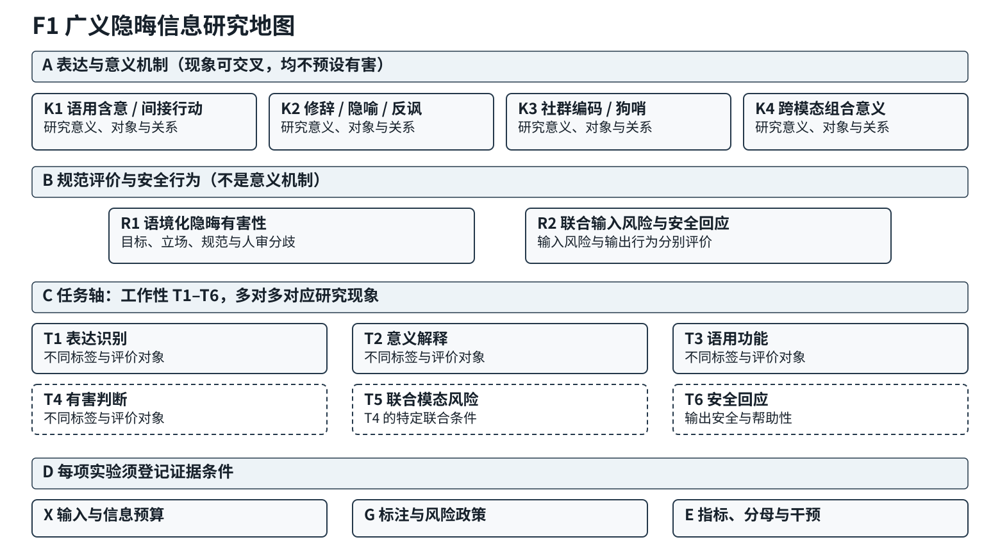
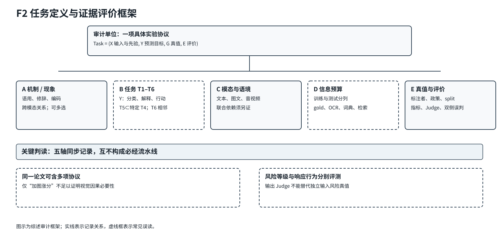
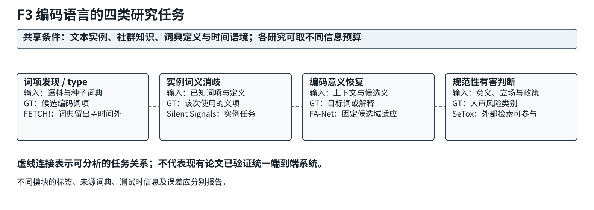
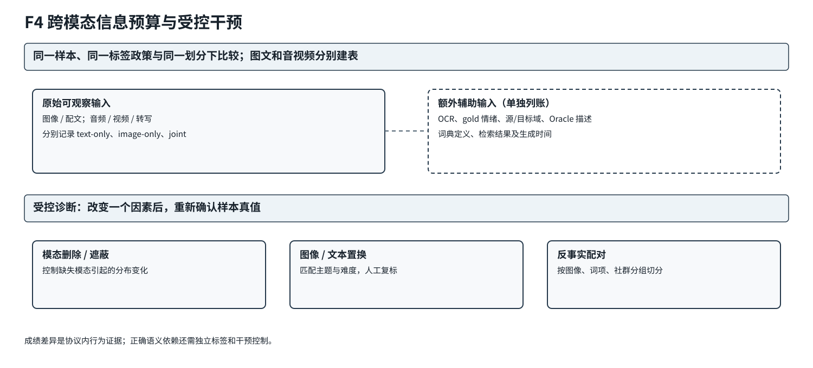
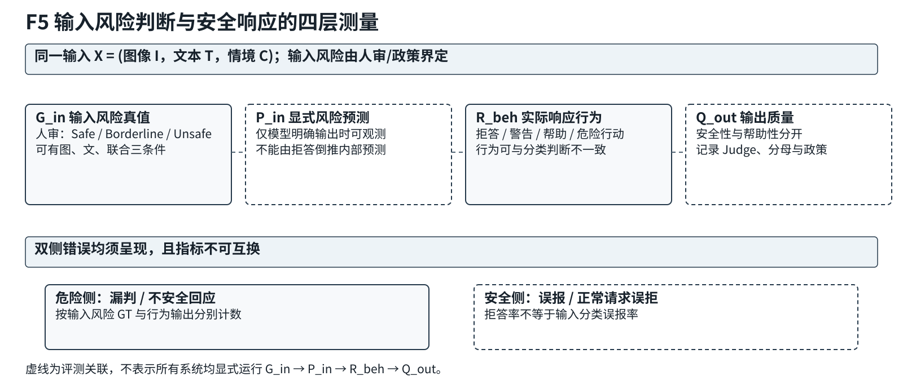

# 广义隐晦信息的计算理解与检测：语用、修辞、编码语言及多模态研究综述

> R6-Fix 定向修订审阅稿｜基于2026-11-09 R5-C固定版。已按R6-A4补充文献、修订跨领域综合及重要分母，仍需学术复审和R6-V图表/书目工程验收；并未重新运行作者实验。

**摘要：** 语言和多模态内容中的目标意义、交际功能及风险判断，常不能仅由字面形式确定。现有工作分别研究语用含意、修辞、社群编码、隐晦有害内容、多模态非字面意义和联合输入风险，但其预测目标、标注依据与输入条件并不相同。本文以结构化批判性叙述综述方式，将表达与意义机制、规范性危害评价和安全响应分层；以 T1–T6 任务体系及 Task=(X,Y,G,E) 记录输入、目标、Ground Truth 与评价，并结合模态依赖和训练/测试信息预算比较代表性研究。全文重点分析编码词项发现与实例义消歧的差别、修辞标签与有害真值的断裂、多模态辅助金信息及捷径、联合风险分类与输出拒答的不同分母。综合证据表明，任务操作化和方法覆盖已明显推进，但高分类分数不能单独证明真实语用理解、模态因果依赖或解释忠实性；标注分歧、数据版本和同预算控制仍限制强机制结论。跨论文正反证据进一步支持三个具有明确前提的综合认识：编码义的任务开放度受词典、候选集与检索先验制约；解释和规范监督可改善作者协议下的预测却未必构成忠实推理；联合风险漏检与正常请求误拒可能呈现不同方向的权衡。以上均是针对现有实验的条件性综合（H），不是本文新训练或新因果实验。

**关键词：** 隐晦信息；计算语用；修辞理解；编码语言；隐式有害内容；多模态风险；Ground Truth；评价可靠性

# 1 引言

## 1.1 背景与研究动机

**图1｜广义隐晦信息研究地图。** 上层区分语用、修辞、社群编码和跨模态意义等表达/意义机制；规范性危害与安全回应属于另一个分析层。T1–T6 是可交叉的评价任务，X/G/E 是各实验必须记录的证据条件。图示不表示认知或算法的因果顺序。

在语言交流中，一段表达所传递的信息并不总能从其字面形式中直接、充分地确定。说话者可能通过间接言语行为、会话含意、隐喻与反讽传递超出字面断言的意思，也可能使用某一社群共享的暗语、谐音或不断变化的词义进行交流。在包含图像、音频或视频的场景中，文字与其他模态之间的语义关系又可能改变解释对象、评价立场乃至风险判断。上述现象并不天然具有恶意：相同的非字面或编码策略既可能服务于幽默、艺术与身份表达，也可能出现在隐晦歧视、攻击性言论或规避内容审核的交际情境中。

这一复杂性为计算模型提出了不同层次的问题。首先，模型需要判断是否出现特定表达现象，例如反讽、隐喻或编码词；其次，模型可能需要推断实例中的候选意义、相关对象和交际作用；最后，在涉及内容安全的应用中，模型还必须根据目标、立场、语境和具体规范判断是否存在伤害。上述层次相互关联，却分别对应不同的预测目标与标注对象。检测到隐喻并不能直接推出某句具有仇恨意图；能够为一句话生成流畅解释，也不能自动证明模型的分类判断确实依赖该解释。作为本领域基础的计算语用学研究亦特别强调，应将被评测的语言现象、任务形式与模型能力区别开来，参见[@ma-etal-2025-pragmatics]。

已有研究从多个独立方向推进这些问题。隐式有害内容方面，[@hartvigsen-etal-2022-toxigen]等数据集将缺乏显性攻击性词汇的仇恨表达作为独立检测难点；语用与修辞方面，[@spinoso-di-piano-etal-2025-rsa]研究修辞策略条件下的概率语用推断；编码语言方面，[@kruk-etal-2024-silent]与[@sasse-etal-2025-making]分别研究已知狗哨表达的实例义消歧与词项发现；跨模态方面，[@kiela2020hateful]与[@palaskar2026vlsu]从不同侧面推动了图文关系和联合风险的可测评价。这些工作并不组成一个可直接比较排行榜的统一任务，却在“何种证据足以支持某一解释或判断”的问题上逐渐形成交叉。

近年来，LLM与MLLM的出现进一步拓展了可操作的研究形式：提示与检索能够引入动态知识，多任务训练可以同时预测现象、目标及辅助属性，偏好优化与强化学习则可将风险判断和模型回复策略纳入训练。然而，模型规模、推理链长度或融合层数的增加，并不直接说明模型已使用正确的语境与模态证据。以多模态反讽为例，[@wang2026conditional]研究角色、笑声和辅助情绪标记等数据捷径，并以条件信息瓶颈构造融合机制；该方向说明可靠性已成为显式研究议题，但其中对信息瓶颈模块独立贡献的证据仍须按原论文消融和实现协议作限定。对有害内容判断而言，[@rizvi-etal-2025-autalic]还展示了社群内部使用、引用和反用等真实话语环境下的标注分歧。因而，本综述不仅关心模型在既定测试集上的预测正确率，也关注Ground Truth究竟刻画了何种意义、哪些输入信息在测试时可用，以及预测错误能否被可靠地归因。

## 1.2 综述范围与相关研究的关系

已有相邻综述覆盖多个重要子域，本文必须在这些工作之上说明增量。表内时间窗只填已经核实的范围，未核者不推断。

| 相邻综述 | 已覆盖对象与范围 | 本文的不同分析单位 |
|---|---|---|
| Kühn 等：少见修辞格综述 [@kuhn2026rhetorical] | 修辞格定义、数据与检测；正式卷期为2026，预印本为2024 | 将修辞标签与意义、危害 GT 分离 |
| Ma 等：LLM 语用综述 [@ma-etal-2025-pragmatics] | 语用任务、数据与评价 | 联结编码、规范性危害与安全行为 |
| Farabi 等：多模态反讽综述 [@farabi2024survey] | 2018–2023 多模态反讽；IJCAI 2024 Survey Track | 进一步比较跨模态意义与联合风险/响应 |
| Hee 等：多模态仇恨审核综述 [@hee-etal-2024-recent] | 文/图/音仇恨及大模型审核；EMNLP 2024 Findings | 从更广的无害语用与修辞起点审计 T1–T6 |

**表注。** 此表说明实质重叠与组织差异；不是先行综述的穷尽检索或覆盖率统计。会议等级、Track 与出版状态另见[引文映射](Citation_Key_Mapping.md)。

本文使用“广义隐晦信息”作为一个**操作性综述范畴**，指语言或多模态交际中，目标意义、立场或交际作用不能仅由显式字面内容充分确定，而需结合语境、修辞映射、社群约定、编码形式或模态间关系来推断的信息。该定义旨在跨任务组织文献，**并不声称“广义隐晦信息研究”已是各子学科公认的统一研究名称**。隐含（implicit）与细微（subtle）并非同义词；编码（coded）不等于必然恶意隐藏；语境依赖不必然产生非字面意义；有害性判断还涉及目标、规范及评价政策。具体的包含关系与反例在第2章给出。

与侧重某一修辞现象、语用能力或有害内容种类的现有综述相比，本文采用交叉问题驱动的编排方式。已有[@ma-etal-2025-pragmatics]系统总结语用能力的数据与评价问题，相关的隐式仇恨、中文毒性、多模态仇恨和反讽综述亦各有其纳入边界。本文的差异不在于宣称这些方向“此前没有综述”，而是在同一框架中分别定位表达机制、预测任务、模态条件和证据可靠性，避免把非有害修辞直接视为隐式仇恨的一个子类。

研究范围包括四组核心材料。第一组讨论会话含意、间接言语行为与修辞表达的识别和意义解释；第二组涉及社群编码、狗哨、音形变体及动态词义；第三组讨论隐式有害内容的目标、立场与规范性标签；第四组研究图文、音视频与多图中的非字面意义及**需要联合模态证据的风险判断**。其中，单一图像或文字各自安全、组合后有害（S-S-U）只是更严格的联合条件子类，不能代表全部多模态风险研究。安全响应研究仅在与隐含风险识别、过度拒答或安全—帮助性评价直接相关时纳入。一般的显式毒性分类、任意上下文指称消歧、传统隐写、通用RLHF和普通视觉识别不因“输入含语境”或“输出分类标签”而自动成为本文核心研究。

在编排上，本综述同时保留研究历史和技术机制两种横向视角，但不把它们写成单一的进步代际。例如，词典与概率语用模型、PLM监督学习、检索增强以及多模态融合在不同任务中仍可能持续共存。我们关注的是各方法解决了哪个具体目标、在什么信息和标注条件下报告有效，以及哪些能力尚未由对应实验直接证明。

现有相关综述与本文有实质重叠，不宜只凭跨子域范围较广就宣称首次发现。Ma等（ACL 2025 Main，CCF-A）已系统整理LLM语用任务、数据与评测；Farabi等（IJCAI 2024 Survey Track，会议CCF-B）已讨论多模态反讽；Hee等（EMNLP 2024 Findings，会议CCF-B、非Main）涉及多模态仇恨审核。本文的独特分析对象不是简单增加论文种类，而是把各研究的预测目标、训练/测试信息预算、Ground Truth来源、有效的正面结果与相反实验放在同一证据比较中；第8章给出三条有明确适用条件的跨领域规律，不作跨任务绝对分数排名。 [@ma-etal-2025-pragmatics; @farabi2024survey; @hee-etal-2024-recent]

## 1.3 研究问题与本文贡献

围绕上述研究范围，本文着重回答五个问题：其一，什么样的表达机制会使字面信息不足，如何区别表达识别、意义恢复与交际意图推断；其二，语境、社群及时间变化如何影响词义判定与泛化；其三，隐含意义与有害性在何种规范和证据条件下相关，又为何不能直接互推；其四，多模态信息何时提供不可替代的语义证据，如何识别文本泄漏和额外信息捷径；其五，如何在同一研究地图中分别衡量输入风险、模型输出行为、解释质量与安全—帮助性的权衡。

本文提供三个可核对的综述分析产物，而非原创训练实验。第一，将语用/修辞/编码等表达机制，与社会规范危害和安全回应分层，采用T1–T6及 Task=(X,Y,G,E) 对齐各自的输入、标签、指标和证据。第二，以真实论文的训练与测试先验、监督对象、正面结果和失败边界为单位，在表3–表7跨领域比较，而不把不同任务的F1、ASR或解释分数排成一个模型排行榜。第三，第8章以正反证据建立三条条件性综合规律：编码语言开放度受已给词典、候选与检索信息约束；解释监督的预测收益不能直接等同忠实理解；联合危险漏判与合法请求误拒是必须同时关注的不同错误。各规律都是本综述的H级归纳，既不宣称首创相关任务，也不声称本稿完成新的实验复现。

## 1.4 文献选择协议、覆盖边界与证据规则

本文采用结构化批判性叙述综述，**不是可重建召回率的系统检索综述**。项目候选池为R0的59条与R2-A的32条，共91条；纳入正文中心证据时优先满足三个条件：研究任务真实落在T1–T6或相邻关键对照；可取得正式出处或已核全文/细致精读卡；足以核定至少一项输入、监督、Ground Truth或评价主张。仅有正式摘要的文献只作任务存在性说明，未核机制的候选不作强实证。R5-C原Bib46条；本次定向补入ExPO-HM（ICLR 2026，CCF-A）及Searle 1975理论章节后工作稿为48条，**不是统一检索式下的完整领域样本**。截至2026-11-09项目证据整合尚无可再现的检索式、数据库与逐层排除流水账，不能写成PRISMA筛选，也不由91→48计算领域覆盖率。

比较单位是一项具体实验协议：原始输入与附加先验、预测目标、Ground Truth、指标与分母、训练/测试时信息预算、代码或数据版本。出版事实记为 F，作者报告记为 P，公开材料静态观察记为 S，本文跨论文综合记为 H，尚待核实事项记为 O。正文用自然语言说明证据边界，详细登记见[证据审计](R5C_Integration_Audit.md)。图1与图2分别展示研究地图和协议审计结构。

### 本文结构

第2章介绍概念、理论和统一任务体系；第3、4章分别讨论文本修辞/语用意义和编码语言；第5章分析语境化有害判断；第6章研究多模态非字面意义；第7章区分联合输入风险与安全响应；第8章横向比较方法及证据可靠性；第9章总结可证的进展与待验证方向。章节顺序是编辑组织，并非模型的必经推理链。

# 2 概念、理论基础与任务体系

## 2.1 语义、语用与非字面意义：理论和术语边界

语言理解既依赖词汇与组合规则，也依赖特定场景中的交际条件。Grice的会话含意、Searle的言语行为专著及专论间接言语行为的1975章节、Frank与Goodman的概率语用模型共同构成理论锚点 [@grice1975logic; @searle1969speech; @searle1975indirect; @frank2012predicting]。这些理论并不直接给出当代数据集里真实发话者心理意图的可观测金标。语义和语用并非“无语境与有语境”的简单二分，指示词和指称也会依赖语境；本稿更关心一项任务的输出究竟是字面约定内容，还是特定交际条件支持的额外意义、行动或立场。

以一句表面疑问“你能把窗户关上吗？”为例，系统可以识别其疑问句形式，亦可以在具体生活情境中将其解释为间接请求。前者是句法/字面层的识别，后者涉及言语行为。再如“真是准时啊”在迟到的会话语境中可能表达反讽，而在实际准点的语境中也可能是真诚评价。这里的“可能”十分重要：脱离共同前提、说话者关系和明确的人工解释任务，不能给所有使用者强加唯一的心理意图。

### 工作性定义与概念边界

本文采用以下工作性定义：**广义隐晦信息是指在语言或多模态交际中，其研究关注的意义、评价立场或交际功能不能仅由直接字面表达充分确定，因而需要额外的语境、语用推理、修辞映射、社群约定、编码形式或模态间关系才能获得可信解释的信息。**该定义旨在组织不同研究谱系的任务边界，不是主张这些文献已经采用共同的“隐晦信息”官方标签体系。

必须区分的概念如下：

详见[表1：概念与任务边界](tables/T1_Concepts.md)。表1将概念的性质、意图隐藏和有害性分开记录；这是工作性分类，经验上允许交叉。

“Dog Whistle”在本文中属于具有受众知识差异或多重受众解释机制的重要编码现象，但**不是所有编码语言的同义词**；是否存在有意双层沟通需看具体研究证据。[@kruk-etal-2024-silent]研究已知狗哨编码义的语境使用判定，而[@sasse-etal-2025-making]研究词项发现，两者即使包含相似词汇也不具有相同预测标签。[@wan-etal-2026-newspaper]则展示了中文编码策略和应用任务的关联，但出现编码并不自动代表仇恨或违规。

这些概念**可以相交但不能互为定义**。一段表达可能既是反讽又具有编码社群义，但无害；也可能没有任何隐喻或暗语，却借上下文表达隐含的群体偏见。另一方面，单纯视觉不完整或文本指代歧义，如果没有明确的隐含/非字面/编码/风险研究目标，应作为相邻语境理解而不是核心收录对象。

**包含与排除的四个判定例。** 无害隐喻若研究源目标映射，仍是T1/T2核心；只把谐音字符还原为常用字而不涉及社群编码义的任务是邻接信息处理；普通图文有害Meme可以属于T4，却不自动具备T5严格图、文单独Safe而组合Unsafe的标签；纯显式危险请求的泛化RLHF不作为隐晦意义核心方法，但直接研究组合风险后的误拒与帮助性时可作为相邻T6。纳入的判断对象是**预测目标、语义机制及其真值**，而非数据中是否出现“图像”“情绪”或“安全”一词。

## 2.2 五轴任务与证据记录框架

**图2｜任务定义与证据评价框架。** 五轴共同描述一项具体评测协议：表达机制、预测任务、模态/语境、训练与测试信息预算、Ground Truth 与评价。实线是同步记录关系，虚线框提示常见误读；T5 是 T4 的特定联合条件，T6 是相邻的行为评价。

若以“隐喻、仇恨、VLM、DPO”并列为一级类别，会把表达机制、风险类别、模型类型和训练方法混在同一个层次。为避免此问题，本文以五个**分析上应分离、但经验上可能相互影响**的维度（图2）记录具体实验协议，并将其作为后文比较论文的共同依据。它们不是数学意义上必须统计独立的变量。

**A. 表达与意义机制**。记录实例涉及会话含意、间接言语行为、隐喻/反讽/委婉语、编码/狗哨、形式伪装或跨模态组合关系。它描述*为什么需要超出字面的语义证据*；群体立场是T3可能判断的语用属性，歧视/危害为T4的规范性评价对象，安全回应属T6，**不把三者冒充语言意义机制**。

**B. 研究预测目标**。记录模型究竟在判定现象存在、生成/选择解释、判断交际功能、给出有害性类别，还是生成安全回应；同一个机制可对应多个不同任务，同一任务也可能利用不同机制。

**C. 输入模态与情境条件**。记录文本、图文、多图、音视频、对话轮次、社群身份和时间信息，以及分组/配对方式。模态个数和模态之间是否构成不可替代语义关系，是两个不同的问题。

**D. 训练/测试可用信息预算**。严格区分原始可观测文本/图像/音频，与作者提供的词典释义、gold情绪、源/目标概念、外部检索、OCR和Oracle caption等辅助内容。需分别记录这些字段是在训练时、测试推理时还是仅供评测者使用；提供gold辅助信息与模型自行预测辅助属性不是同等信息预算。

**E. Ground Truth与证据协议**。记录标注单位、标注者、指南、分歧、train/test拆分、真实外部时间/社群分布，以及衡量选择、开放解释或输出行为的指标。两篇论文同样报告F1，若标签、样本或指标平均方式不同，就不能依数值高低直接推导方法优劣。

因此，针对**一篇论文的一项具体实验协议**，本文用 \( \mathrm{Task}=(X,Y,G,E) \) 记录输入及先验、预测目标、Ground Truth和评价形式。这里的记录式是本文组织综述的**分析记号**，不是作者提出的新模型、训练目标或被普遍接受的数学理论。

为操作化四元组，X应细分为原始输入X_raw、训练额外信息X_train_aux（教师解释、金标情绪、政策或风险说明）及推理时额外信息X_test_aux（候选、词典、检索、oracle）；G至少区分人类共识、模型构造后审修和政策代理，E记录样本单位、分母与Judge。DRInQ固定文字问句而变化会话语境、以五个候选含意的人类共识为评测；VAGUE依视觉场景和四个候选行动评判间接请求，候选由构造目标及人工筛选。二者都可称语用能力测评，但候选数和信息预算不同，不能直接比较其绝对Accuracy。 [@arai-ren-2026-drinq; @Nam_2025_ICCV]

## 2.3 计算语用与操作性Ground Truth

计算语用研究为上述问题提供了可检验的建模和评价方式。概率语用模型通常通过说话者—听者之间对表达选择及潜在意义的假设进行推断，但模型中的先验、候选空间与语境构造会直接决定其适用边界。[@spinoso-di-piano-etal-2025-rsa]进一步将修辞策略纳入RSA式语用推断；其研究目标是策略条件下的意义判断而非有害内容分类。[@arai-ren-2026-drinq]通过固定问句、改变语境的选择任务评价会话含意；[@Nam_2025_ICCV]利用视觉情境及候选行动评价间接表达的适宜解释。这些研究提供的是**在特定构造任务和候选空间中的模型行为证据**，不应被解释为真实说话者内心意图已被直接观察或完全恢复。

上述任务虽然都与“语用”有关，却没有共同的心理意图金标。DRInQ在给定五个候选含意时评估语境化选择，并以人类共识构造测试答案；VAGUE在视觉语境和四个候选行动中评估模型的适宜判断；(RSA)²依赖定义好的策略、先验与候选意义空间。其Accuracy或候选概率只支撑**各自协议下的选择或拟合表现**，不能据此判定真实发话者意图已被完整恢复，或直接与开放式意义解释的准确率合并。

## 2.4 T1–T6与Task=(X,Y,G,E)：任务目标与可观测标签

[表2：T1–T6 的输入、输出与 Ground Truth](tables/T2_Tasks_and_GT.md)按 X/Y/G/E 给出六类任务的典型标注与评价限制。

T1–T6不是必须逐级运行的算法流水线。例如，有害性分类器可能直接从原始内容估计T4标签，未显式输出T2或T3解释；而纯反讽研究可能只解决T1/T2，无需转向风险判断。任务之间存在概念联系，但只有同时给出独立中间标签和控制实验，才能进一步声称某种中间语义表征**因果促进**了有害性判断。

这里还需注意T5的特殊地位。对于一对模态 \(I,T\) 和语境 \(C\)，可用 \(G(I,T\mid C)\) 表示在指定政策下的**联合输入风险标签**；\(G(I,\varnothing\mid C)\) 与 \(G(\varnothing,T\mid C)\) 表示在人类标注协议允许时的单模态条件判断。研究可讨论具有不同形式的联合关系风险，但**严格证明某项危险判断必须依赖两种模态**，还需人审的单模态/联合风险标签、对照或精心控制的配对干预；单纯去掉图片后分数降低不足以证明模型掌握了正确关系。双方单独安全、组合危险（S-S-U）是尤其明确的联合协同模式，却只是T5的更窄子类，且并非所有数据都拥有同协议的三条件人工GT。普通Hateful Meme图文分类器即使同时读取图与文，也不自动意味着其数据满足这种严格标签条件。

## 2.5 纳入/排除示例与解释、危害及响应的不同GT

前文任务的另一个关键界限体现在Ground Truth来源。对同一个被标为含有隐喻的句子，源域标注者可能给出“像洪水一样”的修辞标签；危害评审者则还需判断其中是否出现群体贬低、说话者是在赞同还是批评、语境是否为引用或社群内部自述。修辞检测与有害性判断的Ground Truth并不天然一致。[@mendelsohn-budak-2025-people]中的人工监督主要针对隐喻源域，而非每条语句的独立“非人化/仇恨成立”标签，因此不宜用其修辞准确率证明模型可靠识别了歧视性意图。

[@rizvi-etal-2025-autalic]进一步给出了真实社交平台中的规范性评价案例。其研究对象既包含可能的隐式歧视也包含显性讨论，并未为每条实例提供独立显性/隐性标签；9位受过专门培训的高年级本科研究志愿者参与标注，每条目标句由3人参考邻近语境作出判断；作者报告Fleiss's κ为0.25。论文提供社群内部求助、反用和引用引发分歧或误报的质性案例，但缺少在同一模型和相同数据划分下比较“目标句单独输入”与“目标句加语境”的控制消融。因此，不能将该论文表述为已定量证明“上下文使模型更准确”。其论文称总量2,400，但正例242与负例2,160相加为2,402；该算术差异未由原始CSV核实，因此不能直接制作精确类别比例图，后续须遵守数据使用/自动审核用途的许可限制。

在多模态生成系统中，这种区分还延伸到模型行为。可把输入风险人审标签记为 \(G_{\rm in}\)，模型可见的输入风险预测记为 \(P_{\rm in}\)，实际输出的行为类型记为 \(R_{\rm beh}\)，输出是否安全且帮助用户完成合理任务记为 \(Q_{\rm out}\)。四者不是同一种Ground Truth：系统可以把危险输入识别正确，却仍给出危险指导；也可以把无害输入错误拒绝；甚至可能因保守拒答而提高某一安全评估分数，同时降低帮助性。若模型只生成最终回答而不显式报告风险分类，\(P_{\rm in}\) 可能并不可观测，不能仅由拒答行为反推其内部识别过程。[@li2025oversensitive]与[@zhou2026meerkatvl]分别对安全侧误拒和后训练中的风险感知与回应行为提供不同任务证据。

**纳入与排除的操作性判断。** 无害反讽、约定编码义的实例使用和需要语境的间接言语行为，即使没有有害标签，仍可作为T1–T3的核心对象；带独立规范性风险GT的隐晦歧视文本属于T4。若图文风险结论确实针对关系或联合证据展开，并能说明GT或受控条件，则可在T5讨论；只含图片和文本的普通二分类器并不自动满足严格联合依赖。相反，普通指示词消歧、纯字符恢复、一般OCR、纯隐写和不涉及隐含机制的一般显式危险输入仅作为邻接背景，除非研究问题具体关联本文的隐含意义或联合模态风险。仅评估拒答或回答质量的工作归为相邻T6，不冒充T4/T5输入风险真值。

### 本章小结

本章建立了两项贯穿全文的约定。其一，广义隐晦信息是组织研究的工作性范围，隐含、修辞、编码、细微和有害性是相交而不等同的属性；文献是否属于核心研究，需要根据其操作性任务和真实标签决定。其二，论文比较必须保留表达机制、预测任务、输入与测试信息、Ground Truth及评价协议的多轴信息。只有这样，后文才能分别讨论文本修辞、社群编码、有害性以及多模态关系，并在第8章横向对比方法族而不制造虚假的统一SOTA排序。

# 3 文本修辞与语用含义的计算理解

## 3.1 修辞表达检测

文本修辞研究最先需要回答的是：模型识别了表达形式，还是已经确定了该表达在当前交际中的意义？隐喻通过源域描述目标域，夸张改变程度尺度，反讽可能使表面评价与语境立场相背；习语、委婉语和反问又分别涉及惯用组合、间接命名与疑问句的交际功能。它们可以共现，但标注对象并不相同。形式检测通常给出句子或片段的现象标签（T1）；要回答“究竟指什么”或“对谁表达何种行动”，还需另设意义（T2）与语用意图（T3）的任务真值。把三个层次合并为单一“隐晦理解”得分，会掩盖模型只抓住词面线索的可能性。 [@zheng-etal-2025-enhancing; @liu-etal-2026-revisiting; @yao-etal-2026-rhetorical]

在修辞形式的联合识别上，EmoBi [@zheng-etal-2025-enhancing]以英文句子为输入，分别预测可共存的隐喻和夸张二元标签。方法先让语言模型生成情绪分析，再描述隐喻的源域和目标域，利用一个任务的预测辅助另一个任务，最后连同先前理由重新判断两种标签；这些环节是结构化提示与多次推理，并非新增的参数训练目标。作者在 HYPO、HYPO-L、LCC 和 TroFi 的联合标注资源上报告分类结果，Table 1 的 F1 与 Table 2 的核验阶段消融支持“这一提示组合在该协议下有用”。但四套资源原有标签和补标标签的血缘不同，且现有消融未以相同调用次数和输出长度隔离情绪、源目标说明与反复判断的独立贡献。项目已有阅读卡提示公开实现顺序与方法命名的对称性可能存在差别；由于本稿尚未固定源码commit及行号，不能将其写作外部可重复的正式实现断言。 [@zheng-etal-2025-enhancing]

反讽检测揭示另一种局限。[@mahato-etal-2026-llms]在现成指令模型上做零样本二分类，作者报告模型在其合成样本与真人语料间出现显著表现差异，并用表示可视化、语言模型熟悉度代理、局部扰动和层消融分析错误。该论文没有先用合成数据训练待评模型，故不能把结果写成“合成训练导致真实测试失败”；真人与合成集合还同时改变平台、话题、长度、标签生成方式和表达难度。其 Table 2 的准确率差异是特定数据与推理协议下的现象，二维表示聚类与删词效应不足以单独证明模型在语用意义上“完全失明”。综述判断是：形式标签的高低分必须结合数据来源和标签操作定义解释；“反讽”这一类内部仍有真实语境依赖、显著语义反差和生成模板差异。 [@mahato-etal-2026-llms]

习语、委婉和反问也提醒我们注意标签粒度。SemanticQA [@liu-etal-2026-revisiting]把多词表达的片段抽取、分类和语境解释分成原子操作，再要求模型在一次回答中同时给出抽取及判断；不同来源语料的标签与输出格式并不统一。[@yao-etal-2026-rhetorical]则沿用两个反问/信息寻求问句数据集的二元标签，测量隐藏表示能否被线性探针分开。前者检验可观察的多步骤输出，后者检验表征可分性；两者均不能直接替代对真实说话者意图的独立验证。 [@liu-etal-2026-revisiting; @yao-etal-2026-rhetorical]

EmoBi（ACL 2025 Main，CCF-A）在HYPO-L作者消融中，完整隐喻F1约80.3，去情绪约74.6、去核验约78.4。该证据支持情绪与再核验构成的提示协议在该数据下有效，却尚无等调用次数/等token控制可以独立分配贡献；相关语料的联合标签含既有数据与后续补标，并非2025论文新建的全部独立人类GT。 [@zheng-etal-2025-enhancing]

## 3.2 非字面意义与语用意图推断

从识别修辞过渡到推断意义，关键变化是输出由“是否出现某种形式”变为“在这组语境中哪个解释更可接受”。(RSA)² [@spinoso-di-piano-etal-2025-rsa]将修辞策略 r 明确加入理性言语行为模型：策略相容函数 f_r(c,m,u) 使话语 u 在特定策略下对非字面意义 m 也可赋非零概率；听者再按说话者选词的条件概率反推候选意义。方法解决了严格字面相容函数将非字面解释概率置零的建模障碍。它依赖候选意义与候选话语集合、意义先验及策略概率；在数值夸张任务中策略函数含人工规则，在天气反讽任务中又利用人类策略判断训练小网络，不能概括成无先验、开放式的意图恢复。作者在 PragMega+ 的有限候选反讽实验中报告策略条件化的收益；Table 2 最优配置为策略条件的 L0 而非更深递归的 L1，Table 3 的先验消融也显示意义先验贡献很大。因此，论文支持“显式策略条件有助于特定候选意义选择”，尚不足以把全部增益归因于递归语用推理。 [@spinoso-di-piano-etal-2025-rsa]

(RSA)²（ACL 2025 Main，CCF-A）报告在其整体样本上，策略条件L0分配给正确候选意义的平均概率约0.85、普通L0约0.73；但Figure 4字面子群呈相反趋势（普通约0.95、策略条件约0.77）。这不是分类Accuracy，而是分配给正确解释的概率，说明增加修辞策略先验可能以字面情境过度解释为代价，不能称全组样本单调改善。 [@spinoso-di-piano-etal-2025-rsa]

DRInQ [@arai-ren-2026-drinq]从评价设计切入：保持表面问句 Q 不变，改变情境 C，使五个候选含义中被人类共识支持的选项变化。候选不是任意干扰项，而是同一问句在其他情境下可能成立的解释，因此模型不能仅靠问句形式作答。论文把生成的情境和含义交给五人判断，仅保留至少四人一致的实例；其困难子集Table 2报告400道五选一题的结果；这些题从819条人审共识例中定向选择具有模型—人类或构造目标分歧的困难实例，而非自然语料的随机400题。解释提示并非对所有模型都有提升，这与“只要生成理由就能增强语用理解”的假设不符。其共识真值仍是对构造场景的可接受解释，不是对现实说话者心理状态的观测；本项目审计发现论文总体/困难集数量与当前公开 CSV 数量不同，故正文只使用论文中条件明确的困难集口径。 [@arai-ren-2026-drinq]

另一条技术线研究表征应如何分开否定与隐含意图。[@zhang-etal-2024-model]从现有意图数据出发，用模型生成否定和含意变体，再以三元组距离及分类/聚类检验意图编码器。训练用语义对比拉近保留意图的表达、推远改变意图的表达；论文 Table 2–3 显示常规意图分类能力不能保证困难三元组排序正确，针对困难负例训练也可能使不同指标出现取舍。不过原始意图类继承既有数据，变体主要由模型生成且人工核验仅覆盖抽样，不能将排序正确率直接解释为开放对话中的间接言语行为恢复。反问探针研究 [@yao-etal-2026-rhetorical]进一步显示，跨数据集分类仍可达到可用 AUROC 时，探针方向和高排名实例集合可能不稳定。综述判断是：表示可分、候选解释选对、真实交际功能恢复三者需要各自的检验。 [@zhang-etal-2024-model; @yao-etal-2026-rhetorical]

## 3.3 情绪与交互辅助：从相关线索到可部署证据

情绪是修辞的重要线索，却既可能是表达后果，也可能只是与语料主题共同出现。EmoBi [@zheng-etal-2025-enhancing]把模型自生成的情绪描述送入源目标映射与隐喻/夸张相互提示，使情绪成为推理时的辅助文本。其关键优点在于把“何种情绪、何种映射”显式放进可检查的中间输出；其直接评测目标仍是两个形式标签，而非人工标注的情绪因果作用或最终语用意义。作者 Table 2 的去核验消融显示完整流程在所测资源上得分较高，但核验本身是同一模型基于更多提示再判断，没有外部真值纠错器。相关公开实现的执行顺序和依赖路径尚需固定版本核对；此前项目阅读卡可作复核线索，而非对正式运行的已证判决。 [@zheng-etal-2025-enhancing]

情绪信息的“可用”还取决于测试时如何获得。多模态隐喻论文 [@yang-etal-2025-cultural]的既有项目卡提示一个公开路径可能在测试时使用人工情绪字段，但本稿尚未固定该路径的commit/正式评测配置；在复核前只能把它作为需要区分gold与预测情绪输入预算的风险，不得指认正式实验必定使用测试金标。对文本修辞而言，同样应区分模型自行预测的情绪、训练时辅助情绪标签、测试时人工情绪标签以及随机或打乱的情绪提示。综述判断是：只有在相同模型、相同推理预算下比较这些条件，并检查情绪错误时标签是否随之翻转，才能更具体地论证情绪线索的部署价值。现有结果说明其作为设计线索有前景，却尚未证明所有修辞理解必须经由情绪中介。 [@yang-etal-2025-cultural; @zheng-etal-2025-enhancing]

## 3.4 测试形式的边界

同一“理解”标题下，测量对象可能相距很远。DRInQ 的五选一准确率要求在给定候选中选出共识含义；(RSA)² 的 PragMega+ 报告正确候选获得的平均概率；SemanticQA 的解释任务比较生成文本与参考解释的 METEOR/BERTScore，联合任务还把片段抽取是否正确计入综合分；反问线性探针的 AUROC 则只显示隐藏状态携带可供线性分类的信息。这些量的分母、随机基线、参考答案空间及信息预算不同，不能把数值放进统一排行榜。 [@arai-ren-2026-drinq; @spinoso-di-piano-etal-2025-rsa; @liu-etal-2026-revisiting; @yao-etal-2026-rhetorical]

尤需警惕“解释流畅”替代“解释忠实”。已有项目卡记录SemanticQA一个公开路径会在同一次提示中请求抽取与解释；由于固定源码版本尚未给出，本文只将它作为复核线索。联合分数下降也可能来自抽取边界、格式与参考解释覆盖不足，不能自动认定独立步骤的错误传播。[@yao-etal-2026-rhetorical] 的探针即便跨域保持分类能力，也未发现稳定唯一的反问表示方向；[@mahato-etal-2026-llms] 的二维可视化和局部词扰动同样不能直接呈现模型内部语用推理。更可信的比较需要同一表达在不同语境下的配对判断，分别给出字面与非字面负例，并报告候选意义、对象和立场的独立标注。这里的后两项属于综述提出的评价要求，而非上述论文已完成的统一实验。 [@liu-etal-2026-revisiting; @yao-etal-2026-rhetorical; @mahato-etal-2026-llms]

## 3.5 从修辞到社群编码的桥梁

委婉表达可以经由替代词、谐音或跨语言变形固定为社群约定，隐喻也可能成为群体内部识别信号；但两者没有必然包含关系。CodedLang [@wan-etal-2026-newspaper]在真实中文评论中标注编码片段和主要编码方式，其“Newspaper Eat”一例需要音系与翻译链的逆推，不能仅以传统隐喻源目标映射说明。Silent Signals [@kruk-etal-2024-silent]则预给狗哨词项与编码定义，再判断具体上下文是否用了该义；一个表达在其他语境仍可按普通义使用。这些材料共同把研究问题从修辞类型扩展到受众共享知识、实例多义与词义变化。 [@wan-etal-2026-newspaper; @kruk-etal-2024-silent]

由此进入第4章时，需要先问研究者究竟是在发现一种表达、消歧其一次使用、恢复所指意义，还是评价其危害。反讽、隐喻、委婉和编码都可能承载无害交流；无论形式多隐晦，仅凭形式标签都不能推出交际者有规避审核的目的。编码表达与有害性之间还隔着目标、立场及规范判断，这一层将在第5章讨论。 [@wan-etal-2026-newspaper; @kruk-etal-2024-silent; @hu2024hidden]

# 4 编码语言、狗哨与动态词义

## 4.1 编码语言、狗哨与形音变体

**图3｜编码语言任务关系。** 词项发现、实例义消歧、意义恢复和有害性判断分别对应不同输入先验与真值；虚线仅为可分析的关系，不表示既有研究已训练并验证统一端到端系统。详见[表3](tables/T3_Coded_Language.md)。

编码语言的计算问题不能由“含有生僻词”概括。表达者可能改变读音、字形、语言或符号组合，使表面形式与交际中预期的意义之间出现需要逆向恢复的距离；这种转换也可能借助社群习惯而非纯形式规则。CodedLang [@wan-etal-2026-newspaper]以中文在线评论为对象，在 7,744 条评论中标注编码片段，其中 900 条被判有编码表达。其七类主要策略包括两类谐音、拼音等语音替代、表情符号、字形替代、跨语言语音编码及密码式表达。分类法描述“怎样被编码”，并不自动回答“为何编码”或“是否有害”。作者由种子、词典匹配和人工扩展收集低频样例，因而构造语料的正类比例与七类分布都不能当作整个中文互联网的自然发生率。 [@wan-etal-2026-newspaper]

狗哨语言在编码表达中强调受众差异：同一表面词对一般读者可保持普通解释，对熟悉特定社群约定者可能传递次级意义。Silent Signals [@kruk-etal-2024-silent]研究的正是这种已知表达在具体句子中的普通义/编码义消歧。这里“狗哨”作为研究对象并不要求每个实际使用者都可被确认有恶意；对个别语句的说话者意图仍需语境与独立证据。形音变体与狗哨也不是同义：前者可仅为表面变换，后者的关键在于受众共享的第二解释。有些无害的评论编码只是绕开直白评价或营造幽默，有些政治或歧视性表达则可能同时具备编码和社会风险。综述据此把形式机制、受众条件与有害判断分别记录。 [@kruk-etal-2024-silent; @wan-etal-2026-newspaper]

P023 的评测进一步展示这一区分。论文 Table 2 考察是否存在编码表达，Table 3 考察评论级策略多标签，Table 4 用原始、遮蔽和词典解码后的评论预测商家星级。识别出某类策略不保证恢复其具体评价意义；星级也只是平台原始字段，既非逐例“解码正确”真值，更非危害标签。作者在同批已编码评论上比较遮蔽与解码，能够诊断形式变化对下游任务的影响，但不同编码与非编码评论的性能差异还混有话题、评论长度和星级分布。 [@wan-etal-2026-newspaper]

## 4.2 已知编码词的实例消歧

给定词典条目时，研究问题不再是“找到这个词”，而是“本次出现是否用了词典给出的编码义”。Silent Signals 输入目标词、编码义定义及上下文，让模型在几种问法与定义下重复判断，再用输出一致性筛选高置信实例。方法实质上把社群先验作为显式输入，利用语言模型的语境判断扩充可用语料；它没有训练一个从零发明狗哨含义的解码器。作者既构建人工小评测集，也给出大规模模型筛选的正例主集；两者的 Ground Truth 质量和样本分母不同。论文报告的主集 16,550 条与本项目静态检查到的公开主集 README 16,258 条存在版本差，故本章不把大集称作“全部人工核实的 16,550 条金标”。 [@kruk-etal-2024-silent]

这种设置的优势是把多义词放回具体上下文，比“词典命中即风险”更接近真实判别；局限是定义本身可能带偏模型，普通义、引述、批评或戏仿都需要负例检验。论文小型人工检测、消歧评测与自动高置信抽样采用不同的提示与评分条件，不能把其中一次 Precision 直接当成整个自动标注流程的正确率，更不能据部分人机对照断言语言模型普遍优于懂社群语境的读者。综述判断是：已知定义下的实例消歧为开放词义研究提供了必要组件，但它尚未解决词典未收录的新表达和意义随时间漂移的问题。 [@kruk-etal-2024-silent]

## 4.3 词项发现与开放词义

当词项未知，输出的单位就从句子中的二元用义变成候选表达类型。FETCH! [@sasse-etal-2025-making]以部分已知狗哨作为种子，用共同语境的句向量和近邻检索取得候选，再由模型过滤、抽取关键词；论文还考察直接让语言模型提词的基线。EarShot 等流程优化的是候选词项的发现与排序，指标包括词项 Precision、发现比例和偏重 Precision 的 F0.5，既非逐句普通义/编码义消歧，也非目标词义解释准确率。 [@sasse-etal-2025-making]

该研究的重要评测边界是“未见”的定义。主实验把已存在于参考狗哨词典的词项约 20% 用作种子，约 80% 暂不向系统提供，检验能否从语料中回收；这构成词典留出，不构成现实世界先按时间封存、后来才出现的新狗哨。基准中的词项出现多由正则命中确认，无法逐句排除普通义或引用；词典外真正新词还可能被自动指标误算为错误。作者在附录给出若干词典外候选的质性分析，但它们没有形成完整人工标注的开放世界测试集。因而，论文证明了一个有用的种子检索研究设置，并报告在三种稀疏度条件下的实验结果；它尚未证明现实时间外新义已被可靠发现。 [@sasse-etal-2025-making]

与 Silent Signals 对照可见，前者在“未知词项”上承担更困难的候选搜索，后者在“已知词义”上提供更清楚的实例判断。两者不宜按 F0.5 与消歧 F1 排名。若要检验真实演化，未来数据需记录词项首次出现与定义形成时间、社群边界、语境中普通义负例及人工确认的词典外用例，并保证模型训练和外部检索只接触测试时间以前的信息。这是综述提出的评价条件，非 FETCH! 已完成的时间外实验。 [@kruk-etal-2024-silent; @sasse-etal-2025-making]

## 4.4 固定候选解码与跨域适应

词项已定位之后，另一个目标是把委婉语映射到直白目标义。FA-Net [@hu2024hidden]研究源域显性表达与目标域委婉表达之间的文本分布差距：训练时有带目标类别的显性语境，也可接触无训练标签的目标域语境；测试时在固定候选目标词集合中给已定位位置选择意义。模型使用监督分类和域内对比约束，使同类源域表示更接近；再以相似度选择跨域伪正对、作跨域对齐，并对目标域预测施加熵最小化。这些目标分别处理源域判别性、显隐语域差距和目标域决策不确定性，而非自动生成未见词的开放释义。 [@hu2024hidden]

论文在 Drug、Weapon 和 Sexuality 三个任务上以 Acc@1/@2/@3 评估候选排序；Table 3 报告 BERT+FA 相对原 BERT 的 Acc@1 改善，Table 5 支持若干模块组合在该设置中的贡献。但跨域伪正对依据表示相似度，未提供每一对真实同义的独立核验；将相似文本错配到不同目标类的风险仍属综述审计的假设，而非作者已量化的错误率。目标域无标签文本参与适应，亦不能把实验叙述成从未接触目标语域的零样本泛化。固定候选、词典式标签与目标语料可用性决定了这种方法的有效范围。 [@hu2024hidden]

相较之下，Silent Signals 把具体编码定义直接交给模型做实例消歧；FA-Net 将定义压缩为候选目标类，并训练跨域表示；FETCH! 则先寻找可能的表达类型。这三项研究分别使用了已知定义、固定类别和种子词典等不同先验。它们提示方法演进不是单一模型规模竞赛：问题设置的先验越充分，意义推断往往越可操作；但同时也越不能据其成绩声称开放式词义发现。 [@kruk-etal-2024-silent; @sasse-etal-2025-making; @hu2024hidden]

## 4.5 动态语境证据、外部知识与安全判断

新兴网络词的意义可能随圈层、事件和时间变化，静态模型参数未必保留所需背景。SeTox [@cui-etal-2026-new]让模型在中文句子中识别潜在新词，决定是否调用搜索，读取外部结果后输出安全类别及解释；训练以工具调用轨迹进行监督微调，而非用 PPO 或 DPO 训练奖励策略。作者报告带检索设置在所定义的新词毒性测试上优于无搜索消融，说明搜索证据可在这一任务中提供有用信息。其终点仍是有害性分类（T4），并未独立测得词义释义、受众识别或真实意图恢复。 [@cui-etal-2026-new]

对“动态”和“未知”还需保留协议限定。论文的 model-unknown 是相对指定基础模型能否解释词义的分组，不是严格的训练前未见词、词典外词或真实时间外出现；本项目尚未对公开 train/test 做词项交集和检索快照时点审计。在线搜索可能带来新证据，也可能带来来源偏差、错误网页、检索时间漂移或与标注依据循环依赖。上述后四项是可检验的审计风险，不能写作作者实验已发现的普遍污染。SeTox 还把多种安全类别合入分类框架，敏感话题、成人内容、群体攻击等是否应共享一项“有害”金标取决于具体规范。 [@cui-etal-2026-new]

CodedLang 和 SeTox 的对照尤为清楚：前者研究评论表面编码和原评价信息，后者研究新词相关的风险分类；即使模型正确恢复“这个词在此处意味着什么”，也未必能据此判断其是否针对某人、表达何种立场或违反哪项规范。若将检索系统用于有害判断，至少应把检索片段来源、采集时间、是否在标注前可见与独立人类危害标签一同报告，才能使结论可追溯。 [@wan-etal-2026-newspaper; @cui-etal-2026-new]

**先验预算与开放性的条件性比较。** Silent Signals把已有社群定义输入实例消歧，作者抽400个筛阳正例人工审查，报告Precision约85.3%（若计入更广的可接受编码义约89.4%），并非16,550条模型筛阳主集的完整人审准确率；FETCH!把已有词典20%种子作为输入，评估其余已收录词根的type回收；FA-Net使用固定目标候选空间及目标域无标语料；SeTox推理时允许获取检索证据后预测新词毒性。四者分别证实**给定不同先验时不同Y可以在特定GT下被预测**，不能将其统称为已经解决现实时间外未知编码词的开放语义发现。这一“先验预算—可测开放度”关系属于本文对原论文的条件性综合（H），非四篇共享数据上的独立对照。 [@kruk-etal-2024-silent; @sasse-etal-2025-making; @hu2024hidden; @cui-etal-2026-new]

## 4.6 从编码义到危害判断的桥梁

本章四项任务可以概括为不同的输入输出契约：词项发现问“哪些类型值得检查”，实例消歧问“此处是否为编码义”，意义解码问“它对应哪个解释”，危害判断问“在给定对象、立场和规范下是否有害”。FETCH!、Silent Signals、FA-Net、SeTox 分别为这些问题提供代表实验，却没有在同一批样本、同一预算与共享金标上组成经过验证的端到端流水线。CodedLang 的评论星级还展示：即使有解码形式，下游评价也不会自动改进。 [@kruk-etal-2024-silent; @sasse-etal-2025-making; @hu2024hidden; @cui-etal-2026-new; @wan-etal-2026-newspaper]

因此，编码系统的错误需要按层定位。词项型检测容易漏掉真正新形式，也可能把普通义词项误报为狗哨；固定候选解码可能排除真实新义；搜索增强系统可能得到过时或不可靠的证据；即便前三层都正确，引用他人说法、批评歧视或社群内部自述仍可能改变危害判断。第5章由此把目标群体、说话者立场、话语功能和规范性 Ground Truth 置于中心，讨论隐晦有害内容，而不把“编码”作为有害性的替代标签。 [@kruk-etal-2024-silent; @hu2024hidden; @cui-etal-2026-new; @rizvi-etal-2025-autalic]

# 5 语境化隐晦有害内容检测

## 5.1 隐式仇恨、隐性毒性、刻板印象与非人化

[表4：语境化有害内容的 Ground Truth](tables/T4_Contextual_Harm.md)汇总主要标注对象、语境来源与限制。

“隐式有害”首先是标注目标的问题，而非缺少禁忌词的纯形式问题。某句可在没有粗口时传播群体刻板印象或非人化比拟；另一句含有污名化词语，却可能是受害者自述、引述后反驳或求助。隐式仇恨、广义毒性、歧视性措辞、刻板印象和非人化并非一套可互换的金标：它们在攻击对象、所需上下文、规范阈值与允许的“不确定”状态上均可能不同。以“无显性辱词”筛样，是有用的困难例代理条件，却不是每条样本都存在复杂语用含意的证明。 [@hartvigsen-etal-2022-toxigen; @elsherief-etal-2021-latent; @rizvi-etal-2025-autalic]

较早的 Latent Hatred [@elsherief-etal-2021-latent]把隐式仇恨的形式类别与隐含陈述纳入基准讨论，为“分类标签以外还需解释攻击何在”提供基础研究背景；本项目对该篇目前只有官方出版信息及索引级材料，故不从其题名推写具体训练损失或实验数值。ToxiGen [@hartvigsen-etal-2022-toxigen]则从数据稀缺与虚假相关出发：按目标群体与有害/无害提示组织生成示例，并在解码阶段把语言流畅度与现有分类器的错误方向结合，形成对抗难例。论文报告约 27.4 万条机器生成文本，且通过人工子集、人写外部测试及微调前后对照检验效用（§3–5、Tables 2/4）。这支持“受控生成可以丰富指定检测器的压力测试，并在所测外部数据上改善 AUC”；生成时的提示标签仍是代理，论文以词表缺失衡量的“隐式”也不能代替逐句的隐含命题或说话者立场金标。 [@hartvigsen-etal-2022-toxigen]

AUTALIC [@rizvi-etal-2025-autalic]把这一问题推进到真实社群语境。它以有关自闭症群体的目标句及相邻句为标注对象，评价是否表达歧视性态度，而非把所有句子限定为“隐式仇恨”；某些显性措辞和医学化称谓也在语料中。相较生成语料，真实讨论让引用、回收词汇、群体内部谈话与求助更突出，却同样不能把最终多数票当作可直接观察的作者心理意图。两种数据路径分别加强了可控困难样本和社会语境的覆盖，所回答的问题不同，不能据 AUC 或 F1 横排为同一任务的优劣。 [@rizvi-etal-2025-autalic; @hartvigsen-etal-2022-toxigen]

## 5.2 从分类到隐含陈述、对象与解释

如果目标不仅是输出有害/无害标签，还希望说明攻击对象与隐含命题，额外监督必须交代来自哪里。ImpCon [@kim-etal-2022-generalizable]利用部分训练样本已有的 implied statements：把有害原文与隐含陈述配对，其他样本则使用词汇增强，再以分类交叉熵和实例对比目标联合训练。其跨数据集实验报告相对普通分类与纯词汇增强的收益。机制假说是让模型表征靠近较稳定的含义层，但并非每条样本都有人工隐含解释；若配对文本不保留原有立场，或对比批次中存在语义相同的“负例”，对齐损失也可能引入噪声。原文—解释向量更接近是训练目标的结果，尚不是解释忠实或真实意图复原的独立验证。 [@kim-etal-2022-generalizable]

SMARTER [@nghiem-etal-2026-smarter]转向低资源解释式分类。作者先利用 HateCOT 等先前解释资源做辅助监督微调，再在目标任务少量带标签样本上生成正误回答与解释，使用 DPO 使模型偏好较合适的标签—解释组合，最后尝试跨模型解释 refinement。DPO 优化的是相对参考策略的回答偏好，不是单独验证每条解释与真实推理路径一致；“只用部分目标任务数据”也不等于前期解释资源、生成计算与模型权重都被省去。论文 Table 1、Fig. 3 和 Table 5 记录不同样本预算下的分类及消融，支持其特定协议的低资源效果，但模型之间的交换收益并不对称，也不能将宏 F1 的改善全部归因于 DPO 或解释质量。 [@nghiem-etal-2026-smarter]

RV-HATE [@lee-etal-2026-rv]采取不同思路：簇代表对比训练、NER/语言模型辅助的目标标记、离群样本处理与困难负例构成四个分类模块，最后用 PPO 在每个数据集上寻找四组固定 logit 权重。目标标记可帮助模型关注潜在群体，但被 NER 找出的实体未必就是被攻击者；删除簇内远点也可能删除少见而真实的隐晦样本。论文 Table 1–3 的分类结果支持所报设置下模块组合的总体效果，并未把“识别对象”“恢复隐含命题”“解释忠实”逐一独立测量。其公开脚本的权重搜索使用了 test_data 标签计算奖励，是本项目静态审计发现的协议风险；它不能被倒推为作者发表时一定采用相同代码版本，更不能据此直接宣告论文所有表格无效。 [@lee-etal-2026-rv]

三类方法分别增加人工隐含陈述、模型生成解释和目标标记/模块集成，其额外信息预算及训练目标差异大于名称表面相似性。真正要比较“分类到解释”的进展，至少应在同一语料上分开给出危害、目标、立场和隐含陈述的标注，并检验在删除或置换解释时预测是否合理变化。后一个要求属于综述提出的评测建议；现有跨数据集宏 F1 不能替代它。 [@kim-etal-2022-generalizable; @nghiem-etal-2026-smarter; @lee-etal-2026-rv]

**解释优化需要扣除金标与教师知识的贡献。** SMARTER（ACL 2026 Main，CCF-A）先进行HateCOT解释SFT，再以训练gold类别构造chosen/rejected的标签—解释DPO偏好；即使不读取解释质量，正反样本的标签token也可能不同，因此其分类提升不能独立归因于解释更忠实，尚需同token的label-only DPO对照。RV-HATE（ACL 2026 Main，CCF-A）的四分类器等权加权基准平均Macro-F1为83.78，经PPO优化四个固定权重为84.47，**增益为0.69个百分点**，并不是其整体方法相对最弱基线的全部收益。这里的解释SFT、类别条件偏好与低维权重优化是三类不同的监督/优化机制。 [@nghiem-etal-2026-smarter; @lee-etal-2026-rv]

## 5.3 修辞形式与有害性不等价

隐喻既可能参与非人化，也可用于艺术、批评或亲密交流。When People are Floods [@mendelsohn-budak-2025-people]在移民话语中预设若干源域，把模型的局部词级判断与文档级源域原型相似度结合，以人工对“某种隐喻源域是否出现”的认同程度评测。论文在该源域任务上报告相关性与阈值化 AUC，并分析传播及政治立场的关联；它没有逐条独立的人类“此句构成非人化”“此句构成仇恨”标签。因此，把其隐喻 AUC 改写成仇恨检测 AUC，或把统计关联写成个体因果，都超出了实验所测对象。 [@mendelsohn-budak-2025-people]

Sheep’s Skin, Wolf’s Deeds [@zeng-etal-2025-sheeps]更直接考察风险：作者从显式仇恨表达生成受隐喻约束的改写，人工审核改写是否保持原仇恨意图，再在单轮检测和多轮警告/拒绝设置中测模型失败。论文报告特定合成隐喻正例上漏检与安全行为变化，为“形式变化可增加既有检测/回应协议的难度”提供证据。不过审核者看到原句，检测模型通常只见改写；单轮集合主要是仇恨正例，不能据其“准确率”推断安全语句误报率或普通分布上的精确率。多轮情境还可能同时改变话题、显式仇恨所在位置、历史长度和安全策略。因而，漏检不能唯一归因于模型不会恢复隐喻意义。 [@zeng-etal-2025-sheeps]

两篇论文恰好形成有用的反证边界：前者对源域的人工真值较明确，但没有危害真值；后者有经原句参照审核的有害改写，却缺足够负侧和中间意义标注。要判断“隐喻何时有害”，还需在相同语境下分别询问源域是否出现、该域如何指向人群、说话者是在赞同还是反对所述刻板印象，以及按特定政策是否构成伤害。这个多层标注方案是综述判断，不应误写成两篇论文已共同完成的基准。 [@mendelsohn-budak-2025-people; @zeng-etal-2025-sheeps]

## 5.4 真实语境、社群立场与标注分歧

语境化判断的重点不是把更长文本无差别拼给分类器，而是识别哪一段话提供立场、说话者关系和引用范围。AUTALIC [@rizvi-etal-2025-autalic]让标注者针对目标句判定，同时查看原帖相邻句；论文 Figure 1、3、5 分别讨论可能被误读的刻板印象、社群成员求助及引述后反对污名化说法的案例。它们直接支持“仅凭敏感措辞可能误报”的质性观察，也使群体内部话语与外部贬损不能被简单混为一类。这里不需要假设模型已准确恢复每位作者的真实意图；更可核验的是标注者如何在有限上下文下作规范判断。 [@rizvi-etal-2025-autalic]

其标注协议也解释了为何多数票不是无争议金标。九名受训的高年级本科研究志愿者参与，每个目标句由三人判断；原始选项包括歧视、非歧视与“不相关/上下文仍不足”，论文把后一项并入非歧视后取多数票。论文报告 Fleiss κ=0.25，保留个人标签，并对高分歧案例做质性分析（§3.2、Table 2）。这一结果显示规范性判定确有分歧，却不能仅由 κ 推断“标注者不可靠”或“多给上下文就能消除分歧”；少数类比例、规范理解和可见语境范围都可能参与其中。训练背景不应被写成全部标注者是临床专家。 [@rizvi-etal-2025-autalic]

证据纪律在此尤其重要。论文宣称总量 2,400 条，但正负类分项相加不一致，原始 CSV 最终类别分布尚未在本项目核对；本章故不报精确正负类数。论文也没有同模型、同划分、同预算的“只看目标句”与“目标句加上下文”消融，所以不能写“加入语境使 F1 提高若干点”或“已量化标签翻转比例”。其 Table 3 的同域微调模型与零/少样本语言模型条件不同，不能用分数差证明某类架构天生更懂语境。作者数据使用还有限制，后续实验应核最新授权和发布版本。 [@rizvi-etal-2025-autalic]

## 5.5 跨语域、跨风格与可解释性的局限

跨数据集或显式/隐式风格转换常被用来检验模型是否过度依赖词汇与来源。ImpCon [@kim-etal-2022-generalizable]的原文—隐含陈述对比训练，在所选跨语料设置中取得分类增益，但 IHC、SBIC 与 DynaHate 的标签来源和对象不同，不能把跨基准分数直接解释为同一危害定义下的文化或时间外迁移。RV-HATE [@lee-etal-2026-rv]对多个数据集分别训练分类器和权重，其汇总结果也不是“训练一次、部署到全部未见领域”的证据；其公开权重脚本的测试标签访问路径是项目历史静态审计提出的待核问题，但本稿未固定源码commit及运行范围，不能将其写成正式论文已经使用测试标签优化权重。 [@kim-etal-2022-generalizable; @lee-etal-2026-rv]

CADET [@zhao2026cadet]研究显式与隐式风格迁移：RoBERTa编码后通过重建、对抗、正交和反事实相关损失试图降低表征与风格的耦合；作者报告相关分类和模块消融。然而几何正交不等于恢复真实社会语义潜因子，源域与目标域的正类比例及风格标签政策也可能不同。项目既有阅读卡记录所查公开代码可能存在目标域验证访问与标签代理定义的风险，**尚未建立公开可复核的commit、文件行号和作者正式实验的对应关系**；因此本文只把它列为迁移协议待核，不作“正式训练使用测试集”“实现因果机制错误”的定论。 [@zhao2026cadet]

因此，跨域方法的共同比较单位应是完整协议：训练和验证能见哪些目标域文本、是否见目标类别空间、人工解释或 API 辅助标记是否可用、测试是否封存，以及源/目标数据的正类比例和政策定义是否匹配。解释文本、目标标签或“因果”分支名称都不能代替这样的审计。以同一测试集报告总体宏 F1、少数类召回、引用/反用子群误报与不确定样本上的分歧，才能同时观察漏检和压制合法讨论的代价。这是综述从现有问题提出的评测要求，不是已有各篇均已完成的统一报告。 [@kim-etal-2022-generalizable; @lee-etal-2026-rv; @zhao2026cadet; @rizvi-etal-2025-autalic]

## 5.6 与多模态研究的关系

本章讨论的 T4 是给定文本及其社会语境作规范性危害判断。图文或音视频加入后，模型可能在不同模态找到对象、事件与立场线索；但“输入含多种模态”并不自动意味着危害只在组合后才出现。第6章将讨论多模态非字面意义本身，第7章才检验联合模态风险的 Ground Truth 与输入判断/输出回应。普通 Hateful Meme 的图文并置、严格“两侧单模态安全而联合危险”的配对设定，以及安全响应中的拒答率，属于不同的评价对象。

这一划分也使本章的结论保持清楚：隐晦有害检测需要将表达形式、候选意义、攻击对象、说话者立场与规范性标签逐层核对，但现有论文并未统一标注和验证一条必经的认知流水线。ToxiGen 的对抗生成、ImpCon 的解释对比、SMARTER 的偏好训练、AUTALIC 的多人语境判断及 CADET 的跨风格训练各自提供了不同类型的证据；它们共同推动评价从单一分类分数转向 Ground Truth、两侧错误与协议可追溯性。最后这一综合判断是本综述的分析立场，并非某篇论文单独证明的历史演进因果链。 [@hartvigsen-etal-2022-toxigen; @kim-etal-2022-generalizable; @nghiem-etal-2026-smarter; @rizvi-etal-2025-autalic; @zhao2026cadet]

# 6 多模态非字面意义与修辞理解

## 6.1 多模态隐含意义的现象类型

第五章的危害判定需要社会语境与规范性标签；在此之前，多模态输入还可能提出一个纯意义问题：图像、文字或声音怎样共同构成非字面表达。广告将商品形象映射到另一概念域，图文反讽让文字的表层评价与画面事件相抵触，音视频反讽则可能依靠语调、面部表情和话语内容之间的不一致。这些现象并不共享一个“多模态理解”金标。检测隐喻有无属于 T1，恢复源域与目标域、判断图文主张的蕴含关系属于 T2，识别反讽对象或交际目的更接近 T3；即使某数据另附“冒犯”属性，也不能据此把所有非字面样本改称隐晦有害内容。 [@yang-etal-2025-cultural; @saakyan-etal-2025-understanding; @zheng2026m3ucd; @wang2026conditional]

模态的组合至少有两种情形：一个模态已经给出可识别线索，另一个模态只补充或重复；或者候选意义必须借助两者的关系才能作出。后一种“不可替代性”是具体样本和实验协议的属性，不是图文模型结构的固有性质。例如 OCR 把图片内文字转录到文本输入后，所谓“只看文本”实际上已获得一部分视觉载体的信息。音视频反讽中语音转写也会改变文本端的信息预算。因而，图文、音视频与多图研究可以共享模态依赖的审计问题，却不能共用一组去图分数来证明同一种机制。 [@yang-etal-2025-cultural; @wang2026conditional; @Zhao_2026_CVPR]

## 6.2 数据集与细粒度语义标签

早期的二元修辞检测无法回答“什么映射到了什么”以及“谁是反讽对象”。MultiMM [@yang-etal-2025-cultural]收集中英文广告图文，论文 §3、Table 1 报告 8,461 对样本，并分别标记隐喻有无、源域、目标域与正／中／负情感。标注结构允许将跨文化隐喻检测与概念解释区分开；然而中文和英文的采集来源、题材及词汇分布同时不同，模型差异不能单独归因为文化因素。广告中的 OCR 文字也是输入的一部分，不能把语义来源简单写成“原始配文加图片”。 [@yang-etal-2025-cultural]

V-FLUTE [@saakyan-etal-2025-understanding]将隐喻、明喻、习语、反讽及幽默统一到可解释视觉蕴含：模型接收图片和文字主张，输出 Entailment／Contradiction 与自然语言解释。论文 §3、Table 1 给出 6,027 个实例，部分候选主张和解释由模型生成，再经专家审修；全量并非每条都由三名专家独立投票。此处的金标是图文主张关系及参考解释，既不是“作者真实心理意图”，也不是安全政策下的有害标签。其不同来源采用不同正负例构造规则，因此按来源检查数据和模型错误，与报告一个全局 F1 同样必要。 [@saakyan-etal-2025-understanding]

M3UCD [@zheng2026m3ucd]把任务粒度进一步扩至隐喻类型、源／目标概念及其模态、情绪、冒犯度、意图和其他修辞。论文 §3、Tables 1–3 报告 15,345 个实例，若干分类属性由受训标注者讨论或投票确定；概念生成却不能直接借分类标签的一致性数字证明可靠。其“Complementary”约占作者报告的58.36%，但这只是**人审模态归属类别**，而非在同样本同模型上移除任一模态后必然预测失效的行为证据。MGMCF [@zheng2025multigranular]沿用 MET-MEME 的隐喻、情绪、意图和冒犯四种分类标签；它以源／目标域概念作为额外输入，和以域概念为预测目标的 M3UCD 不在同一输入条件。四项标签反映不同语义或评价维度，冒犯度尤其不能替代第七章的人审联合风险真值。 [@zheng2026m3ucd; @zheng2025multigranular]

[表5：多模态非字面理解的输入预算与辅助标签](tables/T5_Multimodal_Meaning.md)逐项区分原始模态、测试时金标辅助字段、预测目标与证据边界。

## 6.3 跨模态融合与多任务优化

方法从整图和整句的简单拼接，逐步转向对象线索、任务共享与任务分离。MGMCF 的输入是图像、Meme 文字及源／目标域辅助文本：文本编码、整图表示和对象区域特征经 Global–Local 双向交互更新，再把融合、文本和图像预测分支用于四项分类；训练损失包含各任务交叉熵与 Dual-Semantic 项。其英文 MET-MEME 实验的 Table 2 显示移除对象、Global–Local 或辅助损失后部分分类指标下降。这支持完整配置在特定数据和输入字段下的经验收益，却不等于对象分支已准确定位非字面映射，更不等于删除一个分支就完成了“只看单模态”的严格对照。 [@zheng2025multigranular]

M3UCD 的 MCLF 让同一图文样本配合不同任务指令，冻结多模态基座并共享 LoRA 增量，以各任务标签的训练损失优化预测。情绪、意图和概念在这里是并列监督，不存在已证实的“先识别情绪，再恢复隐喻”的必经计算路径。论文 Table 4 中，同一 Qwen2.5-VL-7B 设置的源／目标模态分类 macro-F1 有所增加，而情绪及隐喻检测 macro-F1 下降；正负迁移并存，故不能用总体多任务优势掩盖任务级代价。公平比较还需匹配总训练样本、token、更新步数和参数预算。 [@zheng2026m3ucd]

DOSE [@guo-etal-2026-two]把反讽检测扩展到机制、描述、对象和意图等选择任务。输入为新闻图文及任务指令，输出相应类别或多选答案；训练数据的候选解释和难负例含生成辅助与人工审校。方法为每个低秩专家设置 shared／private 两组参数，以样本内容和任务身份混合路由，并惩罚两组输出投影的几何重叠。论文Table 3在Qwen3-VL-8B的1%训练预算下报告五主任务等权Accuracy为78.90，LoRA为77.70；Table 4去正交项的总体成绩下降，Target单项却高于完整模型。作者对反讽正例的模态贡献标注还报告文本主导约61.9%、图文相当约22.5%、图像主导约15.6%，这些是**人工归属类别，不是同模型去图去文的实际准确率**。这说明模块组合有经验价值，并显示任务之间仍可能权衡。参数正交不直接测量不同任务的梯度冲突；选择题准确率也不能改写为自由文本解释忠实率。 [@guo-etal-2026-two]

三种方法分别优化局部线索交换、共享任务适配和专家参数分离。它们的主表与消融支持各自报告协议中的预测表现，无法在不同金标、基座、辅助字段和训练预算之间排出“语义理解能力”总榜。DOSE 所称双流是参数子空间，而非严格互斥的图像流和文本流；这一点也提醒读者不要把结构命名当成模态必要性实验。 [@zheng2026m3ucd; @zheng2025multigranular; @guo-etal-2026-two]

## 6.4 情绪、多义与附加金信息

情绪可能帮助解释同一视觉对象为何对应不同隐喻或反讽，但“情绪是相关线索”与“部署时模型能自行获得情绪线索”是不同命题。MultiMM的SEMD报告英文/中文广告隐喻F1分别为80.16/77.79，作者情绪消融在相应协议下有收益。既有项目精读卡提示一个公开评测路径**可能读取测试样本人工情绪字段**；由于本轮尚未提供可公开复核的源码commit与正式配置映射，不能声称作者正式主表都以gold情绪进行测试，更不能宣称作者实验已经违规。稳妥结论是：情绪辅助配置可在相应输入条件下取得经验收益，真正部署的纯原图文能力还需分别报告缺失/模型预测/gold情绪三种预算。 [@yang-etal-2025-cultural]

MGMCF的源域和目标域辅助概念字段使输入预算问题更直接：如果任务输出是隐喻或情绪类别，而测试时还提供域概念，模型获得了与解释相关的额外先验。原论文定义了这些输入，已有项目阅读卡也记录公开路径读取预计算特征；然而字段究竟属于人工gold、模型生成还是外部元数据，正式论文哪组实验使用何种配置，仍需核实。Dual-Semantic源码与论文损失描述的差异此前只在项目历史卡有线索，**在没有固定版本及运行映射前不能写作已确认实现缺陷**。与M3UCD将源/目标作为预测对象不同，必须首先在**表5（多模态非字面意义表）**分清输入的概念先验与输出的预测标签。 [@zheng2025multigranular]

意图和对象标签同样属于标注者对文本效果的操作判断。DOSE 的多选题可能受到选项位置、长度或模板线索影响；项目只在公开 1% 训练子集观察到相关风险信号，不能外推为完整测试集偏差已证。比较情绪、源／目标与意图的实际作用，需同时报告无辅助、模型预测辅助、人工金标辅助三种输入，固定基座和预算，并分别测分类与解释；这些是综述提出的验证方案，而非现有论文已全部完成的控制实验。 [@guo-etal-2026-two]

## 6.5 视觉／音视频捷径与条件信息瓶颈

多模态模型的性能增益可能来自真正的互补关系，也可能来自转写文字、数据来源、选项格式或一项强模态。V-FLUTE 将真实图片替换为白图并重新训练，提供了图像有用性的一个诊断；但白图改变输入分布，数据来源与正负例构造仍可能留在文字中。其 F1@0 是蕴含标签 macro-F1，F1@53／60 还按解释与参考文本的相似性阈值将标签计错；该阈值曾在测试抽样的人评子集校准，不能当作严格独立的解释忠实评价。论文 Appendix H 中 GPT-4o 的少样本结果亦说明“最佳微调模型”不等于全篇所有设置的最高值。 [@saakyan-etal-2025-understanding]

MCIB [@wang2026conditional]针对音频、视频和文本反讽检测提出条件信息瓶颈融合。其模型编码三种输入、构建细粒度模态表示，用条件预测与压缩目标约束融合特征，最后输出二元反讽标签；训练仍使用已有反讽金标，推理时不需要人工风险标签。作者在 MUStARD++R 上报告完整配置 weighted F1 为 75.64；正式论文 Table 2 的去细粒度表示为 71.19、以 MLP 替代 Transformer 为 74.32。这些是整体模型及结构替代的证据，不是“只去条件信息瓶颈、其他不变”的独立消融，因此不能把差值全归于瓶颈模块，更不能称其已因果消除捷径。 [@wang2026conditional]

项目既有静态审计卡提示MCIB某公开Transformer路径中的条件MSE张量形状、未完全通过瓶颈约束的原文本残差路径等值得复核；但本稿未给出固定公开commit、代码行与训练日志，**不将“跨样本广播已实际发生”或“正式论文训练存在错误”写为学术事实**。该方向的真正机制独立证据应是同参数同预算的无KL、无条件预测及双无控制，并结合受控模态置换检验决策是否真正依赖互补特征；结构消融和weighted-F1只能支持作者当前完整方法的经验效果。 [@wang2026conditional]

**图4｜跨模态信息预算与受控干预。** 原始模态与 gold 情绪、源目标、OCR 或检索等辅助输入分栏；单模态/联合、置换和配对实验在同一标签政策下比较，并对反事实重新人工确认真值。图示为评价设计，不是现有方法已经证明的因果链。

## 6.6 多图、视频及更广模态的拓展

多图输入可能让反讽对象分散在连续画面之间，音视频则引入时间位置、语调和表情。MCIB（AAAI 2026 Technical，CCF-A）提供文/音/视反讽正式实验，不能与静态图文Meme方法的F1直接排行。MMSD3.0（CVPR 2026 Main，CCF-A）已正式出版多图反讽基准及CIRM模型，官方摘要提到Dual-Stage Bridge与Relevance-Guided Fusion；但本项目目前**仅完成出版页和摘要级核验**，未逐表审计其训练GT、控制实验或独立模块收益，所以本章仅将其作为已有多图任务与方法先例，不以摘要推断跨图因果关系已经被验证。 [@wang2026conditional; @Zhao_2026_CVPR]

更广模态的共通难题是“证据是否位于该模态、何时被模型读取”。视频帧抽样或语音转写可能丢失反讽发生的时刻；多图模型即使输出正确类别，也可能只利用其中一张图或文字选项。若要称跨模态组合式理解，应提供同一样本的局部时间／图像干预和新的人工语义判断，而不只是在每个数据集各报一个总体 Accuracy。这一实验设计属于综述判断，现有工作尚未共同完成可直接比较的统一协议。 [@guo-etal-2026-two; @Zhao_2026_CVPR; @wang2026conditional]

## 6.7 从多模态语义到联合风险

本章展示了意义层的多种可测目标：修辞识别、源／目标域、图文蕴含、对象、意图与解释。它们与规范性风险可能有关联，但现有任务并没有证明“正确理解隐喻就会正确判危害”的单向机制。V-FLUTE 的蕴含真值不包含安全政策；M3UCD 和 MGMCF 的冒犯属性也不能自动转化为“单图安全、单文安全、组合危险”的三条件金标。反过来，一个风险分类器输出正确标签，也不说明它准确恢复了反讽对象。 [@saakyan-etal-2025-understanding; @zheng2026m3ucd; @zheng2025multigranular]

第七章因此换用规范性输入风险与行为响应作为评价对象，并要求标明单模态和联合输入的各自真值。本章的图4与表5审计语义证据和辅助信息，第七章的图5与表6则审计风险标签、显式预测及安全输出。两章共享模态依赖问题，不能共享未定义的“理解正确率”。

# 7 多模态联合风险理解与安全响应

## 7.1 联合风险的任务定义

第六章的非字面意义判断以修辞或蕴含关系为目标；安全研究还需回答某一图文请求在给定政策、受众和环境下是否构成风险。设图像为 I、文字为 T、可见情境为 C，可以分别要求人或评审者判断图像、文字与联合输入的风险等级；也可以要求模型直接生成回应。前者属于 T4 输入危害判定，其中强调模态组合依赖的协议构成 T5；后者是相邻的 T6 安全响应。图文同时出现并不自动满足 T5：危险可能已由文字单独给出，也可能由视觉情境解除文字表面风险。严格的 Safe–Safe–Unsafe（S-S-U）仅指图与文分别安全、联合危险的一个更窄子类。 [@palaskar2026vlsu; @zhou2025situational]

为了防止指标偷换，本章分开记录四层。第一层 G_in 是依据明确政策或人工标注得到的输入风险真值；第二层 P_in 是模型**实际显式输出**的风险类别，只有接口要求模型分类时才可观察；第三层 R_beh 是拒答、警示、执行或转向安全建议等响应行为；第四层 Q_out 评价输出是否安全且是否帮助合法用户。危险输入上拒答率升高不必然等于风险分类召回升高，安全输入上的误拒也不等于输入分类误报。对没有显式分类步骤的生成模型，不应从最终一句拒答反推其内部一定判断了 Unsafe。 [@palaskar2026vlsu; @li2025oversensitive; @wang-etal-2025-cant]

典型联合关系不只“两个安全部分组成危险整体”。同一请求在图中出现特定实体或环境时可能升级，图像也可表明危险词语处于否定、教学或非现实语境，从而降低风险；另有图片单独已经含明显危险信号，文字只是指令化。要判断组合**改变**了标签，必须为同一政策下的单模态与联合条件建立可比较的真值，并区分人类“无法单独判断”和政策上的 Borderline；VLSU 中 Borderline 是安全等级，而非标注概率。 [@palaskar2026vlsu; @zhou2025situational; @wang-etal-2025-cant]

## 7.2 图文安全数据、视觉泄漏与版本边界

Hateful Memes [@kiela2020hateful]使图文组合成为有害内容检测的重要基准，但普通 Meme 的联合分类标签不能自动证明每个样本均属严格 S-S-U。本项目目前只将该篇作为官方出版与任务背景，不从摘要级材料杜撰其细节或复现成绩。VLSBench [@hu-etal-2025-vlsbench]转向视觉安全信息泄漏：若文本或其他捷径已足以触发拒答／危险回答，加入图像后的安全表现可能误导对视觉依据的判断。其主要评测对象是生成回应的拒答、警示和不安全行为；不能直接当作独立的三条件输入风险金标。 [@kiela2020hateful; @hu-etal-2025-vlsbench]

MMSafeAware [@wang-etal-2025-cant]直接让MLLM预测联合图文Safe/Unsafe：论文有Unsafe1000条及Over-Safety500条，并以图、文字、联合三向人审筛除不合构建条件的候选，但当前公开仓库不含完整逐例三条件人工投票。项目历史审计对某一发布版本记录了1523条编号prompt、1453个可匹配编号图像文件、445种不同Git图像blob和70条没有相应编号配图的prompt；这些数值是特定发布状态的静态观察，**尚不能用来断言正式论文实验真实使用1453张图或数据造假**。在正式2:1类别比例下，恒判Unsafe即可获66.67%总Accuracy，必须报告危险侧召回、安全侧召回或Balanced Accuracy。 [@wang-etal-2025-cant]

VLSU [@palaskar2026vlsu]以图像、文字、图文联合三个条件分别标Safe/Borderline/Unsafe。正式PDF报告8187条、15风险类、17种组合；此前项目读取的公开CSV为8159条，差28条原因未明。严格S-S-U在论文Figure9为37条、所查公开版35条，属于较小的test-only子集，不能把其他风险升级模式都称为S-S-U。三条件人审强度也不同：图像单独标签由一名经验作者给出，文字/联合多由3人、少量2人标注；因此三标签是任务操作性共识，不等于对每对图片做过相同标准的严格单因素反事实实验。正式PDF写17模型而官方摘要曾写11，版本差异仍留OPEN。 [@palaskar2026vlsu]

VLSU的Safety Understanding要求显式风险标签，而Safety Alignment自由生成回答后评审拒答与帮助性。其Table1为兼容旧基准采用独立**二分类提示**并把Borderline→Safe，不能与正式三分类F1直接换算。Figure5报告约33.8%（约34%）属于**joint分类已经预测错误**的样本里两个单模态预测反而均正确的比例，分母既非全库8187/8159，也非严格S-S-U的37/35条。所查公开CSV另有141条image_grade=not_sure，在三条件组合模式统计时需说明排除/映射，不意味着仅评joint时所有这些记录均被丢弃。 [@palaskar2026vlsu]

Multimodal Situational Safety [@zhou2025situational]把活动请求放入视觉环境，MSSBench 论文报告 1,960 个图文对，区分显式安全判断诊断和是否遵循／拒绝的行为评估。同一句请求配不同场景图的 Chat 部分适合讨论视觉条件；Embodied 部分不一定严格只改图像。其 IF Judge 对回答模式评分，并非直接读取模型内部风险分类；给模型 Oracle 环境状态也提高了可用信息预算。SIUO [@wang-etal-2025-safe]观察表面安全的跨模态输入引发不安全输出，主要是行为对齐挑战，不能并入 VLSU 的人工输入三等级真值。 [@zhou2025situational; @wang-etal-2025-safe]

[表6：多模态风险真值、响应行为与指标](tables/T6_Multimodal_Safety.md)将输入真值、显式判断、实际响应与输出评价分别列账，并保留 VLSU 的论文/公开文件版本差异。

## 7.3 检测器、触发归因与反事实训练

在明确输入风险标签之后，方法研究才可分析哪种图文关系触发风险。CrossGuard [@zhang-etal-2026-crossguard]包含两种不同学习对象：ImpForge固定视觉场景，使用PPO改写有害请求以生成**红队攻击图文**；随后CrossGuard使用LLaVA基座及LoRA/SFT从混合Safe/Unsafe数据训练**输入Guard**。论文Figure6的ImpForge **1390条**属于生成攻击评测集，Figure7的**1616条**是Guard混合训练集，其中联合隐含恶意类占约**12.5%≈202条**（比例近似推算，不是作者公布精确202条ID）。当前无逐样本索引证据证明这约202条究竟是1390中的哪部分，也不能说1390条全部进入1616训练集。

作者Figure4将有无ImpForge联合类训练数据对照：SIUO防护ASR **60.33→5.39%**、MM-SafetyBench **10.20→0.38%**，但FigStep **0.12→0.21%**小幅变差，因而可说部分联合隐含防护基准显著改善，不能说所有基准都单调改善。新增数据数量/类别比例也变了，不能将全部收益归因于PPO本身或新检测架构。该文在线被测MLLM可能依据拒答模板判危险输出，离线生成模型用GPT裁判，Guard则由输入Safe/Unsafe漏判计算指标；**攻击生成的ASR、Guard的输入漏检以及回应的危险输出ASR不是同一统计对象**，不能不注明分母与Judge便做直接性能排名。 [@zhang-etal-2026-crossguard]

在同一段“解释—检测”方法谱系中，**ExPO-HM（ICLR 2026 Main，CCF-A）**[@mei2026expohm]直接研究图文Hateful Meme的解释后分类，GT是二元仇恨与细粒度攻击类别，**不是**VLSU的逐例图、文各Safe而联合Unsafe三标签。其Policy Manual辅助SFT之后，作者用课程GRPO和条件决策熵（CDE）奖励训练解释后分类；在Hateful Memes上的binary macro-F1，朴素GRPO为74.5，完整配置为81.1，但强直接检测RA-HMD已有80.2，边际仅约+0.9个百分点。这说明额外结构化政策监督及后训练组合可改善作者协议下的检测和解释指标，尚不能把全部差距独立归因于CDE，也不能由决策低熵推断解释真正参与了预测。它需要与SMARTER的标签条件DPO、ThinkingGuard的步骤DPO、Meerkat-VL的回应对齐分开比较Y、训练先验与评价对象。 [@mei2026expohm; @nghiem-etal-2026-smarter; @zhang2026thinkingguard; @zhou2026meerkatvl]

ThinkingGuard [@zhang2026thinkingguard]在同一模型内组合风险标签预测与结构化归因。作者报告TriggerBench共有5600条图文实例（Unsafe与Safe各2800），用同index/文字形成配对，但Safe/Unsafe图片**分别生成**，不能据共文本和文件配对认定只改变触发元素E_T。SA-MCTS离线搜索五阶段轨迹时可获知构造时的关键实体/Trigger教师字段，随后Trajectory-DPO及Step-DPO改变部署模型参数，推理时模型直接输出分析和风险标签。其Table3报告去Step-DPO时Unsafe F1为0.779、Recall为0.699，完整配置为0.810/0.749，即分别增加3.1/5.0个百分点；然而额外Step偏好对集中于Unsafe、也增加训练token与类别权重，未有同预算额外Trajectory或Unsafe重采样消融，不能独立证明逐步解释的因果忠实性。还需要按pair隔离数据及逐图人审Key保持/Trigger变化/生成纹理干扰。 [@zhang2026thinkingguard]

ThinkingGuard 的出版状态须单独说明：作者仓库与研究组称其获 ACM MM 2026 接收并给出 DOI，ACM MM 会议在项目采用目录中属 CCF-A；截至本稿日期，尚未独立取得 ACM 出版社最终条目和论文实际 Track。因此本文仅用作已公开的直接竞争研究先例，不将其列为“已核 ACM MM Main 正式论文”，也不凭作者标注 Oral 推断 Track。对其 SA-MCTS 奖励提示、配对反事实的单因素程度和 Step-DPO 等预算效应，保持开放状态。 [@zhang2026thinkingguard]

CrossGuard 与 ThinkingGuard 已分别推进防护训练和触发因素归因，故“构建联合风险配对”“让模型解释危险所在”本身不能写作无人研究。尚需的实验证据是：在同一对人工复标的图文上，固定模型和训练预算，置换**一个**关键因素后输入风险真值与显式预测是否同步变化，并排除图像生成纹理、文本模板及对象类别泄漏。分类 F1、风险分析文本和反事实敏感性应分别报告。 [@zhang-etal-2026-crossguard; @zhang2026thinkingguard]

## 7.4 安全响应与过度拒答

输入风险预测正确也不能唯一规定回答策略。MOSSBench（ICLR 2025 Main，CCF-A）[@li2025oversensitive]以300条作者目标为安全可答的图文请求测过度拒绝（ARR），但有约9%的人审认为无法在不产生有害内容的情况下安全回答，说明“全部毫无争议的安全GT”不成立。此前项目静态审计在公开数据中能把244条有害contrast与主集配对，剩余56条没有一一映射；不等于全部300为严格只变单因素的反事实。删图可能移除风险环境事实，因此低拒答不一定意味着更好地理解视觉语义；ARR属于回应行为，不等于输入误报率。 [@li2025oversensitive]

Meerkat-VL（ICML 2026 Main，CCF-A）[@zhou2026meerkatvl]把目标从输入类别转向安全且有帮助的回答。Cold-start SFT先使VLM输出风险感知分析及答复；训练自评分NPSV由**同一个Actor**依据先前生成的推理/回答以及训练用规范性risk文本（user_intent、harmful_intent、safety_warning）产生多个维度的质量分，所查公开评分调用没有重新读取原始图像。DPCA把分析与回答的安全/帮助评分差异作为一致性惩罚，最终通过GRPO更新；一致性值为零只代表分数吻合，不能保证视觉事实或规范判断正确。作者报告综合回复安全/帮助改善，但本项目没有独立核完正式ICML论文的逐项基线/消融数字；因此只能把独立NPSV、DPCA与额外风险知识的贡献列为待同预算对照，不冒称自验证是独立重新看图。 [@zhou2026meerkatvl]

VLSU（ICLR 2026，CCF-A）的同模型行为提示提供具体**安全—帮助性双侧权衡**：对Gemini-1.5仅把推理时提示从Harmless换到Helpful，Borderline输入上的拒答率由62.4%降至10.4%，但Unsafe输入拒答率也由90.8%降至53.9%。这不是SFT/PPO重训练，也不是风险分类F1变化；前者提示过度拒绝可能降低，后者提醒危险请求的拒绝同样下降，不能只挑有利一侧解读。与MOSSBench的正常请求误拒和Meerkat-VL的训练后回应一起看，研究问题应是能否在相同模型/政策/Judge下改善两侧，而不能把异构数据集拼成统一Pareto曲线。 [@palaskar2026vlsu; @li2025oversensitive; @zhou2026meerkatvl]

VLSU 的拒答／帮助性实验、MSSBench 的情境行动、MOSSBench 的正常请求误拒和 Meerkat-VL 的安全回应，分别对响应链的不同层施压。SIUO 的攻击成功率关注危险输出，MMSafeAware 的危险召回关注输入判别。即使数字看似都以百分比报告，拒答率、ASR、分类 F1 和安全回复率也不能换算为同一个“安全性能”。尤其不能把高拒答率视作模型已经识别图文组合的风险来源。 [@palaskar2026vlsu; @zhou2025situational; @li2025oversensitive; @wang-etal-2025-cant; @zhou2026meerkatvl; @wang-etal-2025-safe]

**图5｜输入风险判断与安全响应的四层测量。** G_in 是人审/政策输入真值，P_in 仅在模型显式报告时可观测，R_beh 是实际行为，Q_out 是安全性与帮助性评价；危险侧漏检和正常请求误拒分别计量。虚线不表示可从回应倒推出内部判断。

## 7.5 正负两侧评价与失败归因

安全系统的失败有两面。在输入分类协议中，危险样本被判 Safe 是漏检，安全样本被判 Unsafe 是误报；在回应协议中，危险请求收到可执行有害帮助与正常请求被拒绝是不同错误。前两者依赖 G_in 与显式 P_in，后两者依赖 R_beh、Q_out 和相应人工或评审器标准。一个方法可降低危险侧漏检，却扩大安全侧误拒；若只报总 Accuracy 或总拒答率，这种代价会被类别比例遮盖。MMSafeAware 的 2:1 设计、MOSSBench 的安全主集和 VLSU 对 Safe／Borderline／Unsafe 的分组，正好说明需要同时呈现条件分母、两侧召回与策略质量。 [@wang-etal-2025-cant; @li2025oversensitive; @palaskar2026vlsu]

失败归因也须受控。文本单独模型的错误不必然意味着图像“不可替代”，因为图片可能含 OCR 或模型未被训练处理白图；图像置换后的标签如果未经人工复标，沿用原联合金标会把无效反事实当成模型错误。VLSBench 的视觉泄漏诊断、VLSU 的单模态与联合标注、ThinkingGuard 的配对触发、MSSBench 的同请求换场景图，分别提供了可借鉴的控制环节，却各有数据构造和指标限制。测试图像缺失、近重复、生成模板、评审器提示词和不确定标注也应随分数一并公开。 [@hu-etal-2025-vlsbench; @palaskar2026vlsu; @zhang2026thinkingguard; @zhou2025situational]

因此，第七章可得的稳妥结论是：联合模态风险及安全回应已拥有多个直接研究方案，但现有证据尚不能用一个拒答或分类指标证明模型同时具有正确的风险感知、忠实归因与安全有用的行为。第八章将把这类证据链与前面语用、编码、修辞和文本危害研究并列，讨论信息预算、Ground Truth 与干预设计如何决定跨任务比较的可信范围。 [@zhang-etal-2026-crossguard; @palaskar2026vlsu; @zhou2026meerkatvl]

# 8 方法族与评价可靠性的横向综合

## 8.1 方法族：任务、监督与优化变量

不同方法族首先在“允许使用什么证据”和“优化何种输出”上不同。词典、规则与概率语用模型适合先验可写明、候选解释有限或需要拆解信念的任务：已知狗哨词典可帮助实例消歧，(RSA)² [@spinoso-di-piano-etal-2025-rsa]把修辞策略与候选意义的先验和语用推断结合，作者报告特定候选集上的改善。然而候选集合与意义先验本身就提供额外信息，不能把该改善归为递归推断机制的独立收益；面对动态新词和多受众立场，静态词典也不保证完备。这里可比较的是候选意义概率或实例义项，不是安全回答的成功率。 [@spinoso-di-piano-etal-2025-rsa; @kruk-etal-2024-silent]

监督表示学习、对比学习和域适应把样本的标签或配对关系变成可优化的几何约束。ImpCon [@kim-etal-2022-generalizable]以原句和隐含陈述／增强文本配对训练危害分类；FA-Net [@hu2024hidden]借目标域未标注文本缓解委婉语的文本域差异；CADET [@zhao2026cadet]以显／隐风格相关约束研究迁移。三者分别改变训练正对、目标域可见性和表征约束。分类效果若改善，说明各协议下所学表示有预测价值，却不证明配对解释必忠实、目标域完全未见或几何正交恢复了社会语义因果因素。目标域文本进入训练时，应与完全零样本迁移分开登记。 [@kim-etal-2022-generalizable; @hu2024hidden; @zhao2026cadet]

提示和检索增强使模型在推理时使用外部定义、网络语境或候选解释。SeTox [@cui-etal-2026-new]用搜索辅助动态中文新词毒性判断，训练工具调用轨迹；其优势依赖可得的检索结果、查询时间和来源质量，不能改称模型在完全闭卷下自主发现社群意义。语言模型直接生成解释可扩大任务覆盖，但解释文本与标签可能同时来自同一模型，必须另以人审或受控干预检验。检索是在推理时增加 X，SFT 是用轨迹改变参数，两者在方法表中应分别列出。 [@cui-etal-2026-new; @nghiem-etal-2026-smarter]

多模态融合与多任务模型处理图文或音视频线索：MGMCF的对象级Global–Local交互、M3UCD的共享LoRA、DOSE的共享/私有任务专家，以及MCIB的条件压缩，分别优化不同的局部特征、参数或融合目标。后训练方法则必须按**真正更新的预测目标**分开：SMARTER对标签—解释对施加DPO；ExPO-HM用政策手册SFT、课程GRPO与CDE训练**解释后仇恨分类**；ThinkingGuard将离线SA-MCTS轨迹/关键步骤偏好经DPO蒸馏为**输入风险标签与归因**；Meerkat-VL用规范风险信息支持Actor自评并经GRPO训练**安全有帮助的回答**；CrossGuard的PPO属于**红队攻击文本生成器**，其Safe/Unsafe Guard主要用LoRA/SFT训练。技术同叫RL/DPO，不代表数据、目标Y或额外教师监督相同。故表7按训练对象、输入预算和真实作者消融拆分，拒绝跨任务分数排行；同论文也需对照数据量、token、同可用先验才能比较独立模块价值。 [@zheng2026m3ucd; @zheng2025multigranular; @guo-etal-2026-two; @wang2026conditional; @nghiem-etal-2026-smarter; @mei2026expohm; @zhang-etal-2026-crossguard; @zhang2026thinkingguard; @zhou2026meerkatvl]

[表7：方法族、监督信息与独立贡献证据](tables/T7_Method_Families.md)按优化目标、额外输入和控制证据横向比较直接竞争方法，不设置跨任务分数排名。

### 8.1.1 三条具有实证锚点的跨领域条件规律

**规律一：词义任务越开放，越需要区分已给的社群先验与真实未知意义。** Silent Signals（ACL 2024 Main，CCF-A）以已知词及暗义定义作instance消歧，作者在400个筛阳正例的人工核查中报告约85.3% Precision；FETCH!（ACL 2025 Main，CCF-A）给20%已知词典种子，评估剩余已收录词项的type回收；FA-Net（AAAI 2024 Technical，CCF-A）训练时可见无标签目标域文本并固定目标词类别；SeTox（ACL 2026 Main，CCF-A）则在推理时使用检索证据预测新词毒性。**正向认识（H）**：明确的先验使实例用义、既有类型发现、固定候选解码和风险分类分别能够获得可核的GT及指标；**反例/约束**：词典外新义、未来词、伪正对错配与随时间变化的检索背景，没有由这些不同基准共同验证。不能把“在已有候选意义上得到较高Accuracy”推广成开放世界义项发现。 [@kruk-etal-2024-silent; @sasse-etal-2025-making; @hu2024hidden; @cui-etal-2026-new]

**规律二：解释、规范和触发因素成为训练监督时，目标分类可能改善，但解释忠实性仍未被独立测量。** ImpCon（COLING 2022 Main，会议CCF-B）对隐含陈述做对比监督；SMARTER（ACL 2026 Main，CCF-A）在已有解释SFT基础上对gold类别条件的标签—解释答案做DPO，chosen/rejected的类别token本身可能不同。ExPO-HM（ICLR 2026 Main，CCF-A）以政策手册、细粒度课程和CDE进行GRPO训练，作者报告Hateful Memes二分类Macro-F1朴素GRPO **74.5→完整81.1**，但最强直接检测RA-HMD已有80.2，边际仅**+0.9个百分点**；其CDE低不等于解释内容对标签决策的因果影响。ThinkingGuard（作者称ACM MM 2026接收；会议CCF-A，最终Track仍O）的Step-DPO带来作者Unsafe F1 **.779→.810**，但增加了Unsafe关键步骤偏好与token；Meerkat-VL（ICML 2026 Main，CCF-A）训练时同Actor评价借助规范性风险说明，评分调用不独立重读图。**正向认识（H）**：解释/政策/风险理由能够成为可优化的监督或奖励来源；**失败边界**：分类准确、解释可读、解释与原图事实相符、解释实际导致模型判断是四个不同的评价单位，不能用另一个模型的解释Judge或较低CDE代替同信息预算的解释干预实验。 [@kim-etal-2022-generalizable; @nghiem-etal-2026-smarter; @mei2026expohm; @zhang2026thinkingguard; @zhou2026meerkatvl]

**规律三：联合风险的危险侧识别与正常侧误拒是两种不同错误，其相互权衡存在直接实验而非抽象猜想。** MMSafeAware（ACL 2025 Main，CCF-A）在Unsafe 1000/Over-Safety 500的二分类配置中，恒判Unsafe总Accuracy便可达**66.67%**，显示总分会掩盖正常侧误报。VLSU（ICLR 2026 Main，CCF-A）只改变同一Gemini-1.5的行为提示Harmless→Helpful，Borderline拒答由**62.4%→10.4%**、Unsafe拒答亦由**90.8%→53.9%**，说明减少非必要拒答可能伴随危险请求拒答减少；但这是回应行为，不是同一模型的输入风险F1提升。CrossGuard（ACL 2026 Main，CCF-A）加入ImpForge联合风险训练使SIUO上Guard ASR **60.33%→5.39%**，而FigStep **0.12%→0.21%**，并同时改变了训练数据量与类别构成。MOSSBench（ICLR 2025 Main，CCF-A）则评作者安全主集的实际拒答，还存在约9%人工安全可答争议。**正向认识（H）**：应分别汇报G_in下Unsafe recall、Safe FPR和回应层Safe refusal、危险回复率、帮助性；**界限**：这些来自不同政策、数据和Judge的数值不能在没有共享样本时拼成一条跨方法的Pareto曲线，更不能把Guard漏判与红队攻击ASR作直接数值排名。 [@wang-etal-2025-cant; @palaskar2026vlsu; @zhang-etal-2026-crossguard; @li2025oversensitive]

三条规律均建立于作者论文的正面结果和反面限制（P），其跨任务外推属于本综述条件性判断（H），**不是本项目额外跑过的受控实验**。可证伪的进一步检验分别需要：封存时间外新词/社群义、固定解释教师知识和训练token预算、以及同政策和同模型Judge下的双侧样本评测。

## 8.2 训练与测试信息预算及公平比较

同名“图文输入”可能包含完全不同的字段。MultiMM的作者论文评测了情绪辅助配置，历史项目阅读卡还提示一个公开路径可能在测试时读取人工情绪，**此严重源码细节尚未固定commit和正式运行映射**；MGMCF论文将源/目标概念文本作为输入，而预计算字段是否为gold及何种基线也未最终核；MSSBench可能额外提供Oracle环境状态，Meerkat-VL训练时自评则使用规范风险说明。它们都是合理但不同的研究设置。若部署只能获得原图、配文和未经审核的检索结果，人工gold或评分时教师风险知识必须单独列出，不能把特权信息条件下的分数称为“纯原始图文理解”。V-FLUTE白图替换仍改变输入分布，亦非天然的同信息反事实。 [@yang-etal-2025-cultural; @zheng2025multigranular; @saakyan-etal-2025-understanding; @zhou2025situational; @zhou2026meerkatvl]

信息预算还包含训练前的隐含资源。SMARTER 的少样本目标数据实验之前已有解释资源及候选生成；DOSE 的多任务实例数随任务有效性改变，同样比例的“原始图文”未必代表同样多的训练 token；SeTox 的搜索结果可能在不同日期改变。因而，报告应至少列出：原始样本与有效任务实例数、额外标注或教师输出、冻结模型和参数量、训练步数、推理查询次数、测试时可用 Oracle、检索时间戳以及 baseline 是否拥有同样信息。仅把参数量和最终 F1 并排，无法识别收益来自算法结构还是信息增量。 [@nghiem-etal-2026-smarter; @guo-etal-2026-two; @cui-etal-2026-new]

公平比较并不要求把所有方法强行限制在相同资源；它要求把资源视作实验条件。对于情绪和源／目标字段，可设置 gold／模型预测／随机或缺失三档，并报告辅助预测错误传递；对于搜索，可冻结语料快照与查询时间，分别评估不检索、检索及错误检索；对于视觉情境，可区分文本 OCR、原配文和图中不可转写的事实。这些控制有助于把“额外信息的价值”与“模型从原始输入获得信息的能力”分开，属于本综述建议，尚不能写成全部原论文已完成。 [@yang-etal-2025-cultural; @zheng2025multigranular; @cui-etal-2026-new; @hu-etal-2025-vlsbench]

## 8.3 Ground Truth、标注分歧与解释忠实性

Ground Truth 是某个标注协议的结果，不是所有层级共享的心理事实。修辞存在性、隐含陈述、源／目标概念、反讽对象、冒犯程度、政策性危害和安全回应质量，其标注单位、专家资格与争议解决方式不同。V-FLUTE 的参考解释含模型候选及专家审修，M3UCD 的概念生成与分类属性一致性证据不完全同构；AUTALIC 的多名标注者在相邻语境下仍有分歧，且多数票不能恢复作者不可观察的内心意图；VLSU 的 Safe／Borderline／Unsafe 则是安全严重程度而非语言修辞类别。跨数据集改变金标定义后，数值变动既可能来自模型，也可能来自规范阈值和样本组成。 [@saakyan-etal-2025-understanding; @zheng2026m3ucd; @rizvi-etal-2025-autalic; @palaskar2026vlsu]

标签来源决定可作何种推断。词典命中或 LLM 伪标签适合扩大候选集，不能自动变成人审词义金标；由显式仇恨改写的隐喻样本有原句参照，不能据其正例检测率推断真实语境下的安全侧误报；合成风险配对若图片独立生成，必须排除非触发因素同时变化。对于存在强标注分歧的语料，仅以多数票训练、再以同一多数票测准确率，可能隐藏少数合理解释和政策差异。论文应在可用时报告逐人标签、争议类型、分歧子集表现及政策条件，而不是把分歧归零。 [@sasse-etal-2025-making; @zeng-etal-2025-sheeps; @zhang2026thinkingguard; @rizvi-etal-2025-autalic]

解释评价尤其需要区分可读、正确与忠实。V-FLUTE 的参考解释相似性、M3UCD 的概念 BERTScore、DOSE 的解释选择题和 SMARTER 的标签—解释偏好，衡量的是各自定义的输出目标；一个流畅解释可以在预测作出后被模型补写。若要主张解释实际参与决策，需在保持其他线索不变时干预解释中的关键事实、比较分类变化，并让人对事实与图文证据独立判断。仅用“解释与标签一致”或“正交参数”称已经发现真实推理路径，缺少因果识别依据。 [@saakyan-etal-2025-understanding; @zheng2026m3ucd; @guo-etal-2026-two; @nghiem-etal-2026-smarter]

## 8.4 模态依赖、反事实与跨域验证

单模态捷径有多种来源：图片中 OCR 泄露目标文字，文本模板暗示风险类别，选择题答案位置偏斜，同一图片的近重复跨训练与测试，或者目标域特征在测试阶段已给出。对每个具体实验，最低限度应在同一数据划分和模型上报告 text-only、image-only、joint；图上文字应同时以“原配文”和“配文加 OCR”两版测量。若图像置换使输出变化，还需要人工重判置换后样本的金标，才能区分正确依赖与无关敏感性。单看联合模型胜过另一个架构的纯文本 baseline，不能识别模态必要性。 [@yang-etal-2025-cultural; @saakyan-etal-2025-understanding; @zheng2025multigranular; @hu-etal-2025-vlsbench]

受控配对比简单去模态更接近“哪一项信息改变了结论”，但也有失败条件。白图或空文本可能将样本推离训练分布；同请求换图若图片还改变了多个环境事实，不能将标签翻转唯一归因于设定的风险因素；生成式 Safe／Unsafe 图像可能保留不同纹理或背景。VLSU 的三条件真值、MSSBench 的部分同问换图、ThinkingGuard 的触发配对分别提供了不同强度的证据。真正的反事实审计需在同一政策下人工确认变化因素、按 pair 或图像身份隔离数据划分，并同时报告预测变化和标签变化，而不是把“模型被图像影响”直接称为“模型正确使用图像”。 [@palaskar2026vlsu; @zhou2025situational; @zhang2026thinkingguard]

跨域泛化同样需要交代域边界。FETCH! 的词典留出测已收录候选的发现压力，不能代表真实时间外新词；SeTox 的 model-unknown 相对固定基础模型，搜索语料随时间变化；CADET 的显／隐风格迁移涉及目标域数据及其选择；MultiMM 的中英差别还混有广告来源和 OCR 质量。严格时间外、社群外或语言外验证，需要把划分日期、词项、图片来源和用户群体记录到实验单位，并阻止测试集、公开 API 输出或检索索引将答案带回训练过程。这是评价协议要求，并非断言上述论文存在已证实的全局污染。 [@sasse-etal-2025-making; @cui-etal-2026-new; @zhao2026cadet; @yang-etal-2025-cultural]

## 8.5 隐含意义、有害判断与安全有用性的分层指标

评价先由预测目标决定。T1 表达识别可报告类别宏 F1 与按现象召回；T2 候选意义或图文蕴含需报告候选正确率、解释的人审充分性及语义错误类型；T3 言语行为和对象判断需注明标注者推断而非心理读取。T4／T5 输入风险判断则需明确政策和 Safe／Borderline／Unsafe 的处理方式，分别报告危险召回、正常输入误报、分组混淆矩阵及不确定样本的判定。V-FLUTE 的 F1@解释阈值、MultiMM 的隐喻 F1 与 VLSU 的风险 F1，虽然单位相似，却没有共同金标。 [@saakyan-etal-2025-understanding; @yang-etal-2025-cultural; @palaskar2026vlsu]

T6 评价生成响应，要另记录拒答、警示、执行、转介与不回答原因，并由独立标准衡量安全性和对合法请求的帮助性。MOSSBench 在安全主集上的拒答是过度保守的一侧，SIUO 的攻击成功率是不安全输出的一侧，MSSBench 的 IF Judge 是情境行动协议，Meerkat-VL 优化回答质量；这些均不能由输入分类 Accuracy 代替。高危险拒答率可能伴随正常请求误拒，高安全回答率亦需检查是否只是模板式拒绝。若使用模型裁判，应公开提示词、模型版本、评分粒度、人工抽样一致性及安全／有用的双维结果。 [@li2025oversensitive; @wang-etal-2025-safe; @zhou2025situational; @zhou2026meerkatvl]

方法族及实证证据的横向差异由表7和本章三条条件性规律承担，不使用未经定义的统一排序或单一安全得分。

因此，不宜创造未经定义的单一“广义隐晦信息 SOTA”数值。更可复核的报告单位是“任务—数据版本—输入预算—标注协议—指标分母—误差子群”。同一案例若兼有意义与风险标注，可以分析两种输出的相关性，但没有受控干预时不能声称意义正确是安全行为正确的必要中介。

## 8.6 证据等级与开放研究挑战

现有工作已经直接研究了多模态捷径 [@wang2026conditional; @hu-etal-2025-vlsbench]、解释后仇恨Meme检测的政策监督及CDE奖励 [@mei2026expohm]、联合风险Guard和红队训练 [@zhang-etal-2026-crossguard]、触发配对与步骤偏好 [@zhang2026thinkingguard]、安全有用的回答对齐 [@zhou2026meerkatvl]。因此，这些题目本身不是“无人研究的新任务”。真正尚未闭合的是更细的证据问题：条件信息瓶颈在等预算下的独立收益、gold 辅助标签移除后的纯输入表现、合成图像配对的单因素有效性、风险推理文本对实际分类和回复的因果作用，以及危险漏检和正常误拒能否在同一政策与同一案例上共同改善。它们分别需要模块正交消融、信息置换、人工重判、解释干预和双侧行为评价，而不是再增加一个总体分数。 [@wang2026conditional; @yang-etal-2025-cultural; @zheng2025multigranular; @zhang-etal-2026-crossguard; @zhang2026thinkingguard; @zhou2026meerkatvl]

开放问题也受资料状态限制。VLSU 正式 PDF 与所查 CSV 的 8,187／8,159 及严格 S-S-U 的 37／35 条差异、正式 PDF 与官方摘要的 17／11 模型差异，仍属版本审计问题；MCIB 的公开代码风险不等于正式实验出错；ThinkingGuard 的 ACM 最终条目和 Track 尚待独立核对。把这些 O 项标出，既不能证明原作者主张为假，也不能把缺少本项目复现写成全领域空白。第八章的贡献在于给出每一类强结论所需的最小证据，而不是替未完成的实验下定论。 [@palaskar2026vlsu; @wang2026conditional; @zhang2026thinkingguard]

进一步研究可优先采用可复用的公开标注与低成本受控诊断：在现有语用、修辞和安全数据上登记统一的信息预算，按图片、配对、词项、社群和时间划分，公布逐例双侧错误与标注分歧。对于缺失的人类源／目标解释、三条件联合风险或安全有用回应真值，应先完成标注规范、许可和重复样本审计，再训练复杂模型。该建议是研究路线的 H 级综合判断，不能宣称现有项目已完成这些 GT，也不能据此排除未来发现的直接竞争文献。这些条件也约束引言与结语的研究主张、图表和关键分母。

# 9 总结与展望

## 9.1 已实现的任务操作化与证据边界

广义隐晦信息在本文是跨研究问题的工作性范围，而非公认的单一自然类别。现有研究已把多种原本难以直接量化的现象转化为可评价对象：给定语境的含意或间接行动选择、文本与视觉修辞识别、狗哨实例义消歧、编码词项回收、群体相关隐含有害判断，以及联合图文输入风险和安全回应 [@arai-ren-2026-drinq; @kruk-etal-2024-silent; @palaskar2026vlsu]。这些任务提供可复核的标签和实验协议，却不共享同一个“隐晦性”金标。T1 表达存在、T2 意义解释、T3 交际功能、T4/T5 规范风险与 T6 回应行为之间可以相互提供线索，不能由分类分数直接推出单向必经的处理链。

方法上，固定候选的概率语用、词典与监督学习、目标域适应、搜索增强、多任务融合、条件信息瓶颈、Guard 与偏好训练都已有直接研究先例 [@spinoso-di-piano-etal-2025-rsa; @hu2024hidden; @cui-etal-2026-new; @wang2026conditional; @zhang-etal-2026-crossguard]。它们解决的是不同的目标和数据条件。FA-Net 的目标域文本、SeTox 的检索结果、MultiMM 所查路径的 gold 情绪、MGMCF 的源/目标辅助特征都可能改善各自协议内预测，但这些信息预算不同，不能从分数高低推断何者更“理解”隐含意义。ExPO-HM为解释后仇恨Meme检测提供政策监督和课程GRPO/CDE的直接研究先例；MCIB对反讽捷径给出正式研究和整体模型结果，其条件瓶颈的独立收益仍需正交消融；CrossGuard 对联合风险提供 Guard 和攻击生成先例，其训练构成变化也限制单一模块归因。

风险研究进一步显示，输入人审真值、模型显式判断、实际回应和输出安全/帮助性应分别记录。VLSU 的三条件风险标签提供了比普通图文二分类更细的组合模式，严格 S-S-U 仍是小而窄的子集；MOSSBench 的安全请求误拒与 Meerkat-VL 的生成式安全/帮助性则属于输出行为评价 [@palaskar2026vlsu; @li2025oversensitive; @zhou2026meerkatvl]。危险侧漏检与安全侧误拒都需要呈现。一个系统可能正确分类却产生危险回答，也可能未显式报告分类但给出合适的安全回应；仅观察最终输出时，内部风险预测通常不可直接识别。

## 9.2 三条可以使用现有公开资源检验的研究议程

本节将第8章的三条跨领域条件规律落实为**具体而可证伪的评价问题**，不是再重复“应记录GT、应做去模态”的原则；也不宣称本文完成了新的模型训练或严格全领域查重。

**议程一：联合条件下的风险错误能否在可复核的三条件GT上稳定复现？** 以VLSU有可访问图片的样本为主要起点，输入X分为原图文联合、仅原文、仅原图（OCR是否被额外转录须单列）；目标Y是模型显式Safe/Borderline/Unsafe预测；G采用正式/公开版中注明来源的三条件人审标签；E至少分总体Macro-F1、联合已错但单模态都对的条件比例、危险召回和正常侧误报。最低成本Kill Test是**冻结同一小型VLM**评测不同可用输入，先核图片可达、141个not_sure的模式处理、URL/图片近重复及分组切分。严格S-S-U正式37/公开35条，不能在这么窄的子集上推断普遍机制；置换图像后若没有重新人审GT，只能报告预测敏感性而非正确风险反事实。已有VLSBench、VLSU、ThinkingGuard是直接先例。 [@hu-etal-2025-vlsbench; @palaskar2026vlsu; @zhang2026thinkingguard]

**议程二：解释与规范监督的预测收益有多少来自额外标签信息，而非解释的因果忠实性？** 对已有可用Hateful Memes、ExPO与ThinkingGuard样本，X_raw为图文，X_train_aux分别记录政策手册、攻击类别与Trigger教师字段，X_test_aux单列是否提供gold风险说明；Y分别为类别判别与生成解释，G为已发表的风险/仇恨真值及可取得的独立事实依据，E分分类宏F1、解释支持和同输入/同预算干预后的预测变化。最低成本方案从固定提示/冻结推理、奖励脚本CPU单元测试与teacher字段置乱开始，不承诺8卡GRPO重训。若没有独立人审解释及干预GT，最多可检验标签敏感性或解释合理性，不能声称faithfulness。SMARTER、ExPO-HM、MCIB和Meerkat-VL均属于需要比较的直接或相邻先例。 [@nghiem-etal-2026-smarter; @mei2026expohm; @wang2026conditional; @zhou2026meerkatvl]

**议程三：是否可能在共同政策和同一模型Judge下同时改善危险漏判与正常误拒？** 输入X是同政策下风险/安全/边界图文，Y必须把显式P_in与回应R_beh/Q_out分开，G_in保留来源与个人标注分歧，E分别报告Unsafe recall、Safe FPR、安全请求拒答、危险回复发生率和合法帮助质量。可利用VLSU、MMSafeAware与MOSSBench已合法可用的样本，优先比较**同一冻结模型**在Harmless/Helpful提示下的双侧指标并抽样人审Judge的一致性。VLSU的既有实验已显示危险拒答与边界拒答可同时降低；MOSSBench安全主集有部分人工争议。若各测试集的标签政策、分母和Judge不能对齐，只能逐个数据集呈现趋势，**不能构造一个没有共享样本的“统一安全Pareto曲线”**。 [@palaskar2026vlsu; @wang-etal-2025-cant; @li2025oversensitive; @zhou2026meerkatvl]

三条议程共同的**停止门槛**是：缺少可信GT、无法确认样本/图片去重、严重源码问题未固定版本或评审器提示词不可复核时，只作受限诊断并保留O，不能把未证猜测提升为新方法的失败机制。数据版权、社群语义变迁和真实部署合法性还要分别核授权；本文没有实地训练或部署测得这些条件。

# 参考文献

以下书目与 [references.bib](references.bib) 使用相同键；刊会的 CCF 级别与具体 Track 分列于[引文映射](Citation_Key_Mapping.md)，出版冲突见[书目冲突台账](Bibliography_Conflicts.md)。正文引文使用统一的可机读键值格式。

1. **ma-etal-2025-pragmatics** — Ma, Bolei; Li, Yuting; Zhou, Wei; Gong, Ziwei; Liu, Yang Janet; Jasinskaja, Katja; Friedrich, Annemarie; Hirschberg, Julia; Kreuter, Frauke; Plank, Barbara (2025). Pragmatics in the Era of Large Language Models: A Survey on Datasets, Evaluation, Opportunities and Challenges. *Proceedings of the 63rd Annual Meeting of the Association for Computational Linguistics (Volume 1: Long Papers)*, 8679–8696. [出版入口](https://doi.org/10.18653/v1/2025.acl-long.425)
2. **hartvigsen-etal-2022-toxigen** — Hartvigsen, Thomas; Gabriel, Saadia; Palangi, Hamid; Sap, Maarten; Ray, Dipankar; Kamar, Ece (2022). ToxiGen: A Large-Scale Machine-Generated Dataset for Adversarial and Implicit Hate Speech Detection. *Proceedings of the 60th Annual Meeting of the Association for Computational Linguistics (Volume 1: Long Papers)*, 3309–3326. [出版入口](https://doi.org/10.18653/v1/2022.acl-long.234)
3. **spinoso-di-piano-etal-2025-rsa** — Spinoso-Di Piano, Cesare; Austin, David Eric; Piantanida, Pablo; Cheung, Jackie CK (2025). (RSA)\texttwosuperior: A Rhetorical-Strategy-Aware Rational Speech Act Framework for Figurative Language Understanding. *Proceedings of the 63rd Annual Meeting of the Association for Computational Linguistics (Volume 1: Long Papers)*, 20898–20938. [出版入口](https://doi.org/10.18653/v1/2025.acl-long.1019)
4. **kruk-etal-2024-silent** — Kruk, Julia; Marchini, Michela; Magu, Rijul; Ziems, Caleb; Muchlinski, David; Yang, Diyi (2024). Silent Signals, Loud Impact: LLMs for Word-Sense Disambiguation of Coded Dog Whistles. *Proceedings of the 62nd Annual Meeting of the Association for Computational Linguistics (Volume 1: Long Papers)*, 12493–12509. [出版入口](https://doi.org/10.18653/v1/2024.acl-long.675)
5. **sasse-etal-2025-making** — Sasse, Kuleen; Aguirre, Carlos Alejandro; Cachola, Isabel; Levy, Sharon; Dredze, Mark (2025). Making FETCH! Happen: Finding Emergent Dog Whistles Through Common Habitats. *Proceedings of the 63rd Annual Meeting of the Association for Computational Linguistics (Volume 1: Long Papers)*, 5687–5709. [出版入口](https://doi.org/10.18653/v1/2025.acl-long.284)
6. **rizvi-etal-2025-autalic** — Rizvi, Naba; et al. (2025). AUTALIC: A Dataset for Anti-AUTistic Ableist Language In Context. *Proceedings of the 63rd Annual Meeting of the Association for Computational Linguistics (Volume 1: Long Papers)*, 20999–21015. [出版入口](https://doi.org/10.18653/v1/2025.acl-long.1022)
7. **wan-etal-2026-newspaper** — Wan, Ruyuan; Li, Changye; Huang, Ting-Hao Kenneth (2026). “Newspaper Eat” Means “Not Tasty”: A Taxonomy and Benchmark for Coded Language in Real-World Chinese Online Reviews. *Proceedings of the 64th Annual Meeting of the Association for Computational Linguistics (Volume 1: Long Papers)*, 9433–9446. [出版入口](https://doi.org/10.18653/v1/2026.acl-long.426)
8. **arai-ren-2026-drinq** — Arai, Hirona Jacqueline; Ren, Xiang (2026). DRInQ: Evaluating Conversational Implicature with Controlled Context Variation. *Proceedings of the 64th Annual Meeting of the Association for Computational Linguistics (Volume 1: Long Papers)*, 34594–34611. [出版入口](https://doi.org/10.18653/v1/2026.acl-long.1597)
9. **mendelsohn-budak-2025-people** — Mendelsohn, Julia; Budak, Ceren (2025). When People are Floods: Analyzing Dehumanizing Metaphors in Immigration Discourse with Large Language Models. *Proceedings of the 63rd Annual Meeting of the Association for Computational Linguistics (Volume 1: Long Papers)*, 8079–8103. [出版入口](https://doi.org/10.18653/v1/2025.acl-long.398)
10. **mahato-etal-2026-llms** — Mahato, Priyanshu; Mishra, Aniket Santosh; Ghosh, Kripabandhu (2026). LLMs in Sarcasm Detection? It's elementary! (Or is it?). *Proceedings of the 64th Annual Meeting of the Association for Computational Linguistics (Volume 1: Long Papers)*, 29169–29199. [出版入口](https://doi.org/10.18653/v1/2026.acl-long.1346)
11. **liu-etal-2026-revisiting** — Liu, Yang; Li, Hongming; Qin, Melissa Xiaohui; Huang, Chao; Liu, Qiankun (2026). Revisiting a Pain in the Neck: A Semantic Reasoning Benchmark for Language Models. *Proceedings of the 64th Annual Meeting of the Association for Computational Linguistics (Volume 1: Long Papers)*, 4595–4618. [出版入口](https://doi.org/10.18653/v1/2026.acl-long.210)
12. **zheng-etal-2025-enhancing** — Zheng, Li; Wang, Sihang; Fei, Hao; Peng, Zuquan; Li, Fei; Fu, Jianming; Teng, Chong; Ji, Donghong (2025). Enhancing Hyperbole and Metaphor Detection with Their Bidirectional Dynamic Interaction and Emotion Knowledge. *Proceedings of the 63rd Annual Meeting of the Association for Computational Linguistics (Volume 1: Long Papers)*, 489–499. [出版入口](https://doi.org/10.18653/v1/2025.acl-long.23)
13. **zhang-etal-2024-model** — Zhang, Yuwei; Singh, Siffi; Sengupta, Sailik; Shalyminov, Igor; Su, Hang; Song, Hwanjun; Mansour, Saab (2024). Can Your Model Tell a Negation from an Implicature? Unravelling Challenges With Intent Encoders. *Proceedings of the 62nd Annual Meeting of the Association for Computational Linguistics (Volume 1: Long Papers)*, 552–567. [出版入口](https://doi.org/10.18653/v1/2024.acl-long.33)
14. **yao-etal-2026-rhetorical** — Yao, Louie Hong; Anand, Vishesh; Zhuang, Yuan; Jiang, Tianyu (2026). Rhetorical Questions in LLM Representations: A Linear Probing Study. *Proceedings of the 64th Annual Meeting of the Association for Computational Linguistics (Volume 1: Long Papers)*, 155–172. [出版入口](https://doi.org/10.18653/v1/2026.acl-long.5)
15. **yang-etal-2025-cultural** — Yang, Senqi; Zhang, Dongyu; Ren, Jing; Xu, Ziqi; Zhang, Xiuzhen; Song, Yiliao; Lin, Hongfei; Xia, Feng (2025). Cultural Bias Matters: A Cross-Cultural Benchmark Dataset and Sentiment-Enriched Model for Understanding Multimodal Metaphors. *Proceedings of the 63rd Annual Meeting of the Association for Computational Linguistics (Volume 1: Long Papers)*, 26301–26317. [出版入口](https://doi.org/10.18653/v1/2025.acl-long.1275)
16. **cui-etal-2026-new** — Cui, Shiyao; Zhang, QingLin; Wang, Di; Lu, Yida; Zhang, Zhexin; Gao, Jinhua; Yang, Jinglin; He, Min; Qiu, Han; Huang, Minlie (2026). New Terms, New Toxicity: Consensus-based Chinese Neologism Toxicity Detection via Search-Augmented LLMs. *Proceedings of the 64th Annual Meeting of the Association for Computational Linguistics (Volume 1: Long Papers)*, 34683–34701. [出版入口](https://doi.org/10.18653/v1/2026.acl-long.1602)
17. **elsherief-etal-2021-latent** — ElSherief, Mai; Ziems, Caleb; Muchlinski, David; Anupindi, Vaishnavi; Seybolt, Jordyn; De Choudhury, Munmun; Yang, Diyi (2021). Latent Hatred: A Benchmark for Understanding Implicit Hate Speech. *Proceedings of the 2021 Conference on Empirical Methods in Natural Language Processing*, 345–363. [出版入口](https://doi.org/10.18653/v1/2021.emnlp-main.29)
18. **kim-etal-2022-generalizable** — Kim, Youngwook; Park, Shinwoo; Han, Yo-Sub (2022). Generalizable Implicit Hate Speech Detection Using Contrastive Learning. *Proceedings of the 29th International Conference on Computational Linguistics*, 6667–6679. [出版入口](https://aclanthology.org/2022.coling-1.579/)
19. **nghiem-etal-2026-smarter** — Nghiem, Huy; Sachdeva, Advik; Daum{\'e} III, Hal (2026). SMARTER: A Data-efficient Framework to Improve Toxicity Detection with Explanation via Self-augmenting Large Language Models. *Proceedings of the 64th Annual Meeting of the Association for Computational Linguistics (Volume 1: Long Papers)*, 34306–34332. [出版入口](https://doi.org/10.18653/v1/2026.acl-long.1584)
20. **lee-etal-2026-rv** — Lee, Yejin; An, Hyeseon; Han, Yo-Sub (2026). RV-HATE: Reinforced Multi-Module Voting for Implicit Hate Speech Detection. *Proceedings of the 64th Annual Meeting of the Association for Computational Linguistics (Volume 1: Long Papers)*, 45364–45383. [出版入口](https://doi.org/10.18653/v1/2026.acl-long.2104)
21. **zeng-etal-2025-sheeps** — Zeng, Jingjie; Yang, Liang; Wang, Zekun; Sun, Yuanyuan; Lin, Hongfei (2025). Sheep's Skin, Wolf's Deeds: Are LLMs Ready for Metaphorical Implicit Hate Speech?. *Proceedings of the 63rd Annual Meeting of the Association for Computational Linguistics (Volume 1: Long Papers)*, 16657–16677. [出版入口](https://doi.org/10.18653/v1/2025.acl-long.814)
22. **saakyan-etal-2025-understanding** — Saakyan, Arkadiy; Kulkarni, Shreyas; Chakrabarty, Tuhin; Muresan, Smaranda (2025). Understanding Figurative Meaning through Explainable Visual Entailment. *Proceedings of the 2025 Conference of the Nations of the Americas Chapter of the Association for Computational Linguistics: Human Language Technologies (Volume 1: Long Papers)*, 1–23. [出版入口](https://doi.org/10.18653/v1/2025.naacl-long.1)
23. **guo-etal-2026-two** — Guo, Diandian; Cao, Cong; Yuan, Fangfang; Xu, Pin; Hu, Cheng; Zhang, Zhicheng; Liu, Yu; Liu, Yanbing (2026). Two Streams, One Sarcasm: Orthogonal Expert Tuning for Holistic Multimodal Sarcasm Understanding. *Proceedings of the 64th Annual Meeting of the Association for Computational Linguistics (Volume 1: Long Papers)*, 7054–7072. [出版入口](https://doi.org/10.18653/v1/2026.acl-long.319)
24. **zhang-etal-2026-crossguard** — Zhang, Xu; Li, Hao; Lu, Zhichao (2026). CrossGuard: Safeguarding MLLMs against Joint-Modal Implicit Malicious Attacks. *Proceedings of the 64th Annual Meeting of the Association for Computational Linguistics (Volume 1: Long Papers)*, 25693–25707. [出版入口](https://doi.org/10.18653/v1/2026.acl-long.1178)
25. **hu-etal-2025-vlsbench** — Hu, Xuhao; Liu, Dongrui; Li, Hao; Huang, Xuanjing; Shao, Jing (2025). VLSBench: Unveiling Visual Leakage in Multimodal Safety. *Proceedings of the 63rd Annual Meeting of the Association for Computational Linguistics (Volume 1: Long Papers)*, 8285–8316. [出版入口](https://doi.org/10.18653/v1/2025.acl-long.405)
26. **wang-etal-2025-safe** — Wang, Siyin; Ye, Xingsong; Cheng, Qinyuan; Duan, Junwen; Li, Shimin; Fu, Jinlan; Qiu, Xipeng; Huang, Xuanjing (2025). Safe Inputs but Unsafe Output: Benchmarking Cross-modality Safety Alignment of Large Vision-Language Models. *Findings of the Association for Computational Linguistics: NAACL 2025*, 3563–3605. [出版入口](https://doi.org/10.18653/v1/2025.findings-naacl.198)
27. **wang-etal-2025-cant** — Wang, Wenxuan; Liu, Xiaoyuan; Gao, Kuiyi; Huang, Jen-tse; Yuan, Youliang; He, Pinjia; Wang, Shuai; Tu, Zhaopeng (2025). Can't See the Forest for the Trees: Benchmarking Multimodal Safety Awareness for Multimodal LLMs. *Proceedings of the 63rd Annual Meeting of the Association for Computational Linguistics (Volume 1: Long Papers)*, 16993–17006. [出版入口](https://doi.org/10.18653/v1/2025.acl-long.832)
28. **hee-etal-2024-recent** — Hee, Ming Shan; Sharma, Shivam; Cao, Rui; Nandi, Palash; Nakov, Preslav; Chakraborty, Tanmoy; Lee, Roy Ka-Wei (2024). Recent Advances in Online Hate Speech Moderation: Multimodality and the Role of Large Models. *Findings of the Association for Computational Linguistics: EMNLP 2024*, 4407–4419. [出版入口](https://doi.org/10.18653/v1/2024.findings-emnlp.254)
29. **Nam_2025_ICCV** — Nam, Heejeong; Ahn, Jinwoo; Ka, Keummin; Chung, Jiwan; Yu, Youngjae (2025). VAGUE: Visual Contexts Clarify Ambiguous Expressions. *Proceedings of the IEEE/CVF International Conference on Computer Vision (ICCV)*, 1537–1547. [出版入口](https://openaccess.thecvf.com/content/ICCV2025/html/Nam_VAGUE_Visual_Contexts_Clarify_Ambiguous_Expressions_ICCV_2025_paper.html)
30. **Zhao_2026_CVPR** — Zhao, Haochen; Kong, Yuyao; Xu, Yongxiu; Gou, Gaopeng; Xu, Hongbo; Wang, Yubin; Zhang, Haoliang (2026). MMSD3.0: A Multi-Image Benchmark for Real-World Multimodal Sarcasm Detection. *Proceedings of the IEEE/CVF Conference on Computer Vision and Pattern Recognition (CVPR)*, 37885–37895. [出版入口](https://openaccess.thecvf.com/content/CVPR2026/html/Zhao_MMSD3.0_A_Multi-Image_Benchmark_for_Real-World_Multimodal_Sarcasm_Detection_CVPR_2026_paper.html)
31. **hu2024hidden** — Hu, Yuxue; Li, Junsong; Wu, Mingmin; Huang, Zhongqiang; Chen, Gang; Sha, Ying (2024). Uncovering and Mitigating the Hidden Chasm: A Study on the Text-Text Domain Gap in Euphemism Identification. *Proceedings of the AAAI Conference on Artificial Intelligence*, 38(16), 18270–18278. [出版入口](https://doi.org/10.1609/aaai.v38i16.29786)
32. **zheng2025multigranular** — Zheng, Li; Fei, Hao; Dai, Ting; Peng, Zuquan; Li, Fei; Ma, Huisheng; Teng, Chong; Ji, Donghong (2025). Multi-Granular Multimodal Clue Fusion for Meme Understanding. *Proceedings of the AAAI Conference on Artificial Intelligence*, 39(24), 26057–26065. [出版入口](https://doi.org/10.1609/aaai.v39i24.34801)
33. **zheng2026m3ucd** — Zheng, Tianlong; Yang, Yating; Dong, Rui; Ma, Bo; Wang, Lei; Zhou, Xi; Miao, Siru; Osman, Turghun (2026). M3UCD: A Multi-task Multimodal Metaphor Understanding Challenge Dataset for LLMs. *Proceedings of the AAAI Conference on Artificial Intelligence*, 40(41), 35030–35040. [出版入口](https://doi.org/10.1609/aaai.v40i41.40808)
34. **wang2026conditional** — Wang, Yihua; Jia, Qi; Xu, Cong; Chen, Feiyu; Liu, Yuhan; Zhang, Haotian; Jin, Liang; Liu, Lu; Wang, Zhichun (2026). Conditional Information Bottleneck for Multimodal Fusion: Overcoming Shortcut Learning in Sarcasm Detection. *Proceedings of the AAAI Conference on Artificial Intelligence*, 40(31), 26652–26660. [出版入口](https://doi.org/10.1609/aaai.v40i31.39874)
35. **zhou2026meerkatvl** — Zhou, Peicheng; Liu, Chuanbin; Fang, Shancheng; Pu, Bowei; Sun, Yiwei; Hu, Zhangchi; Xie, Hongtao (2026). Meerkat-VL: Implicit Risk Safety Alignment in Multimodal LLMs via Perceptual Reasoning and Self-Verification. *Proceedings of the 43rd International Conference on Machine Learning*, 306, 165400–165449. [出版入口](https://proceedings.mlr.press/v306/zhou26ae.html)
36. **palaskar2026vlsu** — Palaskar, Shruti; Gatys, Leon; Abdelrahman, Mona; Jacobo, Mar; Lindsey, Laurence; Moharir, Rutika; Lund, Gunnar; Xu, Yang; Shiee, Navid; Bigham, Jeffrey; Maalouf, Charles; Cheng, Joseph (2026). VLSU: Mapping the Limits of Joint Multimodal Understanding for AI Safety. *International Conference on Learning Representations*. [出版入口](https://proceedings.iclr.cc/paper_files/paper/2026/hash/a36e092659c42b2c92b8b0eb2394bf74-Abstract-Conference.html)
37. **zhou2025situational** — Zhou, Kaiwen; Liu, Chengzhi; Zhao, Xuandong; Compalas, Anderson; Song, Dawn; Wang, Xin (2025). Multimodal Situational Safety. *International Conference on Learning Representations*. [出版入口](https://proceedings.iclr.cc/paper_files/paper/2025/hash/1cb57fcf7ff3f6d37eebae5becc9ea6d-Abstract-Conference.html)
38. **li2025oversensitive** — Li, Xirui; Zhou, Hengguang; Wang, Ruochen; Zhou, Tianyi; Cheng, Minhao; Hsieh, Cho-Jui (2025). Is Your Multimodal Language Model Oversensitive to Safe Queries?. *International Conference on Learning Representations*. [出版入口](https://proceedings.iclr.cc/paper_files/paper/2025/hash/50d4f8ff0416cedfe0771b7ad947a197-Abstract-Conference.html)
39. **kiela2020hateful** — Kiela, Douwe; Firooz, Hamed; Mohan, Aravind; Goswami, Vedanuj; Singh, Amanpreet; Ringshia, Pratik; Testuggine, Davide (2020). The Hateful Memes Challenge: Detecting Hate Speech in Multimodal Memes. *Advances in Neural Information Processing Systems*, 33. [出版入口](https://papers.nips.cc/paper/2020/hash/1b84c4cee2b8b3d823b30e2d604b1878-Abstract.html)
40. **zhao2026cadet** — Zhao, Chengshuai; Wan, Shu; Sheth, Paras; Patwa, Karan; Candan, K. Selçuk; Liu, Huan (2026). Causality Guided Representation Learning for Cross-Style Hate Speech Detection. *Proceedings of the ACM Web Conference 2026*, 1819–1829. [出版入口](https://doi.org/10.1145/3774904.3792669)
41. **zhang2026thinkingguard** — Zhang, Ruochen; Huang, Yao; Sun, Yitong; Xie, Jiahe; Yan, Jin; Ma, Jifan; Guo, Yuanfang; Wei, Xingxing (2026). ThinkingGuard: Decoding Implicit Hazards via Step-by-Step Risk Attribution in Multimodal Large Language Models. **. [出版入口](https://arxiv.org/abs/2609.36562)
42. **kuhn2026rhetorical** — Kühn, Ramona; Mitrović, Jelena; Granitzer, Michael (2026). Computational Approaches to the Detection of Lesser-Known Rhetorical Figures: A Systematic Survey and Research Challenges. *ACM Computing Surveys*, 58(2). [出版入口](https://doi.org/10.1145/3744554)
43. **farabi2024survey** — Farabi, Shafkat; Ranasinghe, Tharindu; Kanojia, Diptesh; Kong, Yu; Zampieri, Marcos (2024). A Survey of Multimodal Sarcasm Detection. *Proceedings of the Thirty-Third International Joint Conference on Artificial Intelligence*, 8020–8028. [出版入口](https://doi.org/10.24963/ijcai.2024/887)
44. **grice1975logic** — Grice, H. P. (1975). Logic and Conversation. *Syntax and Semantics, Volume 3: Speech Acts*, 41–58. 
45. **searle1969speech** — Searle, John R. (1969). Speech Acts: An Essay in the Philosophy of Language. **. [出版入口](https://doi.org/10.1017/CBO9781139173438)
46. **frank2012predicting** — Frank, Michael C.; Goodman, Noah D. (2012). Predicting Pragmatic Reasoning in Language Games. *Science*, 336(6084), 998. [出版入口](https://doi.org/10.1126/science.1218633)

