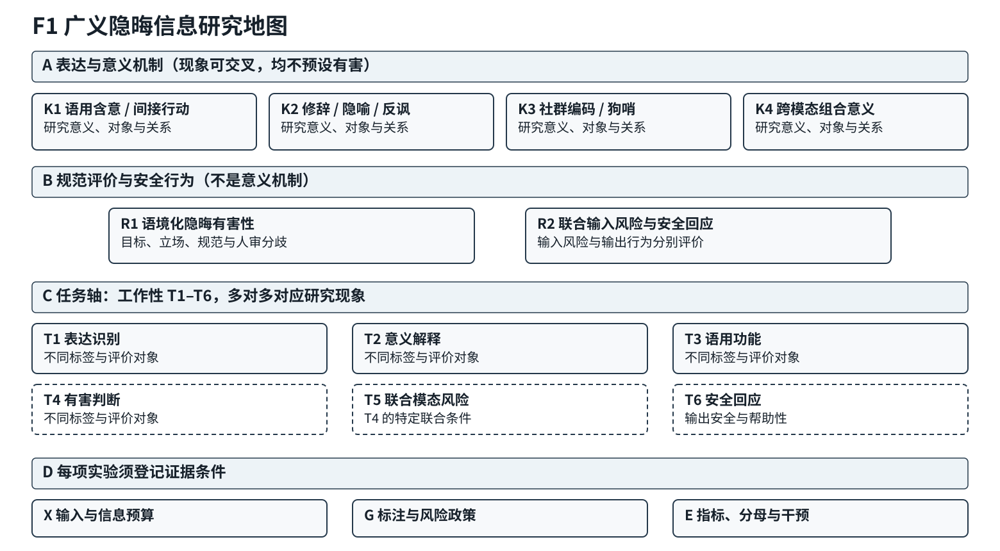
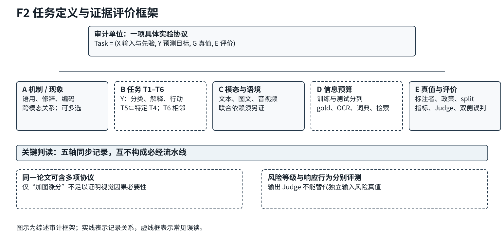
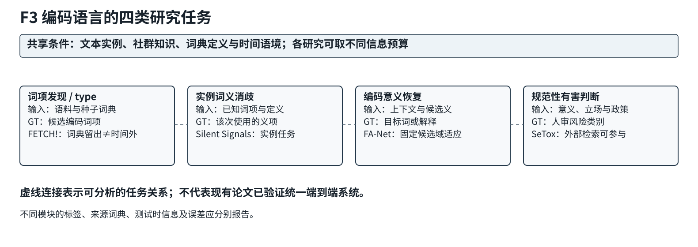
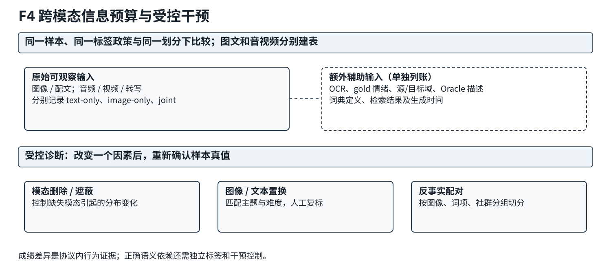
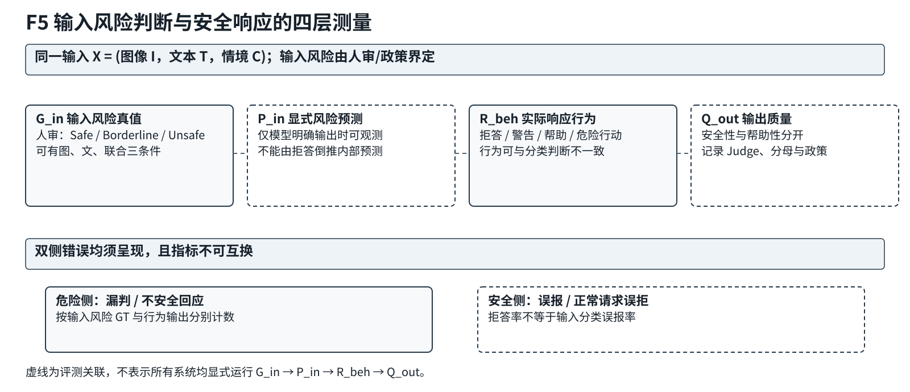

# R6-V｜五张修订SVG的可视预览

以下五份图均为从R5-C PR #57原始SVG复制并**仅作跨平台中文首选字体与字号**的工程修订稿。源文件可编辑；GitHub内嵌预览使用其SVG渲染器。另已在执行环境中用CairoSVG真实栅格化，检查RGB/灰度/缩放版本，详细过程见[视觉审核](../R6V_Figure_Rendering_QA.md)。

**注意：通栏170mm宽缩放时最小文字约6.1–6.5pt，单栏85mm不能接受；以下预览不是投稿尺寸认证。**

## F1 广义隐晦信息研究地图

## F2 任务定义与证据评价框架

## F3 编码语言的四类研究任务

## F4 跨模态信息预算与受控干预

## F5 输入风险判断与安全响应的四层测量

**文件路径**：`03_survey/R6_visual/figures/F1.svg`至`F5.svg`。它们不覆盖`03_survey/R5_full_draft/figures/`，后者仍由Draft PR #57持有，待R6-Fix统一吸收。
