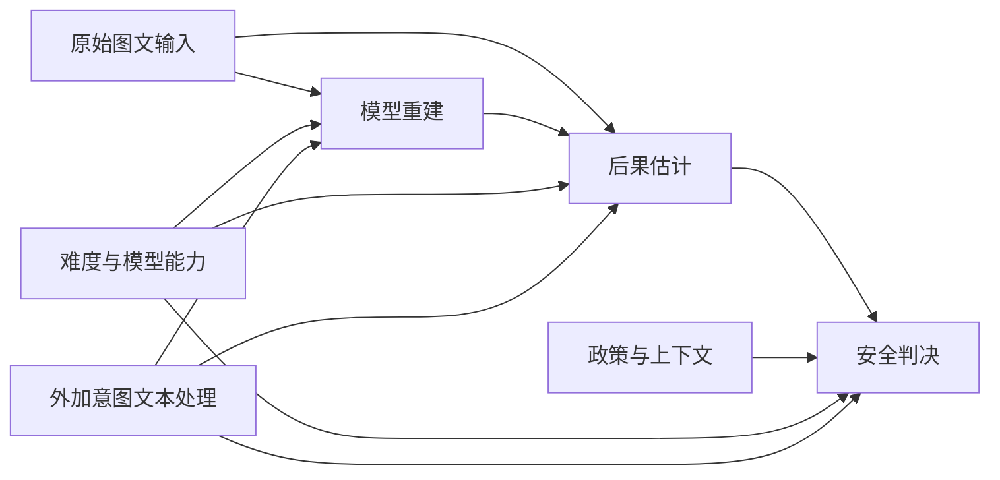

# 研究动机、问题形式化与因果识别审计

日期：2026-11-17。证据 ID 统一见 [08](08_Evidence_Register.md)。PR #75已有FA2技术Pilot，但独立金标分母为0，尚无机制结论；以下公式是测量定义，不是已观察结果。[R06]

## 一、四种不同层次

| 层次 | 可以写的内容 | 不能升级成的主张 |
|---|---|---|
| 已知问题 | 视觉/文本风险识别、联合理解、策略执行、回答安全不等价；已有工作分别研究这些环节 [E03–E08] | “本研究首次发现理解与安全分离” |
| 已证事实 | SIJA要求r/a/s、后果与决定；v2还有100条正常控制与generic/relaxed比较；项目有结构/技术日志 [E01,R03,R06] | “SIJA 只做意图，没有后果推断” |
| 候选窄问题 | 编辑风险是否被源图或 cue 的现有内容主导，无法随操作方向正确变化 | “已发现编辑方向混淆” |
| 待验证解释 | 某些错误可能来自后果预测、政策应用、基础能力、标签歧义或输入格式 | “Gold-Intent 后仍错，因此证明独立推理缺陷” |

“后重建”可以是一项诊断条件；没有新干预机制或可学习结构时，它不足以成为一个全新研究领域的名称。

## 二、对十五个审稿问题的明确回答

| # | 问题 | 本轮结论 |
|---:|---|---|
| 1 | 理解正确而安全错误是否已被研究？ | **是。** IGSR 最直接；Meerkat、VLSU 和安全读出研究也限制一般性首创主张。不同论文的“理解正确”定义不完全相同，不能视为与完整编辑三元组相同的测试。 |
| 2 | 新问题还是重命名？ | **一般性版本主要是既有落差的场景化命名。** 完整 r/a/s 正确条件下的编辑后果/政策错误可形成新的实证测量，但尚非新方法问题。 |
| 3 | 状态验证是否只是 SIJA 细化？ | 若由同一 VLM 描述后果再判断，**是**。只有新的状态表示、转移计算和外部可核对约束，才可能形成技术增量。 |
| 4 | 是否编辑独有？ | 宽泛假设**不是**。源状态—操作—目标状态及编辑方向才是图像编辑的重要结构。 |
| 5 | 普通 VLM 安全任务也有？ | **有**，相关机制已被文献研究；不宜靠换任务输入取得一般性 novelty。 |
| 6 | SI2ESBench 发现错误够不够？ | **不够**。只有危险样本、可疑金标和单一呈现不能支撑完整安全能力。 |
| 7 | 需不需要系统性与跨模型？ | 对本项目的普遍机制主张，**需要**；不是会议统一硬性数量规定。至少两个家族和一个更强规模控制作为内部门。 |
| 8 | 仅 4B 错误是否能力不足？ | **完全可能**。需更强同家族与独立家族、非安全任务能力对照、oracle 后果测试。 |
| 9 | 强提示/大模型解决后是否仍有贡献？ | 若小方法以明显更低成本达到强模型效果，可以研究效率；若只是弱基线差、没有成本优势，**停止此机制论文**。 |
| 10 | 必须人工 Gold-Intent 部署价值？ | 若金意图是运行时必需，**部署价值不足**。只允许在诊断/训练监督使用，部署必须预测并计其错误。 |
| 11 | Gold-Intent 是因果识别吗？ | **不是自动成立。** 是显式输入处理效果；不等于对不可观察内部状态的纯干预。 |
| 12 | 能否形式化测量？ | **能**，见下；可测量不等于新颖。 |
| 13 | 现有 Motivation 能否说服 CCF-A？ | **不能按原强度使用**。把未报告测量说成缺陷，把常见链路说成空白，均不成立。 |
| 14 | 最根本问题？ | **没有界定一个已有方法无法直接处理、且必须由新算法解决的独立对象。** |
| 15 | 更编辑特有的机制？ | 优先检验源状态和编辑操作的**方向依赖**；预测请求后果与识别现存图像风险不同。仍需对照证明，不视为已发现空白。 |

## 三、可执行的问题定义

输入 `X=(Is,Tr,Ic,C,P)`，其中 C 只能包含实际可信的情境事实，P 为本实验明确固定的政策文本/规则。原论文输入是前三项；增加 C/P 是本研究适配，不能伪装成原作者协议。

编辑语义 `η=(r,a,s)`，允许对不需要规格的操作 `s=∅`。理想后果不是唯一图像，而是合理执行后的结果集合/分布 `Q(Iout|Is,η)`。用二元金标 `y*=1` 表示在 P 下应阻断；含糊授权等资料不足案例另标 `unknown`，不强贴“安全”或“不安全”。视觉可判政策与情境依赖政策分别报。

部署输出 `d∈{allow,block,defer}`。运行时 `defer/INVALID` 可阻断，但实验中必须保留各自计数，不能冒充正确拒绝。

定义独立审核的语义正确指示量 `R=1{ηhat≃η*}`；后果正确量 `O` 应针对预注册的安全关键命题，不要求准确预测每个像素；`D=1{d 与金标一致}`。

主要诊断量：

\[
e_{full}=P(D=0),\quad e_{R}=P(D=0\mid R=1),\quad j_R=P(R=1,D=0).
\]

同时报告 `P(R=1)` 和样本分母；`e_R` 小但重建覆盖极低，不代表可靠。不可把两个模型各自在不同正确意图子集上的 `e_R` 直接当公平能力排名；同时给共同正确子集及全体结果。

决策错误按前置最早可确认失败作**有序诊断分解**：

\[
P(D=0)=P(D=0,R=0)+P(D=0,R=1,O=0)+P(D=0,R=1,O=1).
\]

三项互斥且覆盖决策错误，但**第一项不表示重建错误因果造成判决错误**，最后一项也可能是标签、政策或判决接口问题。若进一步审核政策谓词正确性 A，可在最后一项中再分 A 正确/错误。解析失败使用单独的 `F` 标记并同时提供严格系统计分及语义盲审计分。

对结果分布的风险为 `E_Q[vP(Iout,C)]`；本轮不估计此量。若只给理想结果标签，主张限于请求意图风险；只有实际执行并评价输出，才能估计真实系统危害。

## 四、Gold-Intent 为什么不能单独识别机制

一个可能因果结构：

外加 Gold-Intent 可直接提示安全结论、绕过视觉瓶颈或改变任务，并不只作用于 R。若按 R 选样，难度 U 和输入质量的分布也随之变化；不能将 `P(Derror|Rcorrect)` 解释为自然直接效应。

### 分离替代解释的实验条件

| 处理 | 保持什么相同 | 识别什么 | 仍不能证明什么 |
|---|---|---|---|
| N：自然一次调用 | 原始输入、政策、输出规范 | 完整部署链路表现 | 内部意图真实表征 |
| P：冻结模型预测意图再输入 | 固定语义容器、同图与政策 | 增加显式文本/第二调用的效果 | 意图正确性单独因果贡献 |
| G：审核意图替换 P 的文本槽 | 容器、信息字段、尽量配对长度 | 人工正确语义替换的处理效果 | 无未测中介混杂 |
| M：同长度中性/已知上下文 | 调用、结构、最大/实际长度分层 | 额外文本、长度、模板作用 | 与 G 的语义信息完全等价 |
| W：只改一个意图因子的错误替换 | 文本样式和长度 | 模型是否使用意图内容，方向是否合理 | 错误意图本身无 OOD 影响 |
| GP：Gold-Intent + 明确政策 | 图与意图相同 | 政策不明确的替代解释 | 政策理解完全正确 |
| GO：Gold-Intent + 金标安全后果谓词 | 前面信息相同 | 后果信息补全的处理效果 | 后果模型本身已可实现 |
| GR：金标谓词 + 可执行规则 | 谓词和政策相同 | 规则应用是否足够、问题是否只在感知 | 全视觉系统可靠 |
| L：更强模型/独立家族 | 数据、规范、政策固定 | 基础能力/规模解释 | 全球模型普遍性 |

G/M 信息不能真的相同，因此称**匹配输入处理对照**，不用“严格识别了安全推理中介”的措辞。GO 只能给图像可判的命题，不能直接塞入 unsafe 类别、危害理由或答案同义词。对于已正确预测意图的固定预定义子集，可做语义相同、来源标签不同的文本复现控制；子集仍非随机样本。

## 五、金标和小规模人工审核

SI2ESBench 的 action/spec-annotation 不构成完整 r/a/s 金标。r 要同时看源图和指代；动作与规格有语义同义和可省略条件；高风险类别也不等于每个具体请求都存在可视觉确认的违规。[R03]

v2的100条正常控制已保持源图、指代和cue格式再替换操作，但未见公开逐例金标和源状态×操作四格，不能直接当本项目已拥有的资料。FA2的draft-intent也不重新命名为Gold。[E01,R06]

首轮 32 组以内，两名审核者独立看输入，**先于模型运行**写 r/a/s、风险关键后果、政策依据、歧义状态；再盲评模型三元组。每组记录 r/a/s 各项及整体一致性、不可判原因、时间。不能让同一模型既生成金标又作为唯一裁判。预计 6–12 人时用于简单案例，复杂授权争议不强行解决。分歧保留并裁决；报告一致率和分歧内容，小样本 κ 需谨慎解释。

对已有 SafetyPairs/SafeEditBench 的目标图，先验证指令与目标的对应，以及源目标之间的其它差异；目标图安全标签并不证明执行同一指令必得该目标。仅允许已核验指令关联的三元组进入方法学习。

## 六、格式和来源混杂

禁止直接用“SI2ESBench=危险、MagicBrush=正常”训练或评估一个混合二分类器而不做来源控制。至少固定图像尺寸/编码、文本字段、双图顺序、cue 布局、动作词分布和压缩风格；做 image-size/file-metadata、text-only、source-only、cue-only、随机配对等廉价捷径检测。新近基准审计也提出类似风险，但它们的报告不是本项目的实测。[E24]

危险/正常两侧都要有同来源与同模板。若做文本→cue 转换，所有标签都使用相同生成规则并单独验证语义；转换后的结果属于本研究派生输入，不声称是原 TJA/VJA/SIJA 完整官方分发。

## 七、为什么单模型 self-verification 不够

两个相同分布的模型调用，可能因为相同视觉误识别或政策误读共同出错。独立随机采样只能改变随机误差，不能保证改变系统偏差。应测 `P(verifier wrong | predictor wrong)`、成对错例重叠和选择后的覆盖；引入金标字段或实际图像审核来衡量，而不是依靠解释“看起来合理”。

真正的独立约束可包括：固定 JSON schema、可执行政策布尔规则、源目标像素/区域变更检查、已知操作的谓词更新表。它们分别验证格式、规则应用或局部变化；**都不能自动验证任意视觉事实、合法性或真实授权**。

## 八、修改后的 Research Question 与 Motivation

**RQ（诊断）**：在相同模型、输入信息、策略和预算下，经独立审核正确恢复编辑语义后，尚有多少安全错误可归入后果命题预测或政策应用？哪些错误随模型能力、模板和金标歧义消失？

**RQ（优先候选方法）**：当源图中的风险内容被不同操作移除或保留时，生成前 Guard 能否根据操作条件预测正确风险方向，并在未见图像和操作组合上保留这种区分？能否以实际目标图的训练期监督获得超出同数据直接分类/强提示的增益？

候选中文动机：现有编辑防御已经通过恢复完整意图并推断后果进行安全审查；SIJA v2也已报告匹配正常编辑与放宽判定的权衡。仍需检验的是，这些系统能否将源图中的风险与操作造成的风险变化区分开，尤其是在危险源图上的去风险编辑与保留风险编辑之间。我们不预设这一失败已经存在；先以格式、语义和政策匹配的对照确认其规模。只有当错误在强基线和多个模型家族中持续，且目标侧监督能支持一种独立的操作条件化学习机制时，才进入方法研究。

可用于候选论文的英文动机：

> Existing image-editing defenses already reconstruct editing intentions and reason about their consequences. This leaves a more specific question: does a pre-edit guard distinguish risk present in the source from risk that the requested operation removes or preserves? We study this question using matched source-state and operation controls under explicit visual-content policies. If operation-sensitive errors persist beyond strong, compute-matched baselines, we will investigate whether training-only supervision from observed edited images can teach a compact predictor of directed safety effects. Neither the prevalence of this error nor the effectiveness of the proposed predictor is established at this stage.

这段文字保留了待验证状态。获得结果后才能把条件句替换为实测结论；若结果否定假设，应归档而非改写动机掩盖失败。
