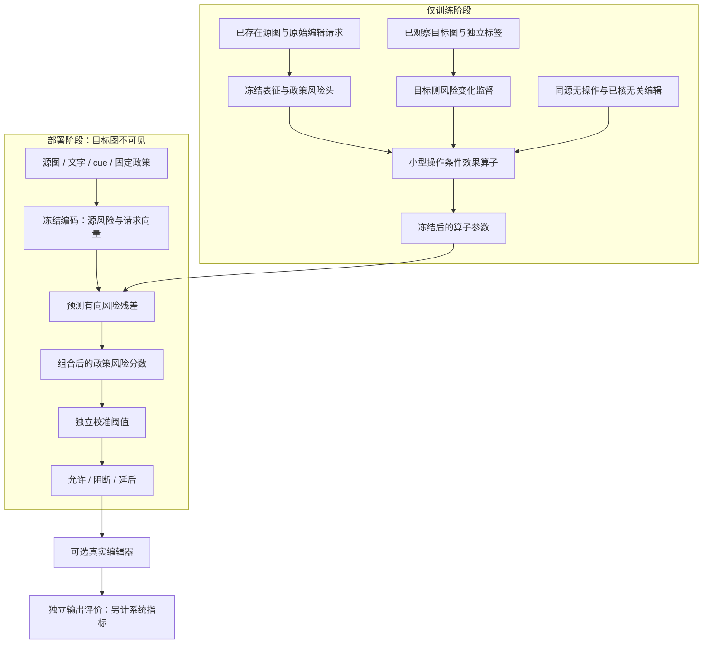

# 最优先候选的完整论文蓝图

日期：2026-11-17。**这是一份条件性研究蓝图，不是已完成论文。** 对当前 TGSV 的决定仍是 NO-GO；本蓝图仅在 K-DIR 和同监督方法门通过后启用。所有 `TBD` 与 `[RESULT TO BE VERIFIED]` 均为待填证据，不能作为结果发布。

## 一、题目与投稿方向

| 候选英文题目 | 具体研究问题与创新对象 | 与 SIJA 的区别 | 适合方向及条件 |
|---|---|---|---|
| **Learning Directed Safety Effects for Pre-Edit Image Guardrails** | 学习给定源图和操作的风险变化，目标图仅训练期监督 | 不是提出重建/后果推理，而是学得操作效果及其泛化 | 首选；CVPR/ICLR/ICML，需清楚视觉机制与同监督优势 |
| **When Risky Images Admit Safe Edits: Operation-Conditioned Safety Prediction** | 危险源图上的去风险操作何时被系统性误拒 | 主张收窄为编辑方向/正常修复效用 | 若数据只有去风险方向，题目更诚实；方法贡献仍需独立成立 |
| **From Source Risk to Edit Effects: Learning Safety Changes Before Image Editing** | 端点图像风险与操作效果的区别 | 不再用“Beyond reconstruction”暗示原文没有后果判断 | 可用于一般表征/低成本学习研究；需跨操作组合证据 |

不优先使用 *Beyond Intent Reconstruction*：它容易使读者以为前人只重建、没有后果推断；本轮核验不支持这种叙述。

**One-sentence candidate research claim（待证，不是结果）**：

> A pre-edit guard can learn operation-dependent changes in policy risk from observed edit pairs without access to target images at deployment.

这句话可被同监督简单模型、跨操作测试与部署输入审计直接证伪。若只能在训练样本成立，或者方法必须运行时查看目标图，则撤回该主张。

## 二、候选英文摘要

Image-editing safeguards already reconstruct user intentions and reason about the consequences of an edit. A more specific question is whether their decisions distinguish risk present in a source image from risk removed or preserved by the requested operation. We investigate this question with matched source-state and operation controls under explicit visual-content policies. Our proposed approach learns a compact, operation-conditioned residual in a policy-risk representation, using observed target images only during training. A no-operation anchor and verified risk-invariant edits constrain the predicted effect, while deployment requires only the source image and the original multimodal request. We design comparisons against reconstruction-based prompts, policy-conditioned guards, and classifiers trained with the same supervision, together with controls for inference cost, policy scope, and data-source shortcuts. **[RESULT TO BE VERIFIED: prevalence and cross-family consistency of operation-sensitive errors.] [RESULT TO BE VERIFIED: gains over the strongest same-supervision baseline at matched benign false-rejection rates, with uncertainty intervals.] [RESULT TO BE VERIFIED: transfer to unseen operations and actual runtime costs.]** End-to-end safety claims will additionally require evaluation of real edited outputs; guard-only measurements will be reported separately.

摘要中的“proposed”描述当前算法规格，不表示已完成实现；没有填写任何虚构性能数字。

## 三、Introduction 六段结构

| 段落 | 本段目的 | 核心论点 | 已有支撑 | 本项目需要的结果 | 与下一段关系 |
|---|---|---|---|---|---|
| P1 | 确定实际任务与安全单位 | 编辑的风险取决于源图和操作所造成的视觉变化 | VJA/SIJA [E01,E02] | 不需要用我们的错误率开篇 | 从任务重要性转向已有技术 |
| P2 | 充分承认已有防御 | 现有方法已恢复意图、推断后果，并研究风险/策略推理；SIJA v2已有正常/relaxed比较 | SIJA、IGSR、Meerkat、SafeGuard [E01,E03–E05] | 不把缺项测量说成已知缺陷 | 缩窄真正的问题 |
| P3 | 提出窄问题 | 源图现有风险不必等于去风险编辑请求的风险；操作方向应改变判决 | 操作结构是任务逻辑；失败频率待证 | [K-DIR: two-family group errors and ambiguity-controlled counts] | 从逻辑区别转向实证必要性 |
| P4 | 给出已测机制与方法必要性 | 若强提示仍犯方向错误，目标侧效果监督可能有价值 | SafetyPairs 的成对资料/验证是先例 [E14] | [same-compute strong-prompt residual; gold-intent/outcome controls] | 从已确认瓶颈引出方法 |
| P5 | 说明唯一方法核心 | 冻结骨干、学操作风险残差；不用部署目标图 | 本研究候选；不声称蒸馏/低秩/对比是首次 | [same-supervision MLP/CE/distillation; ablations] | 由机制到验证范围 |
| P6 | 贡献与结论边界 | 方向诊断、效果学习、成本与效用；系统安全另测 | 本研究计划 | [cross-operation/model, risk–utility, end-to-end if claimed] | 结束引言，进入任务定义 |

### 可直接修改使用的英文 Motivation 草稿

Image-editing safety is a property of a requested transformation under a specified policy. The source image provides the initial state, while the editing instruction determines which aspects of that state should change. A source image that violates a visual-content policy may therefore admit an edit that removes the violation. Conversely, an ordinary-looking source may support a request whose intended result violates the same policy. This distinction motivates evaluating the operation together with its source, rather than using source-image risk as a sufficient decision rule.

Existing defenses already address important parts of this problem. VJA and SIJA use multimodal reasoning to recover editing intentions and assess their consequences. IGSR separates perceptual evidence from intent arbitration, while Meerkat-VL supervises both risk perception and response quality. Policy-adaptive image guards further show that visual content must be interpreted under the active policy. SIJA's revised evaluation also includes benign controls and original versus relaxed decision prompts. These results rule out treating intent reconstruction, consequence reasoning, policy grounding, or a benign-utility check alone as our contribution.

We instead ask whether pre-edit decisions respond correctly to the direction of a verified operation. **[EVIDENCE NEEDED: matched examples and population-level measurements showing that operation-sensitive errors persist after controlling intent accuracy, policy ambiguity, output formatting, and inference budget.]** If this condition holds, we will study whether observed edited images can provide a useful training signal for predicting safety effects before editing. The proposed predictor learns a residual in a compact policy-risk representation, with the target image confined to training. Its value must be established against direct classifiers and ordinary distillation using the same data. **[EVIDENCE NEEDED: independent gains, transfer to unseen operation combinations, and acceptable benign-edit utility.]**

## 四、Problem Definition

任务域限制为已声明的可视觉判断内容政策；P 固定或取训练/测试已定义政策集合。可信 C 不包含模型猜测的授权。X 为源图、指代文字和视觉 cue；训练时另有经核验 η、目标图 It 和相应端点标签。

部署预测 `risk(X,P)`，决策为 allow/block/defer。目标图不可进入部署输入、请求编码器、检索库中的测试配对项或测试阈值。Gold-Intent 只用于诊断轨道；标准主表全部使用原始请求。

理想语义安全与真实执行安全分别定义。前者评价“若正确执行该编辑会怎样”；后者取决于固定编辑器、随机种子和实际终图。训练真实目标图只是观察到的一次效果，不保证代表全部合理执行分布；需要在局限中说明。

## 五、Method Overview

详细矩阵和损失见 [04](04_Method_Design_and_Alternatives.md)。论文应只命名一个核心算法：**operation-conditioned risk-effect prediction**。意图解析使用固定已有骨干；阈值校准是通用步骤，不各占一项贡献。

此图的“验证”来自目标侧标签/真实图像审核和冻结的实验对照，**不是**部署时又让相同 VLM 自证。不存在对任意编辑的形式安全保证。若有限政策分数无法承载关系风险，需要报告失败，不把自由文本解释补到算法外而不计成本。

关键实现应给出：z 的每维政策语义、端点头训练数据、u 的取值位置和维度、noop 实际输入、交互算子矩阵大小、伪标签掩码、输入白名单、阈值选择规则及实际计算量。任何一步不明确都不得用数学符号代替。

## 六、三项候选 Contributions

| 贡献草案 | 新在哪里/与谁比较 | 重要性 | 能证明的实验 | 必须撤回的情形 |
|---|---|---|---|---|
| C-A：编辑操作方向诊断 | 源状态×操作控制，不把原始拒绝率当完整防御；与SIJA v2已有正常控制及整体指标区分；只发现over-refusal不够 | 判断正常去风险编辑是否被错误阻断 | K-DIR扩大版、意图/政策/格式对照 | Strong已解决、只有标签争议、事件过少 |
| C-B：目标侧效果监督的紧凑算子 | 与语言后果提示、端点分类、同监督MLP/蒸馏比较 | 如有效，可避免昂贵编辑生成，并提供明确学习对象 | 相同监督、去目标/打乱配对/交互消融、未见组合 | 普通监督头相当；参数化只是公式包装 |
| C-C：可信的安全—效用与计算评价 | 方向成对正确、匹配正常误拒和跨模型部署成本同时测 | 避免全拒绝/更多计算取得表面优势 | 统一校准、正常编辑、跨家族、真实终图可选 | 只提高危险拒绝、缺效用或端到端误用 |

C-A 是经验贡献，C-B 是唯一候选算法贡献，C-C 是必要验证贡献。它们相互支撑，但不能将同一项“多步推理”拆成三项。若 C-B 不能成立，即使 C-A/C-C 有价值，也应重新定位为经验/评测研究，而非维持用户要求的方法型定位。

## 七、预计主表与图，不填结果

### Table 1：同骨干、同监督、同政策主比较

| 方法 | 目标图训练监督 | 总推理调用 | GAcc ↑ | Direction PairAcc ↑ | UMR@BFPR5% ↓ | BFPR_oper ↓ | INVALID ↓ | p50/p95耗时 |
|---|---|---|---|---|---|---|---|---|
| Direct-CP | 无 | TBD | TBD | TBD | TBD | TBD | TBD | TBD |
| SIJA-v2-Generic-CP | 无 | TBD | TBD | TBD | TBD | TBD | TBD | TBD |
| SIJA-v2-Decomposed-Relaxed-CP | 无 | TBD | TBD | TBD | TBD | TBD | TBD | TBD |
| Strong-CP / two-pass | 无 | TBD | TBD | TBD | TBD | TBD | TBD | TBD |
| 同特征CE/MLP | 同Ours | 同Ours | TBD | TBD | TBD | TBD | TBD | TBD |
| 普通效果蒸馏 | 同Ours | 同Ours | TBD | TBD | TBD | TBD | TBD | TBD |
| 候选效果算子 | 是 | 含noop成本 | TBD | TBD | TBD | TBD | TBD | TBD |

### Table 2：公开系统竞品

SafeGuard-VL-RL、PolicyShiftGuard、ThinkingGuard、可取得的 Meerkat/IGSR 实现分别列 backbone、参数、训练资料可见性、输入政策适配、量化、native/adapted 协议、风险/效用与成本。缺 checkpoint 写 unavailable，不能以我们写的短提示冒充作者训练模型。

### Table 3：消融

行：完整原型、无效果监督、无交互、无noop、无无关编辑、随机目标配对、只源图、只操作。列：方向对、未见组合、误拒、漏放、实际额外成本；全部 TBD。只有相关机制指标变化，才能支持该项必要性。

### Table 4：泛化与误差分解

Qwen/Gemma 独立家族、较强 Qwen 规模、辅助 InternVL 视觉家族分层；明确 InternVL 与 Qwen3 共享语言基础。列出自然链路 R/O/D、金意图/金后果处理结果及各自分母，不横比不同正确子集。

### Figures

1. 四格源状态×操作示意；无展示性挑选，只用代表性且合法可发布素材。
2. 漏放率—正常误拒率曲线，含All-Reject/All-Allow和同计算对照。
3. 原始源风险 vs 真实/预测效果二维图，按风险移除、保留、引入分层；未覆盖方向留空。
4. 机制干预图：真实操作变化与无关变化的敏感性；不以attention图代替结果。
5. 数据量/计算量—方向性能曲线，与同监督简单模型同图。
6. 若执行端到端，guard决策×编辑有效性×终图风险的联合分解图；否则不画“系统防御成功率”。

## 八、端到端部分的两种诚实版本

**版本1：资源受限的 Guard 方法论文。** 摘要、标题和结论限于 pre-edit request risk prediction。真实终图可只作为训练/诊断监督，终图实验未做则写 NOT_RUN；不能声称减少实际 HRR。

**版本2：安全防御论文。** 必须使用可处理相应双图/视觉cue协议的真实编辑器，固定生成设置和种子；报告全部请求分母、实际正常编辑成功、独立终图评判和防御知情攻击。Guard和编辑器不能通过修改请求语义取得安全“收益”。

若版本1也无法超出普通CE/蒸馏，不能靠加上版本2的昂贵演示挽救技术贡献。

## 九、Threats to Validity

- **外部效度**：固定内容政策不能涵盖授权、欺骗和真实法律条件；某一种cue/语言/低分辨率不代表所有编辑接口。
- **内部效度**：源码来源、文件尺寸、目标配对、请求模板、调用数和阈值可解释增益；必须分别控制。
- **标签与目标**：现有图像对不一定只有风险区域改变；安全目标只是一种可行后果。去风险指令不保证编辑器总能实现。
- **监督质量**：目标侧Guard可能错；伪标签或风险logits不是金语义。必须有独立标签、小量盲审和教师错误敏感性。
- **选择偏差**：只分析意图正确、编辑成功或方向已能区分样本，会缩窄分布；全体与条件结果同时报告。
- **数据污染**：公开基准可能进入骨干预训练；按图/会话分组不能消除预训练接触，只能明确限制，增加未见模板/组合外测。
- **规模混杂**：小模型失败不等于方法普遍瓶颈；视觉家族不同但语言骨干相同，也不是完全独立证据。
- **复现限制**：SIJA v2外部Guard已具名但完整introspection配置/实现仍未取得，IGSR链接本轮不可访问，部分数据gated；适配实现和作者原系统分开。
- **安全声明**：静态标签、真实输出危害和现实使用后果是不同对象；不将内容政策标签当普遍伦理/法律裁决。
- **资源限制**：单块六小时不等于整篇论文六小时；缺主张必要实验时降低主张或停止，而不是省略后继续写确定结论。

## 十、蓝图启用条件

本蓝图当前状态为 **PENDING / NOT_IMPLEMENTED / NOT_EVALUATED**。依次通过 [07](07_Roadmap_and_Go_NoGo_Gates.md) 的数据、机制、方法、泛化与论文门后，才改写为实证论文。任何关键NO-GO都应在执行日志中保留，不修改本轮审计来掩盖否证。
