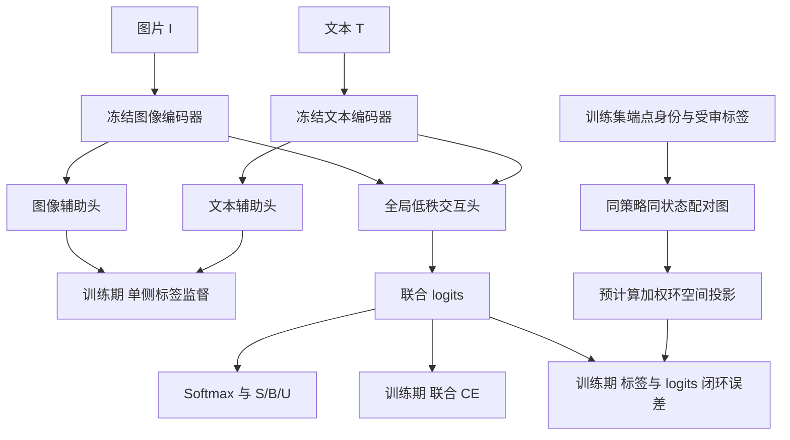

# 推荐方法｜Cycle-Supervised Safety Classification（CSSC，暂定）

## 1. 问题定义

每条样本为 (I,T,yI,yT,yJ)，联合任务在固定策略下输出 pJ∈Δ² 和 argmax S/B/U。公开补充域可提供不同的二类 yJ 及可选单侧等级。全部分类头按域独立定义输出空间，不把不同安全政策的标签拼成同一图。部署时只需要 I,T 和已约定任务，不读取源标签、其他边和检索索引。CSSC 假设部分数据内存在真实配对复用，可以跨组合约束联合输入的分类打分。公开 VLSU 原始字段暂无这种精确闭环。

## 2. 与 Cycle OE 的技术边界

Zhou 与 Xiang 已在图文关系 OOD 任务使用两正两负矩形，证明任意加性 scorer 的差分为零，并以 softplus(−Δ) 直接训练 rank-64 CLIP 双线性模型。此处继承该结果与基线。候选增加的是**允许缺边的多类政策标签监督**及共享边导致的对比协方差处理。在只有完整棋盘式二元四格的极限，两者监督同一方向，目标函数和绝对分类辅助项有所不同。应加入验证相同信息的多类 Cycle OE 适配及长环方向损失、相同 soft-CE，并实测有效覆盖。数据只支持二元完整四格时，当前论文机制不成立。 [Cycle OE 正文](https://arxiv.org/html/2610.23248) · [实现](https://github.com/SDret/Official-Implementation-of-Neurips-2026-paper-Can-the-Parts-Fool-the-Test-)

## 3. 结构

| 模块 | 输入、计算和输出 | 功能与可检验删除结果 |
|---|---|---|
| 冻结编码器 | 同版本 OpenCLIP ViT-B/32 或 ViT-B/16，缓存图文向量；有能力时第二骨干换 SigLIP 2 或更强图文特征 | 保持小试成本与等骨干比较。长 prompt 原截断固定并记录截断比例，公平试长文本第二编码器。骨干受限会表现为所有模型在已验证局部证据上近似失败 |
| 单模态头 | 各用小投影 a=u(hI), b=v(hT)，分类器 gI(a),gT(b)；未知图像标签掩码 | 辅助监督锚定单侧任务，并保留同条件诊断。删除应首先影响单模态指标。若联合或环指标等预算无差，可删除该分支并保留标签分层 |
| 联合头 | z=H{b0+A_I a+A_T b+W[(U a)⊙(V b)]}，H=I−11ᵀ/K | 低秩双线性是现成架构。若删乘积项，联合 CE 仍可用，精确闭环上 z 的对照恒为零。较强同预算备选 MLP/Cross-Attention。线性联合项是拟合组件，其含义不同于单模态头的概率 |
| 支持图 | 训练期图像/文本合法身份、策略、联合真值、已知单侧等级、来源。强对照按策略×可信端点×固定 (yI,yT) 建图 | 限制监督来源；调用重复句和完全不同的图做拼接候选时，实际端点没有联合标签便不入图。去掉这项门槛会产生伪监督和来源捷径 |
| 环空间监督 | 对训练块上 K 类中心化 logits 的差进行加权投影，逼近对应人审标签对比 | 是候选差异。删后保留完全相同配对、采样和架构，直接检验训练目标。若正向指标与对照无区别，机制主张失去实证支持 |

## 4. 图与数学机制

在每个适用的策略和状态块内，构建二部图 G=(V_I∪V_T,E)。边 e=(i,j) 代表观察到、在该组合上有独立可信联合标签的输入。重复相同内容对先合并，冲突标记或保留已取得的投票概率，不能以平行边虚构独立环。节点至少复核字节、解码像素和完全相同的文本；可能改变语义的归一化不用于金标身份。已知相同 I 的 yI 或相同 T 的 yT 有冲突，就隔离该节点或改为独立确认后的固定任务标签。只有二类、无法确认单侧等级的外部域以相同规范的独立图作机制代理，名称单列。

令 A∈R^{m×n} 为边×节点有向关联矩阵，每行图像端 +1、文本端 −1。任意单模态函数在边上的相加可写 Aθ，文本节点参数取负即可。W 是边置信权矩阵，所有 w_e>0。初版在每个可用独立块中等权，低质量记录排除在环损失之外。若以后有独立标注置信度，只用训练来源估权并设置下限。定义

\[
P_W=I-A(A^\top W A)^+ A^\top W .
\]

对每个类列投影。中心化 logit Z∈R^{m×K} 保留可比较的多类对数几率，去掉每例的共同偏移。在任意两图、两文都有观测的矩形，沿边符号 +−−+ 的向量 c 满足 cᵀA=0，所以 cᵀZ 也等于 cᵀP_WZ。定义 \(\mathcal C=\ker A^\top\)。取满秩环基 C，列张成 \(\mathcal C\)，有

\[
\|P_W D\|_W^2
=\mathrm{tr}\big[(C^\top D)^\top (C^\top W^{-1}C)^{-1}(C^\top D)\big] .
\]

这里 \(\|X\|_W^2=\mathrm{tr}(X^\top W X)\)。公式避免把高度重叠的矩形当作独立训练信息，训练初版可以只用不交叠的小分量。相同投影可用去锚点的稀疏图 Laplacian 求解，实际实现无需显式存整个 P。图维度 m−n+c，c 为非孤立分量数。森林上 P_W=0，桥边在循环残差中为零。VLSU 刚好给出这一可复核的支持缺口。

**不变性证明。** W^{1/2}A 的列空间正交投影从 W^{1/2}Z 中减去，故 P_W A=0、P_W²=P_W 且 P_WᵀW=WP_W。这验证加性 nuisance 在该图和这个 logit 尺度上不影响环损失。单环时公式就是按环协方差归一化的差分平方。对任意一列，若所有环对比均零，则它在该观测图上是节点加性函数。非零环只是函数不可加的观察诊断。即使联合头在未见边上外推，可以利用数据编码、主题关联等非加性捷径，且观测硬标签对比可能受偶然标注影响。真实风险表示、心理意图、因果效应和任何未见输入属性不在该代数保证内。

## 5. 优化目标

设真实标签的平滑目标向量 \(q_y=(1-K\epsilon)e_y+\epsilon\mathbf1\)，其中 \(0<\epsilon<1/K\)，默认实验候选 0.1。把 \(t_y=H\log q_y=\rho H e_y\)，其中 \(\rho=\log[(1-(K-1)\epsilon)/\epsilon]\)。可将其理解为有限的目标 log-odds 尺度。它并不估计每例真实人类标签概率。T 为训练块的 t_y 行矩阵。

\[
\begin{aligned}
\mathcal L_J &= -N_J^{-1}\textstyle\sum_{e}
      \log\mathrm{softmax}(z_e)_{y_{J,e}},\\
\mathcal L_M &= \tfrac12\displaystyle\sum_{d\in\{I,T\}}\frac{1}{N_d}
      \textstyle\sum_{e\colon m_{d,e}=1} -\log p_{d,e}[y_{d,e}],\\
\mathcal L_C &= \frac{1}{r_{\rm tot}(K-1)}
      \textstyle\sum_b \|P_{W_b}(Z_b-T_b)\|^2_{W_b},\\
\mathcal L_{\rm total} &= \mathcal L_J+\beta \mathcal L_M+\lambda\mathcal L_C .
\end{aligned}
\]

N_d 指该分支实际可用监督数，为零直接删除该分支项。r_tot 是有效训练块环秩之和，若为零不开启 L_C。混合不同 K 的域时，各域先按自己的 r_tot(K−1) 与样本数归一化，按固定计划加权。标签平滑 \(\epsilon\) 仅用于环目标，CE 默认硬标签，给所有强基线单设相同 soft-CE 对照以排查尺度带来的差异。

- 联合 CE 给各类的绝对预测与校准提供锚点，更新本域联合头与可训练投影。环方向本身保留不可识别的加性自由度，不能只用环损失。
- 单模态 CE 是现成 MTL，更新各自头与共享投影。对其他侧参数不回传。冻住骨干。辅助图像 not_sure 掩码。标签只在训练损失中出现。
- 环损失更新联合头与该联合头所用投影。对固定 W、P、T 无梯度。对模型 logits 梯度与 \(W P_W(Z-T)\) 成正比，且在节点主效应方向上为零。B/S/U 无等距离假设，误差在中心化的名义类别空间。可用累积阈值的标定作为独立敏感性实验。
- 同环训练需边齐备，可选一个批次包含一个或多个完整小分量，加上普通 CE 批。各组按预测无关的固定采样，给 CE-only 同步喂同一批数据和权重。支持环数量少时优先报告组指标与覆盖，避免过采把 35 个 S-S-U 当大量独立监督。
- 在只有单个矩形的分量上，任何等权实现若与普通混差平方同值，属于**正向数值校验**。多环时同协方差 GLS 仍与投影代数等价。论文贡献须实测来源于可得的稀疏支持、覆盖与稳定训练，不挂靠等价改写。比较独立四格、所有可见四格、均匀环基与协方差校正版本。

## 6. 训练、推理与复杂度

1. 按独立成分、来源与策略冻结划分。微型单卡先缓存 OpenCLIP 两个全局嵌入，锁定权重、变换、截断、分辨率、失败清单。同一输入在同 split 只嵌入一次。监督三条路线拥有相同图片与文本。
2. 预注册投影维 d=256、rank 64，所有头匹配预算。在训练集拟合，验证集设 \(\beta,\lambda\) 同等搜索预算。较大模型只做固定 shortlist 的复验。用相同预训练参数、输入和种子复现 MTL→CSSC 差异。第二域训练时源/目标头独立，控制源步数，并冻结机制假设。
3. 推理只执行图文编码、比较轻量联合头、softmax（需要时用验证温度）。图不进部署，另报告对 OOD 真实闭环离线诊断。Borderline 由三类任务头预测。弃权另记录为运行策略，并单独计算风险—覆盖。
4. 用一次稀疏求解或小分量投影预处理。完整矩形或长度为 2k 的单环每类 O(k)；预存稠密 P 的小块投影为 O(∑m_b²K) 时间、O(∑m_b²) 内存。大块用关联矩阵的稀疏乘和每类解 \(A^\top W A\)，数值容差与收敛次数需实测。全局低秩头 O(d·rank+K·rank)，训练图成本无推理摊销。token cross-attention 扩展为 O(L_I L_T d) 计算并增加缓存，必须在最低成本对照见信号后才引入。
5. 必跑负对照。冻结 logits 纯节点加性应得零，玩具四格一处类变应得非零，标签等率重新置换和错接边检验误报，概率 softmax 的非加性不能替代 logit 检验。面积/OCR 匹配与来源探针检验模型学到了什么，详见[执行规划](07_Experimental_Roadmap_and_Kill_Tests.md)。

## 7. 一条可识别性条件对应一条实验

| 条件 | 观测 |
|---|---|
| 确实存在支持 | 复用节点数、各组合与政策下非零环秩、独立分量与有效标签对比数 |
| 削弱单模态捷径 | 强文本/图像分支与固定节点效应无法完成成对方向，闭环差分改进在独立模板上复现 |
| 决策泛化 | 完整四格正确率、目标变更召回、非关键扰动保持率、VLSU Macro-F1 及三类 F1；报告所有失败和覆盖 |
| 受控迁移 | A–D 同样目标标签、同预算和目标测试集，额外二类数据需独立加等数据对照 |
